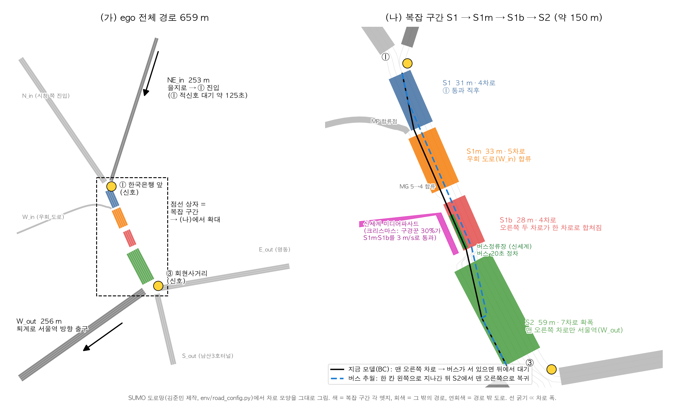
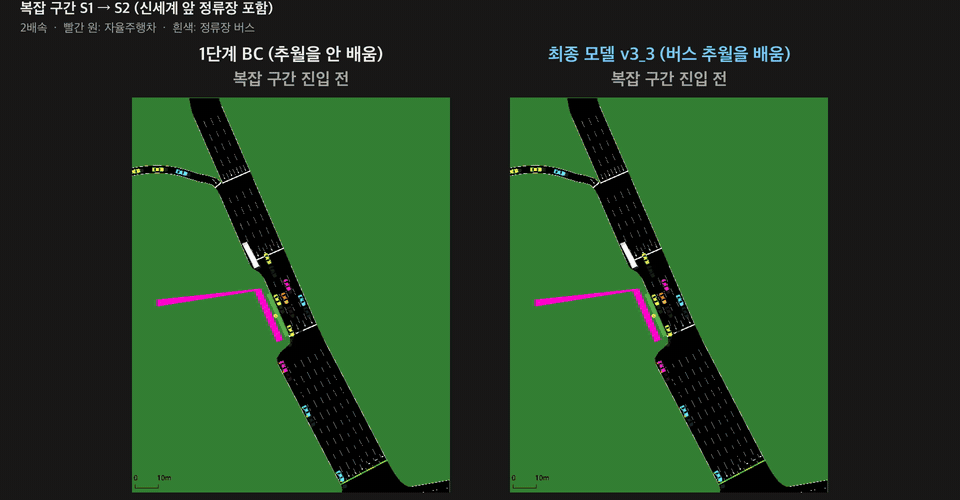
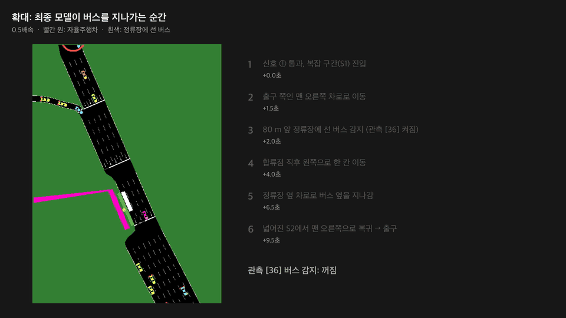
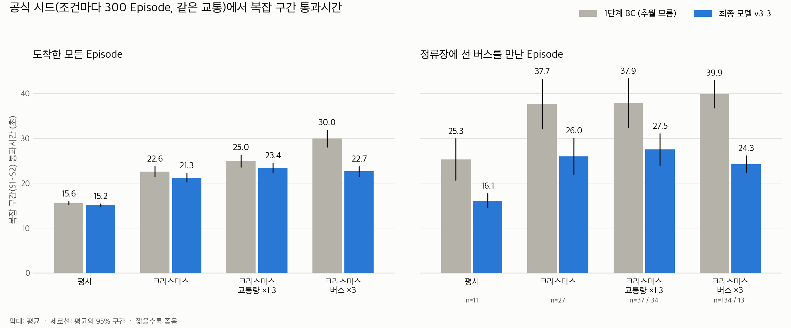

# 명동 소공로 자율주행 (SUMO)

한국은행 앞 교차로 → 소공로(신세계백화점 본점 앞) → 회현사거리, 남쪽 방향 약 187 m.

## 설치

```bash
pip install -r requirements.txt
```

SUMO 설치는 따로 (1.27.1 기준, `SUMO_HOME` 환경변수 설정).

## 실행

```bash
python view_road.py                           # 평시, sumo-gui로 보기 (창이 뜨면 ▶ 눌러서 재생)
python view_road.py --christmas               # 크리스마스
python view_road.py --christmas --speed 4     # 4배속
python view_road.py --nogui --seconds 600     # 화면 없이 10분 돌려 설정 검증 (Waiting 0이면 정상)
```

| 옵션                     | 설명                                                                                  |
| ------------------------ | ------------------------------------------------------------------------------------- |
| `--christmas`            | 크리스마스 시나리오 (구경꾼 30% 감속 + 일반 차량 교통량 1.5배)                        |
| `--traffic X`            | 일반 차량 교통량 배율 X (기본 1.0, 크리스마스 배율과 곱해짐, 버스는 실제 배차 그대로) |
| `--speed X`              | GUI 재생 X배속 (1 = 실시간, 기본 2배속)                                               |
| `--background`           | 영상용 배경 교통 (남대문로 숭례문↔을지로 직진). 학습·데이터에는 쓰지 않음             |
| `--nogui`, `--seconds N` | 화면 없이 N초 돌리고 차량 통계 출력                                                   |
| `--seed X`               | 실험 seed고정 (예: `--seed 23423`)                                                    |
| 그 밖의 옵션             | SUMO에 그대로 넘김( `--window-size x,y`등)                                            |

## AV 모델 학습

### 목표

자율주행차(ego)는 을지로에서 출발해 신호 ①을 지나 소공로를 내려가고, 퇴계로 서울역 방향으로 빠진다 (659 m).

1. **안전:** 충돌 없이 목적지에 도착한다 (수업 기준: 100 Episode 중 충돌 5% 미만).
2. **시간:** 크리스마스 혼잡에서 복잡 구간을 빨리 지나간다.



복잡 구간은 S1 → S1m → S1b → S2, 약 150 m이고, 막힘이 없으면 약 13초 걸린다.

| 구간 | 특징 |
|---|---|
| S1 | 신호 ① 직후 4차로 |
| S1m | 우회 도로 합류, 5차로 |
| S1b | 오른쪽 두 차로가 하나로 합쳐지고, 그 차로에 신세계 앞 버스정류장이 있다 (버스 20초 정차) |
| S2 | 7차로로 넓어진다. 맨 오른쪽 차로만 서울역 출구로 이어진다 |

출구가 맨 오른쪽이라 오른쪽 차로로 가야 하는데, 그 차로에 정류장이 있다. 버스가 서 있으면 그 뒤에서 기다리게 되고, 이것이 크리스마스에 시간이 늘어나는 가장 큰 원인이었다.

### 최종 모델

`models/bc_v3_3.pt`: 관측 37차원, 행동 2차원(가감속, 차선 변경 왼쪽·유지·오른쪽). 수업 PPO 네트워크 구조를 그대로 쓴다.

```
규칙 기반 운전자 ──시연 1000 Episode──▶ BC ──▶ DAgger 3라운드 ──▶ bc_v3_3.pt
 (SUMO 내부 정보를 봄)                  (관측만 봄)
```

1. **규칙 기반 운전자(선생)** `utils/rule_policy.py`
   - 가감속은 IDM 차량추종 공식을 쓴다.
   - 경로상 필요할 때만 차선을 바꾸고, 옆 차로 틈이 충분할 때만 옮긴다.
   - 옮겨야 하는데 막혀 있으면 5 m/s로 줄여 기다린다.
   - 정류장에 버스가 서 있으면 옆 차로로 지나간다.
2. **시연:** 평시 400, 크리스마스 400, 크리스마스·버스 3배 200 Episode.
3. **BC:** PPO 네트워크를 시연에 지도학습한다 (`utils/pretrain.py`).
4. **DAgger 3라운드:** 학생 모델이 직접 운전하며 들어간 상태마다 선생에게 정답 행동을 물어 데이터에 더하고, 다시 학습한다.
   - BC는 선생이 다닌 상태만 보고 배워서, 조금만 벗어나도 실수가 커진다.
   - 선생 개선과 DAgger를 거쳐, 처음 보는 혼잡(크리스마스 + 교통량 1.3배)에서 충돌이 8%에서 0~1%로 줄었다.

### 관측 (37차원)

수업 기본 31칸에 6칸을 더했다. 실제 운전자나 차량 센서가 알 수 있는 정보만 넣었다.

| 칸 | 내용 | 추가한 이유 |
|---|---|---|
| [0] | 내 속도 | 수업 기본 |
| [1..20] | 왼쪽 2칸·현재·오른쪽 2칸 차로의 앞뒤 차 거리와 상대속도 | 수업 기본 |
| [21..25] | 차로 연결성 (곧 끝나는 차로 예고) | 수업 기본 |
| [26..30] | 차로별 앞쪽 차량 밀도 | 수업 기본 |
| [31], [32] | 다음 신호 상태, 정지선까지 거리 |  |
| [33], [34] | 왼쪽·오른쪽 차로 막힘 (사각지대 경고) | 기본 관측은 바로 옆 약 2.5 m 안의 차를 "없음"으로 본다. 이것만 믿으면 차선 변경 충돌이 7~13%였다 |
| [35] | 출구까지 옮겨야 할 차로 수 (내비게이션 차로 안내) | 연결성 칸은 "어디로든 이어지는가"만 알려 줘서 맞는 차로를 구분하지 못한다 |
| [36] | 80 m 앞 정류장에 버스 정차 중 (카메라) | 시간 손실의 주범인 정류장 버스를 관측에 넣어야 추월을 배울 수 있다 |

### 결과



크리스마스, 같은 교통에서 왼쪽은 1단계 BC(추월을 안 배움), 오른쪽은 최종 모델이다 (2배속, 빨간 원이 자율주행차, 흰색이 정류장에 선 버스).
최종 모델은 정류장에 선 버스를 보면(관측 [36]) 합류점 앞에서 왼쪽으로 한 칸 옮겨 정류장 옆 차로로 지나가고, 넓어지는 S2에서 맨 오른쪽 출구 차로로 돌아간다. 이 장면에서 복잡 구간을 37.5초 → 14.0초에 통과했다.
버스를 만난 장면 중 차이가 큰 편인 장면이고, 평균은 아래 표와 같다. 원본 영상(64초, 확대 장면과 결과 화면 포함): [bus_overtake_compare.mp4](docs/training/video/bus_overtake_compare.mp4)



같은 장면의 최종 모델만 0.5배속으로 확대했다. 출구 때문에 맨 오른쪽 차로로 갔다가, 80 m 앞 정류장에 선 버스를 감지하면(관측 [36]) 합류점 직후 왼쪽으로 한 칸 옮겨 정류장 옆을 지나가고, 넓어진 S2에서 맨 오른쪽으로 돌아간다.

공식 평가: 최종 모델을 정한 뒤, 한 번도 쓰지 않은 시드로 조건마다 300 Episode를 한 번만 평가했다.
비교 대상(1단계 BC)도 같은 시드로 돌려서 Episode마다 교통이 같다.

| 조건 | 충돌 (최종) | 복잡 구간 평균 (1단계 BC → 최종) | 버스를 만난 Episode (1단계 BC → 최종) |
|---|---|---|---|
| 평시 | 0 / 300 | 15.6 → 15.2초 | 25.3 → 16.1초 |
| 크리스마스 | 0 / 300 | 22.6 → 21.3초 | 37.7 → 26.0초 |
| 크리스마스 + 교통량 1.3배 (학습에 안 쓴 조건) | 0 / 300 | 25.0 → 23.4초 | 37.9 → 27.5초 |
| 크리스마스 + 버스 3배 | 1 / 300 | 30.0 → 22.7초 | 39.9 → 24.3초 |



- 네 조건 모두 충돌은 수업 기준(5%)보다 훨씬 낮다. 가장 혼잡한 버스 3배 조건에서 1회(0.3%)다.
- 정류장에 선 버스를 만나는 Episode는 평시 4%, 크리스마스 9%라서 전체 평균은 조금만 줄고, 버스를 만났을 때 10초 안팎이 줄어든다.
- 전체 도착시간 약 190초 중 약 125초는 신호 ① 적신호 대기라 운전으로 줄일 수 없어서, 시간은 복잡 구간(S1~S2)으로 비교한다.

### 해 봤지만 효과가 없던 것

| 시도 | 결과 |
|---|---|
| 처음부터 PPO (보상 설계 3가지) | 충돌 7~42%, 또는 충돌을 피하려고 거의 움직이지 않다가 시간초과 |
| BC 위에 PPO 미세조정 (10가지 가까이) | 시간이 유의미하게 줄지 않았다. 과감하게 학습하면 충돌만 늘었다 |
| 추월을 모르는 BC에서 PPO가 추월을 스스로 찾는지 | 찾지 못했다 |

시간 단축은 PPO가 아니라 관측 [36]과 추월을 보여 준 시연(모방학습)에서 나왔다.
PPO가 안 된 이유는 두 가지다. 줄일 수 있는 시간이 드문 버스 장면(크리스마스 9%)에만 있어서 그 차이가 교통 운에 묻힌다. 또 추월은 "감지 → 왼쪽으로 → 지나가기 → 오른쪽 복귀"로 이어지는 여러 단계 행동이라, 무작위 탐험으로는 찾기 어렵다 (학습 과정 기록 11.5절).

### 밝혀 둘 점

- 선생(규칙)은 옆 차로의 실제 틈, 경로상 필요한 차로 같은 SUMO 내부 정보를 쓴다. 최종 모델은 관측 37칸만 보고, 선생 없이 혼자 운전한다.
- 신호에서 서는 것은 SUMO 안전 모드(speedMode 24)가 담당한다 (도로 설정). 모델이 맡는 것은 차선 선택과 가감속이다.
- 크리스마스와 버스 3배 조건은 학습에도 썼다. 학습에 안 쓴 조건(크리스마스 + 교통량 1.3배)에서도 충돌은 0 / 300이다.
- 관측 [33]~[36]은 센서(사각지대 경고, 내비게이션, 카메라)가 항상 정확하다고 가정한다.
- 수업 코드에서 고친 것: 충돌한 차를 도착으로 세던 버그, 시간초과 처리, 평가 시드 분리(`--eval-seed`). 위 결과는 모두 고친 코드 기준이다.

### 실행

```bash
python test.py models/bc_v3_3.pt --christmas                                 # sumo-gui로 주행 보기
python eval_section_time.py models/bc_v3_3.pt --episodes 100 --christmas      # 충돌률, 복잡 구간 통과시간
python collect_pomdp_data.py --model models/bc_v3_3.pt --episodes 1000 --workers 8 --seed 100 --name final_normal
bash scripts/training/train_final_model.sh                                    # 최종 모델을 처음부터 다시 학습 (맥북 8병렬 약 4~5시간)
```

비교용 이전 모델 `models/bc_dag3_36dim.pt`(36차원, 추월 없음)는 앞에 `BUS_STOP_FLAG=0`을 붙여 실행한다.

### 자세한 문서

- 학습 과정 전체 (무엇을 왜 했고 무엇이 실패했는지): [docs/training/학습_과정_기록.md](docs/training/학습_과정_기록.md)
- 모델 인계, 성능 표, 데이터 수집 명령: [docs/training/모델_인계.md](docs/training/모델_인계.md)
- 공식 평가 원본 결과 (Episode별): [docs/training/official_eval/](docs/training/official_eval/)
- 영상과 그래프 다시 만들기: 학습 과정 기록 11.3절
