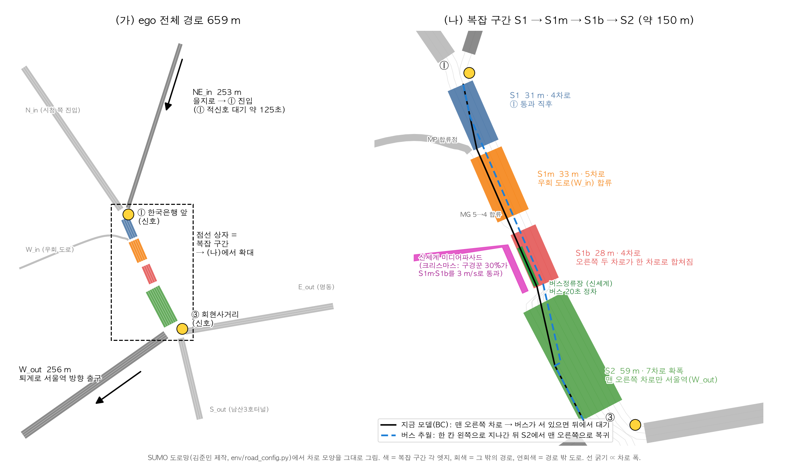
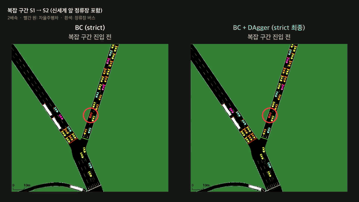
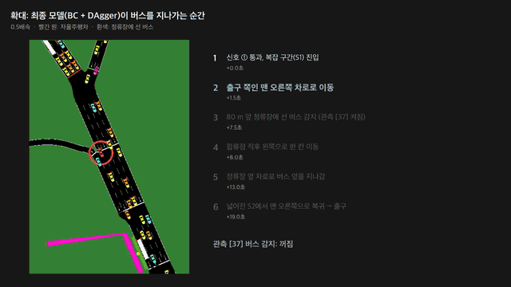
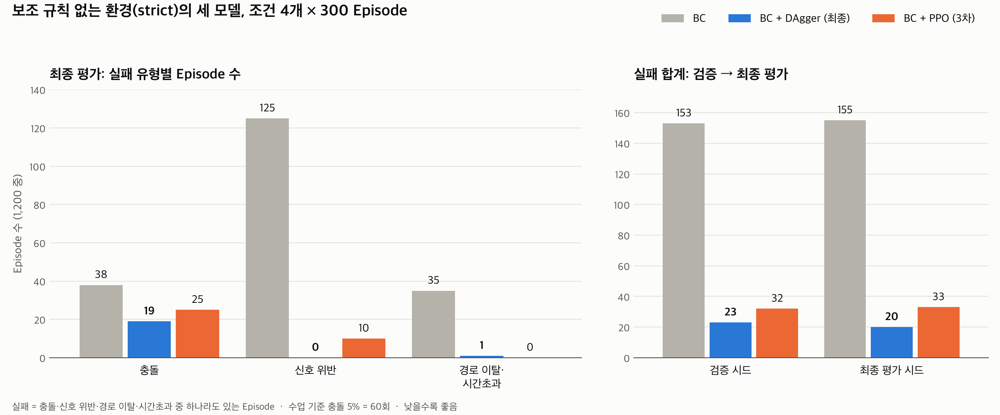
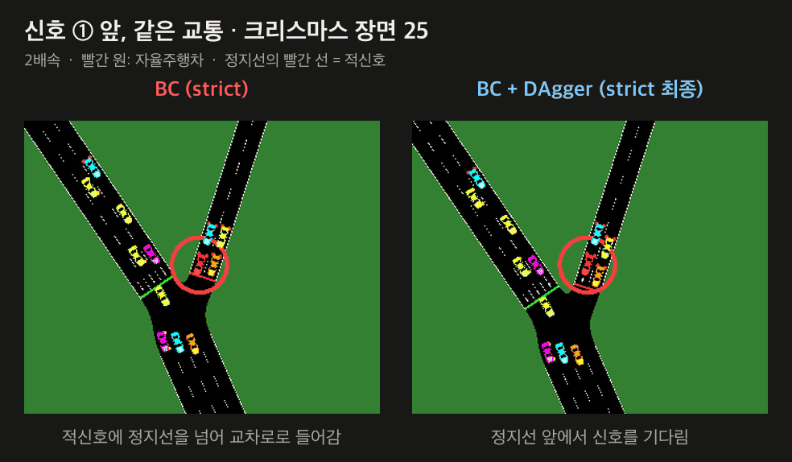

# 명동 소공로 자율주행 (SUMO)

한국은행 앞 교차로 → 소공로(신세계백화점 본점 앞) → 회현사거리, 남쪽 방향 약 187 m.

## 설치

```bash
pip install -r requirements.txt
```

SUMO 설치는 따로 (1.27.1 기준, `SUMO_HOME` 환경변수 설정).

## 실행

```bash
python view_road.py                           # 평시, sumo-gui로 보기 (창이 뜨면 ▶ 눌러서 재생)
python view_road.py --christmas               # 크리스마스
python view_road.py --christmas --speed 4     # 4배속
python view_road.py --nogui --seconds 600     # 화면 없이 10분 돌려 설정 검증 (Waiting 0이면 정상)
```

| 옵션                     | 설명                                                                                  |
| ------------------------ | ------------------------------------------------------------------------------------- |
| `--christmas`            | 크리스마스 시나리오 (구경꾼 30% 감속 + 일반 차량 교통량 1.5배)                        |
| `--traffic X`            | 일반 차량 교통량 배율 X (기본 1.0, 크리스마스 배율과 곱해짐, 버스는 실제 배차 그대로) |
| `--speed X`              | GUI 재생 X배속 (1 = 실시간, 기본 2배속)                                               |
| `--background`           | 영상용 배경 교통 (남대문로 숭례문↔을지로 직진). 학습·데이터에는 쓰지 않음             |
| `--nogui`, `--seconds N` | 화면 없이 N초 돌리고 차량 통계 출력                                                   |
| `--seed X`               | 실험 seed고정 (예: `--seed 23423`)                                                    |
| 그 밖의 옵션             | SUMO에 그대로 넘김( `--window-size x,y`등)                                            |

## AV 모델 학습

### 목표

자율주행차(ego)는 을지로에서 출발해 신호 ①을 지나 소공로를 내려가고, 퇴계로 서울역 방향으로 빠진다 (659 m).

1. **안전:** 충돌 없이, 신호를 지키며 목적지에 도착한다 (수업 기준: 100 Episode 중 충돌 5% 미만).
2. **시간:** 크리스마스 혼잡에서 복잡 구간을 빨리 지나간다.



복잡 구간은 S1 → S1m → S1b → S2, 약 150 m이고, 막힘이 없으면 약 13초 걸린다.

| 구간 | 특징 |
|---|---|
| S1 | 신호 ① 직후 4차로 |
| S1m | 우회 도로 합류, 5차로 |
| S1b | 오른쪽 두 차로가 하나로 합쳐지고, 그 차로에 신세계 앞 버스정류장이 있다 (버스 20초 정차) |
| S2 | 7차로로 넓어진다. 맨 오른쪽 차로만 서울역 출구로 이어진다 |

출구가 맨 오른쪽이라 오른쪽 차로로 가야 하는데, 그 차로에 정류장이 있다. 버스가 서 있으면 그 뒤에서 기다리게 되고, 이것이 크리스마스에 시간이 늘어나는 가장 큰 원인이었다.

### 최종 모델

`models/strict_bc_dagger.pt`: 관측 38차원, 행동 2차원(가감속, 차선 변경 왼쪽·유지·오른쪽). 수업 PPO 네트워크 구조를 그대로 쓴다.

```
expert(규칙) 시연 1,000 Episode ──▶ BC ──▶ DAgger 3라운드 ──▶ strict_bc_dagger.pt
 (SUMO 내부 정보를 봄, 정답에만 쓰임)      (관측만 봄, 혼자 운전)
```

1. **expert(규칙 기반 운전자)** `utils/rule_policy.py`: 학습 정답을 만들 때만 쓴다.
   - 가감속은 IDM 차량추종 공식을 쓰고, 적·황신호에서는 정지선 앞에 선다.
   - 경로상 필요할 때만 차선을 바꾸고, 옆 차로 틈이 충분할 때만 옮긴다.
   - 정류장에 버스가 서 있으면 옆 차로로 지나간다.
2. **시연:** 평시 400, 크리스마스 400, 크리스마스·버스 3배 200 Episode.
3. **BC:** PPO 네트워크를 시연에 지도학습한다 (`utils/pretrain.py`).
4. **DAgger 3라운드:** 학생 모델이 직접 운전하며 들어간 상태마다 expert에게 정답 행동을 물어 데이터에 더하고, 다시 학습한다 (라운드당 400 Episode, β = 0).
   - BC는 expert가 다닌 상태만 보고 배워서, 정지선 앞에서 살짝 가속해 적신호에 기어 나가거나 출구 차로로 옮기지 못했다.
   - DAgger로 신호 위반이 128회 → 0회, 실패가 153회 → 23회로 줄었다 (검증, 1,200 Episode).

**어떻게 여기까지 왔나**
1. 처음부터 PPO는 실패했다 (충돌 7~42%, 또는 움직이지 않다가 시간초과).
2. 관측을 33 → 37차원으로 늘리고, 규칙 기반 시연으로 BC + DAgger를 하자 잘 됐다 (충돌 0~0.3%, 버스 추월로 시간 단축). 그 위의 PPO 미세조정은 효과가 없었다.
3. 교수님 Q&A(11/17, 보조 규칙 금지, 라우팅은 지도 수준만)를 보고, SUMO가 대신 해 주던 신호 정지·교차로 양보·차선변경 판정을 끄고, 차선 단위 안내 관측을 회전 방향·거리로 바꿔 37 → 38차원으로 고쳤다.
4. 결과를 보기 전에 평가 계획을 쓰고, 처음부터 다시 학습했다: BC, BC + DAgger, BC + PPO(3번 시도). 검증 시드로 BC + DAgger를 고르고, 처음 쓰는 시드로 한 번만 평가했다.

자세한 과정: [학습_과정_기록.md](docs/training/학습_과정_기록.md)

### 관측 (38차원)

수업 기본 31칸에 7칸을 더했다. 실제 운전자나 차량 센서가 알 수 있는 정보만 넣었다.

| 칸 | 내용 | 추가한 이유 |
|---|---|---|
| [0] | 내 속도 | 수업 기본 |
| [1..20] | 왼쪽 2칸·현재·오른쪽 2칸 차로의 앞뒤 차 거리와 상대속도 | 수업 기본 |
| [21..25] | 차로 연결성 (곧 끝나는 차로 예고) | 수업 기본 |
| [26..30] | 차로별 앞쪽 차량 밀도 | 수업 기본 |
| [31], [32] | 다음 신호 상태, 정지선까지 거리 | SUMO가 대신 서 주지 않으므로 신호를 봐야 한다 |
| [33], [34] | 왼쪽·오른쪽 측면 레이더 (옆 차로 막힘, 사각지대 경고) | 기본 관측은 바로 옆 약 2.5 m 안의 차를 "없음"으로 본다 |
| [35], [36] | 다음 회전 방향, 회전 지점까지 거리 (내비게이션) | 지도 수준 경로 안내. 어느 차로로 가라는 정보는 주지 않는다 |
| [37] | 80 m 앞 정류장에 버스 정차 중 (카메라) | 시간 손실의 주범인 정류장 버스를 봐야 추월을 배울 수 있다 |

### 결과



크리스마스, 같은 교통에서 왼쪽은 BC, 오른쪽은 최종 모델이다 (2배속, 빨간 원이 자율주행차, 흰색이 정류장에 선 버스).
BC는 정류장 차로에서 버스 뒤에 갇혀 복잡 구간을 39.5초에 지났고, 최종 모델은 버스를 보면(관측 [37]) 합류점 직후 왼쪽으로 한 칸 옮겨 정류장 옆 차로로 지나간 뒤 S2에서 출구 차로로 돌아가 26.0초에 지났다.
차이가 잘 보이는 장면이다. BC도 expert의 추월 시연을 따라 배워서 추월 비율은 비슷하고, 두 모델의 큰 차이는 신호 위반이다 (아래). 원본 영상(72초, 확대 장면 포함): [bus_compare_strict.mp4](docs/training/strict/video/bus_compare_strict.mp4)



**공식 평가:** 고르는 규칙은 결과를 보기 전에 정했다 ([평가_계획.md](docs/training/strict/평가_계획.md)). 검증 시드에서 충돌 5% 미만, 신호 위반 Episode 1% 이하인 후보 중 실패(충돌·신호 위반·경로 이탈·시간초과)가 가장 적은 BC + DAgger를 고른 뒤, 한 번도 쓰지 않은 시드로 조건마다 300 Episode를 한 번만 평가했다. 비교 모델도 같은 시드라 Episode마다 교통이 같다.

| 모델 | 충돌 | 신호 위반 Episode | 경로 이탈 | 시간초과 | 실패 | 복잡 구간 |
|---|---|---|---|---|---|---|
| BC | 38 (3.2%) | 125 (10.4%) | 35 | 0 | 155 | 21.48초 |
| **BC + DAgger (최종)** | **19 (1.6%)** | **0 (0.0%)** | **0** | 1 | **20** | **21.19초** |
| BC + PPO (3차) | 25 (2.1%) | 10 (0.8%) | 0 | 0 | 33 | 22.71초 |

| 조건 (최종 모델) | 충돌 | 신호 위반 | 경로 이탈 | 복잡 구간 |
|---|---|---|---|---|
| 평시 | 0 / 300 | 0 | 0 | 14.9초 |
| 크리스마스 | 2 / 300 | 0 | 0 | 21.9초 |
| 크리스마스 + 교통량 1.3배 (학습에 안 쓴 조건) | 5 / 300 | 0 | 0 | 25.4초 |
| 크리스마스 + 버스 3배 | 12 / 300 | 0 | 0 | 22.7초 |



- 네 조건 모두 충돌이 수업 기준(5%)보다 낮다. 가장 혼잡한 버스 3배 조건에서 4.0%다.
- 검증에서 본 순서(실패: DAgger < PPO < BC)가 처음 쓰는 시드에서도 그대로 나왔다.
- 같은 Episode끼리 뺀 복잡 구간 시간: 최종 모델이 BC보다 0.34 ±0.30초, PPO보다 1.40 ±0.42초 빠르다.
- 전체 도착시간 약 190초 중 약 125초는 신호 ① 적신호 대기라 운전으로 줄일 수 없어서, 시간은 복잡 구간(S1~S2)으로 비교한다.



같은 교통에서 BC(왼쪽)는 적신호에 정지선을 넘고, 최종 모델(오른쪽)은 정지선 앞에서 기다린다.

### expert(규칙)와 비교

모방학습은 expert를 따라 하는 학습이라 expert가 사실상 상한이다. expert를 검증 시드(모델 선택 뒤, 최종 평가 시드와 다름)로 같은 교통에서 조건마다 300 Episode 돌려 비교했다.

| 조건 | expert | 최종 모델 | 같은 Episode 차이 (최종 − expert) | 충돌 (expert / 최종) |
|---|---|---|---|---|
| 평시 | 14.97초 | 15.18초 | +0.21 ±0.08초 | 0 / 0 |
| 크리스마스 | 21.07초 | 21.08초 | +0.05 ±0.46초 | 0 / 1 |
| 크리스마스 + 교통량 1.3배 | 24.74초 | 24.69초 | +0.02 ±0.82초 | 0 / 7 |
| 크리스마스 + 버스 3배 | 22.06초 | 21.80초 | −0.05 ±0.57초 | 1 / 13 |

- **시간과 신호 준수는 expert와 같은 수준이다.** 시간 차이는 평시 0.2초를 빼면 오차 범위 안이고, 신호 위반은 둘 다 0이다.
- **충돌은 expert보다 많다** (1,200 Episode에서 1회 대 21회). expert는 옆 차로의 실제 틈을 SUMO에서 읽고, 최종 모델은 관측 38칸(측면 레이더는 막힘 여부만)으로 판단한다. 혼잡할수록 이 차이가 커진다.
- **한계로만 볼 필요가 없는 이유:** expert는 시뮬레이터 내부 정보를 써서 실제 차에 쓸 수 없다. 최종 모델은 관측만으로 expert와 같은 시간과 신호 준수를 냈다. expert를 고치면 학생도 따라 좋아졌다 (신호 정지, 버스 추월).
- 자세한 설명: [모델_설계_정리.md 5절](docs/training/모델_설계_정리.md)

### 해 봤지만 효과가 없던 것

| 시도 | 결과 |
|---|---|
| 처음부터 PPO (보상 설계 3가지) | 충돌 7~42%, 또는 충돌을 피하려고 거의 움직이지 않다가 시간초과 |
| BC 위에 PPO 미세조정 (교수님 Q&A 이전 환경, 10가지 가까이) | 시간이 유의미하게 줄지 않았다. 과감하게 학습하면 충돌만 늘었다 |
| BC 위에 PPO 미세조정 (지금 환경, 3번) | 실패 102 → 73 → 32로 나아졌지만 신호 위반이 1% 안팎 남았고, 최종 모델보다 1.4초 느렸다 |

PPO는 신호 위반을 벌점으로만 배운다. 위반은 정지선 1 m 앞에서 살짝 가속하는 작은 행동 차이라 보상으로는 어느 순간이 문제였는지 찾기 어렵다. DAgger는 그 상태마다 "여기서는 서라"는 정답을 직접 받는다.

### 밝혀 둘 점

- expert(규칙)는 학습 정답을 만들 때만 쓴다. expert는 옆 차로의 실제 틈, 경로 같은 SUMO 내부 정보를 쓰지만, 최종 모델은 관측 38칸만 보고 expert 없이 혼자 운전한다.
- ego에게는 SUMO 보조(적신호 정지, 교차로 양보, 차선변경 판정)를 모두 껐다 (`speed_mode` 0). 교차로 안 충돌도 센다.
- 신호 위반은 0.5초 스텝 앞뒤가 모두 적신호일 때 정지선을 넘은 경우만 센다 (세 모델에 똑같이 적용).
- 크리스마스와 버스 3배 조건은 학습에도 썼다. 학습에 안 쓴 조건(크리스마스 + 교통량 1.3배)에서도 충돌은 5 / 300이다.
- 관측은 센서(측면 레이더, 내비게이션, 카메라)가 항상 정확하다고 가정한다. 학습도 정확한 관측으로만 했다.
- 최종 모델은 expert(규칙)보다 낫지 않다. 시간과 신호 준수는 같은 수준이고, 충돌은 expert보다 많다.
- 학습 시드는 0 하나다.
- 수업 코드에서 고친 것: 충돌한 차를 도착으로 세던 버그, 시간초과 처리, 평가 시드 분리(`--eval-seed`). 위 결과는 모두 고친 코드 기준이다.

### 실행

```bash
python test.py models/strict_bc_dagger.pt --christmas                                         # sumo-gui로 주행 보기
python eval_section_time.py models/strict_bc_dagger.pt --episodes 100 --christmas --eval-seed 777001   # 충돌률, 신호 위반, 복잡 구간 통과시간
python collect_pomdp_data.py --model models/strict_bc_dagger.pt --episodes 1000 --workers 8 --seed 300 --name strict_normal
bash scripts/training/train_strict_model.sh                                                   # 최종 모델을 처음부터 다시 학습 (맥북 8병렬 약 1시간 40분)
```

비교 모델: `models/strict_bc.pt` (BC), `models/strict_bc_ppo3.pt` (BC + PPO 3차).

### 자세한 문서

- 학습 과정 전체 (무엇을 왜 했고 무엇이 실패했는지): [docs/training/학습_과정_기록.md](docs/training/학습_과정_기록.md)
- 평가 계획과 변경 기록 (결과를 보기 전에 정한 규칙): [docs/training/strict/평가_계획.md](docs/training/strict/평가_계획.md)
- 모델 인계, 성능 표, 데이터 수집 명령: [docs/training/모델_인계.md](docs/training/모델_인계.md)
- 신경망 구조, 하이퍼파라미터, 보상 함수와 그 이유, offline RL을 안 한 이유, expert와의 비교: [docs/training/모델_설계_정리.md](docs/training/모델_설계_정리.md)
- 검증·최종 평가 원본 결과 (Episode별): [docs/training/strict/val/](docs/training/strict/val/), [docs/training/strict/final_eval/](docs/training/strict/final_eval/)
