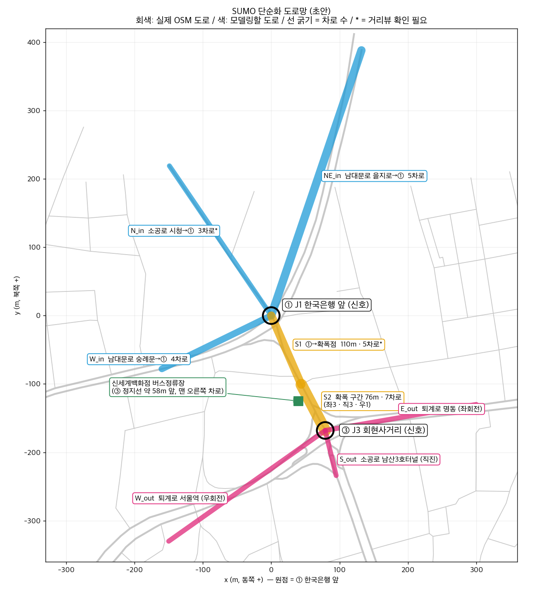

# 명동 신세계 앞 SUMO 단순화 설계 (초안)

> 대상: 한국은행 앞 교차로(①) → 소공로 신세계 본점 앞 → 회현사거리(③), **남쪽 방향**
> 핵심 문제: 두 신호 사이 약 187 m 안에서 세 방향 진입 차량이 세 방향 진출 차로로 갈라지는 **신호 사이 엇갈림 = 눈치싸움**
> 근거 데이터: OpenStreetMap (2026-10-27 다운로드). `*` 표시는 거리뷰 확인 전 값

---

## 1. 도로망 (Road)

좌표 원점 = ① 한국은행 앞 노드 (37.56196, 126.98116), x = 동쪽, y = 북쪽 (m)

### 노드

| id | 의미 | 좌표 (x, y) | 타입 |
|---|---|---|---|
| J1 | ① 한국은행 앞 교차로 | (0, 0) | traffic_light |
| MP | 숭례문 쪽 우회 도로가 우회전해 본선 오른쪽에 붙는 점 (①에서 약 36 m) | (14.4, -33.0) | priority |
| MG | 5→4차로로 줄어드는 점 (신세계 앞, ①에서 약 75 m) | (29.9, -68.75) | priority (운전자 impatience 0.5로 교착 방지, zipper는 쓰지 않음) |
| M | 소공로 확폭점 (4→7차로) | (44, -101) | priority |
| J3 | ③ 회현사거리 | (79, -168) | traffic_light |
| N_in | 소공로 시청 방향 시작점 | (-149, 219) | |
| NE_in | 남대문로 을지로 방향 시작점 (실제 약 410 m를 잘라서 둠) | (80, 250) | |
| W_in | 남대문로 숭례문 방향 시작점 | (-160, -78) | |
| E_out | 퇴계로 명동 방향 끝점 | (300, -130) | |
| S_out | 소공로 남산3호터널 방향 끝점 | (110, -300) | |
| W_out | 퇴계로 서울역 방향 끝점 | (-150, -330) | |

### 엣지

| id | 구간 | 길이 | 차로 | 근거 |
|---|---|---|---|---|
| N_in→J1 | 소공로 (시청→①), ①에서 직진 | 265 m | 3 | 11/4 확인 |
| NE_in→J1 | 남대문로 (을지로→①), ①에서 좌회전 | ~410 m (잘라서 약 260 m) | 2 | 소공로로 좌회전하는 차로만 모델링. 11/3 로드뷰: 좌회전 2차로 (도로 전체는 OSM `lanes=5`) |
| W_in→MP | 남대문로(숭례문 쪽)에서 갈라져 분수대 북쪽·동쪽을 도는 우회 도로, ①을 거치지 않음 | 약 174 m (곡선) | 1 | 11/3 로드뷰: 1차로. 모양은 위성사진 도로선 변환값. 우회전하자마자 본선 맨 오른쪽 차로가 됨 (11/4 위성사진) |
| **S1** J1→MP | 소공로 ①→우회 도로가 붙는 점 | 약 36 m | 4 | 11/3 로드뷰 (본선 4차로) |
| **S1m** MP→MG | 우회 도로가 붙은 뒤→차로 감소점 | 약 39 m | **5** | 11/4 위성사진: 본선 4 + 우회 1, 실선 없이 차로 변경 자유 |
| **S1b** MG→M | 차로 감소점→확폭점 | 약 35 m | 4 | 11/3 로드뷰: 5 → 4 (오른쪽 두 차로가 하나로 합쳐짐) |
| **S2** M→J3 | 소공로 확폭 구간 | 76 m | **7** | OSM `left\|left\|left\|through\|through\|through\|right`, 11/3 로드뷰: 신세계 앞에서 넓어짐, 화살표 좌3·직3·우1 |
| J3→E_out | 퇴계로 명동 방향 | ~220 m | 3 | 11/3 로드뷰 |
| J3→S_out | 소공로 남산3호터널 방향 | 70 m + 연장 → 약 136 m | 3 | OSM `lanes=3`, 11/3 로드뷰 |
| J3→W_out | 퇴계로 서울역 방향 | ~280 m | 4 | 11/3 로드뷰 |

### 차로 연결 (Connection) — SUMO 차로 번호 0 = 맨 오른쪽

- **MP (우회 도로가 붙는 점):** S1 0~3 → S1m 1~4 (한 칸씩 왼쪽), 우회 도로 W_in 0 → S1m 0 (맨 오른쪽 차로가 됨)
- **MG (5→4 차로 감소):** S1m 0·1 → S1b 0 (오른쪽 두 차로가 합쳐짐), S1m 2~4 → S1b 1~3
- **M (4→7 확폭):** S1b 0 → S2 {0, 1} / 1 → {1, 2, 3} / 2 → {2, 3, 4} / 3 → S2 {5, 6}. 확폭 구간엔 실선이 없어 가운데 차로를 이웃 직진 차로로도 이어 줌 (한 칸 연결만 두면 36 m짜리 S1b 끝에 차로를 못 바꾼 차가 갇혀 크리스마스에 Teleport, 11/4)
- **J3 (차로별 진행 방향, OSM 화살표 그대로):** S2 0 → 서울역 (우) / 1~3 → 남산3호터널 (직) / 4~6 → 명동 (좌)
- **J1:** 시청(직진) → S1 0~2, 을지로(좌회전) → S1 2~3 *(진입 차로 배정은 추정)*. 숭례문 쪽은 ①을 거치지 않는다 (11/3 실제처럼 합류로 바꿈).
- 합류 방식 (11/3~11/4 시험, 1시간 × 시드 30개):
  - 본선 우선(priority)만: 크리스마스에 우회 도로 차가 끼어들 틈이 없어 밀림
  - zipper(번갈아 합류): 두 차가 동시에 멈추면 서로 기다리는 교착이 생김 (평시에도 Teleport)
  - **본선 우선 + 모든 차 `impatience` 0.5 (채택):** 오래 기다린 합류 차가 작은 틈도 받아들임. 평시 Teleport 0/30, 크리스마스 2/30(가장 이른 것 33분)

### 단순화한 것 (발표에서 밝힐 내용)
- ①을 지나가기만 하는 흐름(예: 을지로→숭례문 직진), 북쪽 방향 차선, 골목길, 분수대 섬은 모델링하지 않음
- 분수대 광장 공사(2026-09 착공) **전** 구조 기준
- 신호: ① 한국은행앞은 서울시 공식 신호 이력(T-Data, 교차로 2901)으로 주기 170 s (평시 12시, 크리스마스 20시 값). ③ 회현사거리는 공식 데이터가 없고 현장 측정도 못 해서 **추정값**: ①과 같은 주기 170 s(연동 가정), 녹색 80·황색 4·적색 86 s(녹색 비율은 이전 가정 46% 유지), ①보다 20 s 늦게 시작(① 시청 직진 차량이 187 m를 달려 도착하는 시간)

### 버스정류장
- `신세계백화점` 정류장: 확폭점 M 바로 앞, 합류 후 구간 S1b 0번 차로 7~27 m → `busStop` additional (11/4 우회 도로를 본선 차로로 바꾸며 S1b가 짧아져 옮김). 처음에는 S2 0번(우회전 전용) 차로에 뒀는데, 직진 버스가 정차 뒤 옆 차로로 못 빠져 Teleport가 나서 옮김 (11/3)
- 정류장은 차로 위에 바로 서는 형태 (11/3 로드뷰). 정류장 번호 02144
- 버스: 실제 노선별 평균 배차 간격으로 투입, 정류장에서 20 s 정차 (카카오맵 노선 정보, 11/3 조회)
- 버스는 맨 오른쪽 차로로 출발해 차로를 바꾸지 않는다 (세 노선 모두 0번 차로만으로 정류장과 진출로까지 이어짐). 차로 변경을 허용하면 정류장 앞 정지 차량을 왼쪽으로 추월했다가 돌아오지 못해 M에서 교착이 생겼다 (11/4)
  - 143: 시청 쪽 → 남산3호터널, 6분 / 406: 숭례문 쪽 → 남산3호터널, 12분 / 705: 시청 쪽 → 서울역, 14분 → 합계 약 19대/시
  - 기준 시각은 낮 12시(평시)와 저녁 8시(크리스마스). 심야 N31(35~40분)은 넣지 않음. 도착은 평균 간격의 포아송 과정
- → 합류 직후 맨 오른쪽 차로에서 우회 도로 합류, 버스 정차, (크리스마스) 파사드 구경 감속이 겹쳐 뒤차가 옆 차로로 끼어들어야 하는 상황이 생김

### 미디어파사드 (크리스마스)
- 신세계 본관 ㄱ자 스크린: 광장 쪽 북쪽 면 → 모서리 → 소공로를 따라 남쪽 (사용자가 위성사진에 표시한 위치, `SCENERY["media_facade"]`, GUI 장식)
- 구경 감속: 일반 차량 30%가 숭례문 쪽 갈림점 앞(W_in 116.9 m) → 우회 도로 → 5차로 S1m → 4차로 S1b 끝(확폭점 M)을 3 m/s로 통과 (`look_zones`, 11/4 GUI에 표시한 구간). 비율·속도는 가정값. 감속을 차로에 묶이지 않게 바꾼 뒤 20~50% 모두 1시간 × 시드 30개 Teleport 0이라, "일부가 구경하며 느려짐"이 보이는 30%로 둠 (11/4)
- 구현: 여러 차로 구간(S1m, S1b, 영상용 W_in_b)은 구경꾼 차량 분류(`custom1`)에만 걸리는 엣지 타입 속도 제한이라 차로에 묶이지 않음. W_in 일부 구간만 통과 속도 stop. stop은 한 차로에 묶여서 여러 차로 구간에 쓰면 구경꾼이 그 차로로 억지로 옮기다 5차로 끝에 갇혔음(시드 30개 중 12개). 바꾼 뒤 1시간 × 시드 30개 Teleport 평시·크리스마스 모두 0

---

## 2. 교통 (Traffic)

| 항목 | 현재 (고속도로 예제) | 변경 |
|---|---|---|
| 수요 | 단일 flow 1개 | 진입 3 × 진출 3 = **OD 9개 flow** (대/시는 정체·Teleport가 없는 선에서 조정) |
| 일반 차량 차선변경 | `keep_lane=True` (차선변경 완전히 끔) | **켬.** 꺼두면 진출 차로로 못 가서 교차로 앞에서 멈추고 Teleport 발생 |
| 운전 성향 | 차량추종모델 4종 | 그대로 두고 차선변경 성향을 섞음: 공격형(`lcAssertive`↑, `lcCooperative`↓, `lcImpatience`↑) / 양보형(반대) → **눈치싸움의 원천** |
| 초기 배치 | 직선 도로에 prefill | 끄고, ego 투입 전 약 120 s 시뮬레이션을 먼저 돌려 대기열이 생긴 상태에서 시작 |
| 시나리오 | 1개 | 1단계: 평시. 2단계: **연말** (교통량↑, 택시 정차, 버스↑) → "크리스마스 시즌" 비교 실험 |
| 크리스마스 교통량 | – | 일반 차량 **1.5배** (버스는 실제 배차 그대로). 1시간 × 시드 30개 Teleport 0, 진입 대기 평균 1대. 1.6배부터 을지로 좌회전 진입로에 대기가 쌓임(1시간 뒤 최대 38대) (11/4) |

---

## 3. AV(ego) / Episode

| 항목 | 변경 |
|---|---|
| 출발·목적지 | **을지로(NE_in) → 서울역(W_out) 고정** (11/9 팀 회의, `EGO["route"]`). S1에 왼쪽 차로로 들어와 S2 맨 오른쪽 차로(서울역 우회전 전용)까지 2~3칸 옮겨야 하는 엇갈림 경로. 10/30~11/8에는 OD 9개 중 무작위였음 |
| 제한속도 | `vmax = 13.89 m/s` (50 km/h, 서울 도심 안전속도 5030) |
| 신호 준수 | 지금 `setSpeedMode(0)`이라 **적신호를 무시함.** 적신호 정지(bit4)와 교차로 내 우선권(bit3)만 켜기(`speedMode=24` 후보, 실험으로 확인). 앞차 추돌 위험은 그대로 남겨서 충돌 회피 학습 신호는 유지 |
| 최대 길이 | 경로 약 730 m(을지로→서울역) + 신호 대기 1~2회 → `max_steps ≈ 600` (300 s) |
| 종료 조건 | 충돌 / 도착(경로 끝) / 시간초과 + **경로 이탈(새로 추가)**: 내 경로의 다음 엣지로 이어지지 않는 차로 끝에 도달하면 실패 |
| Teleport | Episode마다 횟수를 info와 평가 지표에 기록 (평가 항목 "Simulation 안정성") |
| 차선변경 안전 게이트 | **끔** (`ACTION["lane_change_safety"]["enabled"] = False`, 11/4). 켜 두면 "언제 어느 틈으로 끼어들지"를 env가 대신 판단해서 목표 차로 쪽으로 명령만 내는 규칙 기반 차도 크리스마스에 97% 완주 → 학습 효과를 보일 수 없음. 끄면 (11/9 고정 경로 기준, 100 Episode) 규칙 기반(목표 차로 추종 + IDM)이 평시 97%(충돌 3%), 크리스마스 99%(충돌 1%), 차로 유지만 하면 0%(전부 경로 이탈). 무작위 OD일 때는 크리스마스 약 85%였다. 탐험 중 "차선변경 = 충돌"만 배워 변경을 포기하면 다시 켜거나 간격을 줄여 켬 |

---

## 4. Observation: 31차원 → 33차원 (기존 31개는 그대로, 뒤에 2개 추가)

> **규칙 (교수님):** observation과 데이터 형식은 **늘리는 것만** 허용. 원래 있던 항목을 변경하거나 삭제하면 안 됨.
> → 기존 [0~30]의 계산식, 순서, 정규화는 손대지 않고, 새 값은 전부 **[31] 이후에 덧붙인다.**

추가 기준: **실제 운전자가 보거나 내비게이션으로 아는 정보만** 넣는다. (11/3 확정. 10/30 구현한 41차원에서
경로 기준 연결성 5개·엣지 끝 거리·신호 잔여시간을 뺐다. 앞의 6개는 목표 차로·정지선 거리와 정보가 겹치고, 잔여시간은 운전자가 알 수 없다)

11/9 팀 회의: 경로를 을지로→서울역으로 고정하면서 **목표 차로까지 칸 수(SUMO `getBestLanes`)를 뺐다 → 33차원.** 경로가 하나면 어느 차로로 가야 하는지는 보상(완주·경로 이탈)으로 배울 수 있다. 이 값은 관측에 넣었던 우리 추가 항목이라 교수님 규칙(기존 [0~30] 유지)과 충돌하지 않는다. 신호 두 값은 [32]·[33]에서 [31]·[32]로 당겨졌다.

| idx | 값 | 정규화 | 왜 필요한가 |
|---|---|---|---|
| 31 | 다음 신호 상태 (녹 1 / 황 0 / 적 -1, 신호 없음 1) — `traci.vehicle.getNextTLS` | | 대기열 맨 앞에서는 기본 관측이 "앞이 뚫림"인데 차가 안 움직임 |
| 32 | 다음 신호(정지선)까지 거리 (신호 없음 1) | / 200 m | ③ 정지선 = 차선변경 마감. 기본 관측에는 마감까지 거리가 없음 |

**차선변경은 한 스텝(0.5 s)에 끝난다 (SUMO 기본, `lanechange.duration` 0).** 11/3에 3초로 바꿔 봤다가 되돌렸다.
- 3초로 하면 저속에서 옆으로만 움직여 차가 비스듬히 그려지고(차로 방향에서 15° 넘게 틀어진 차 약 5%), 영상에서 충돌처럼 보였다. 1초·옆 이동 속도 제한도 해결되지 않았다.
- 3초에서는 끼어드는 차를 `getLeader`([9])가 약 1.5초 못 봐서 끼어드는 차 간격·상대속도 2개를 추가했었는데, 0초에서는 끼어든 차가 다음 스텝에 바로 [9]에 잡히므로 뺐다.
- 방향지시등은 쓰지 않는다. SUMO는 회전을 앞두거나 틈을 기다릴 때도 켜서, 켜진 시간의 약 85%가 실제 차선변경과 무관했다. 데이터 `state.vehicles[].signals`에만 기록한다.

**정규화 기준 vmax:** 기존 식 `속도 / ROAD["speed_limit"]`은 그대로 두고, 설정값만 도로에 맞게 13.89로 바꾼다. 식은 같고, 제한속도는 수업 문서(2번, 5번)가 팀별로 실제 도로에 맞추라는 도로 설정이라 50 km/h로 확정했다 (11/4).

Action(가감속, 차선변경 2차원)은 그대로 둔다.

**데이터 형식:** `collect_pomdp_data.py`는 observation을 `reshape(total, -1)`로 저장하므로 33차원이 그대로 들어간다. 기존 열 [0~30]의 위치와 의미는 같다. 새 기록 항목(경로 이탈 여부, Teleport 수, 신호 상태 등)은 `event`, `info`, `state`에 **새 키로만** 추가하고, 기존 키는 이름과 의미를 바꾸지 않는다.

---

## 5. Reward

| 항 | 변경 |
|---|---|
| 속도, 충돌 -5, 도착 +2 | 유지 (vmax만 13.89로) |
| 경로 이탈 | **추가** `route_fail_penalty = 5` (충돌과 같은 수준. 평가에서도 실패로 셈) |
| `blocked_penalty` | **0으로.** 적신호 대기열에 서 있는 것까지 감점되면 "기다림 = 손해"를 잘못 학습함 |
| `close_gap_penalty` | 속도 > 3 m/s일 때만 적용 (대기열의 2~3 m 간격은 정상) |
| 목표 차로 shaping | 일단 넣지 않음. 작은 규모 학습에서 경로 이탈이 줄지 않으면 그때 추가 |

---

## 6. 코드 변경 목록

| 파일 | 변경 |
|---|---|
| `env/road_config.py` | `ROAD`를 노드·엣지·연결·신호·OD 설정으로 교체, 운전 성향 파라미터 추가, prefill 끄기 |
| `env/road_builder.py` | nod/edg/**con** XML 생성 + `busStop` additional + OD flow·버스 route 생성. netconvert에 connection 파일 넘기기. GUI 시점을 도로망 중심으로. 파일명 `highway.*`는 유지 (스크립트 수정 최소화) |
| `env/sumo_env.py` | ego를 고정 경로 r0(`EGO["route"]`)로 투입 (10/30~11/8에는 OD 무작위), warmup 후 시작, `speedMode`, `_get_obs()` 끝에 2개 덧붙이기 → 33차원 (기존 31개 계산 코드는 수정 금지. 4절 참고), 경로 이탈 종료, Teleport 기록, **차선변경 보호 구간 버그 수정**: 지금 `spawn_protect`는 엣지마다 차로 위치로 판정해서, 엣지가 바뀔 때마다 처음 60 m에서 차선변경이 막힘. S2는 76 m라 거의 전부 막힘 → 첫 엣지에만 적용 |
| `env/mdp_config.py` | max_steps, Reward 값 |
| `utils/evaluator.py` | 경로 이탈률, Teleport 수 추가 (지금은 경로 이탈이 "시간초과"로 잘못 집계됨) |
| `view_road.py`, `train.py` | 출력문의 `ROAD['length']` 등 정리 |

Observation 차원은 `env.observation_space`에서 읽어 쓰므로 PPO/BC 코드는 바꾸지 않아도 된다.

---

## 7. 검증 순서 (5번 문서 12절 기준)

1. `python view_road.py --nogui --seconds 300` → Teleport 0, 모든 OD route 주행 가능
2. GUI로 두 교차로 신호, 확폭 구간 차로 화살표, 버스 정차 확인
3. `collect_pomdp_data.py --policy keep-lane` → ego가 고정 경로(을지로→서울역)로 생성되는지, 잘못된 차로에서 경로 이탈 종료가 뜨는지
4. Observation 33차원 값 범위 확인 (특히 신호). 같은 상황에서 [0~30]이 기존 코드와 같은 값을 내는지도 확인
5. 작은 규모 PPO → 충돌률, 완주율, 경로 이탈률, Teleport 확인
6. 데이터 규모: Episode 약 350 step 기준, 10^7개면 약 29,000 Episode

---

## 8. 확인이 필요한 것 (거리뷰)

- [x] 숭례문 우회전: 분수대 옆 우회 도로 1차로, 별도 신호 (11/3 로드뷰). 신호 순서는 미확인 → 시청 쪽 녹색 때도 녹색으로 가정
- [x] 을지로 좌회전 2차로, 신세계 앞에서 확폭, ③ 화살표 좌3·직3·우1, 진출 차로 명동 3·남산3호터널 3·서울역 4 (11/3 로드뷰)
- [x] 서울역 방향 우회전: ③ 직전에 갈라지는 전용 길, 신호 없음 → 모델에서는 S2 0번 차로 → 서울역 연결을 J3 신호와 무관하게 항상 녹색(`signals.J3.free`)
- [x] 정류장: 차로 위 정차, 노선 143·406·705·N31
- [x] 시청 직진 진입로 3차로 (11/4 확인)
- [x] 정차 버스 노선별 진행 방향과 배차 간격 (카카오맵)
- [ ] 신호 주기 (가능하면 현장 영상이나 TOPIS)
