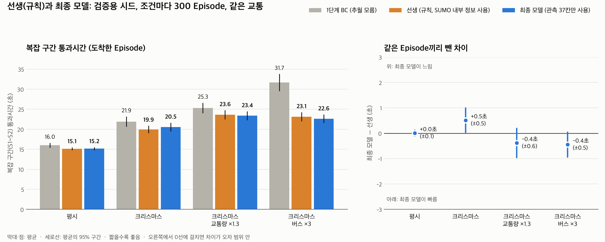
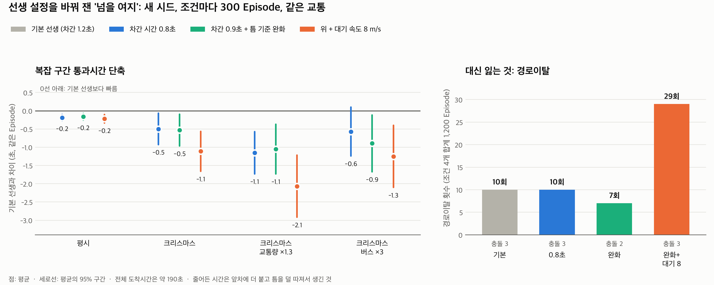

# 모델 설계 정리: 신경망, 하이퍼파라미터, 보상, offline RL, 선생과의 비교

팀원 질문에 대한 답이다. 숫자는 모두 코드(`utils/networks.py`, `utils/pretrain.py`, `train.py`, `env/mdp_config.py`, `env/sumo_env.py`)와 실험 기록에서 옮겼다.

먼저 알아 둘 점: **최종 모델 `bc_v3_3.pt`는 모방학습(BC + DAgger)으로 만들었고, 보상을 최적화하는 RL은 최종 모델에 쓰지 않았다.**
보상과 PPO 하이퍼파라미터는 PPO 실험(효과 없음, 학습 과정 기록 3·5·9·11절)에 쓰였다.

---

## 1. DAgger 이후에 offline RL은 안 했나?

**안 했다.** 이유는 세 가지다.

1. **줄이고 싶던 시간은 "데이터에 없는 행동"이 필요했다.**
   - 시간 손실의 주범은 정류장에 선 버스 뒤 대기였고, 줄이는 방법은 추월뿐이었다 (학습 과정 기록 10절).
   - offline RL(CQL, IQL 등)은 데이터에 이미 있는 행동 중에서 더 좋은 것을 골라 조합한다. 추월이 없는 데이터에서는 추월을 만들어 낼 수 없다.
   - 그래서 데이터에 추월을 넣는 쪽(선생이 추월하도록 고치고 다시 시연)을 택했고, 이것이 시간을 줄였다.
2. **추월을 넣은 뒤에는 offline RL이 고를 여지가 작다.**
   - 데이터 2,200 Episode가 모두 같은 선생(규칙)의 행동이거나, 학생이 운전한 상태에 선생의 정답을 붙인 것이다.
   - 같은 상황에서 서로 다른 행동을 해 본 기록이 적어서, offline RL이 BC보다 나은 행동을 찾을 근거가 부족하다.
3. **보상으로 구분할 차이가 작고 드물다.**
   - 줄일 수 있는 시간은 크리스마스에서도 9%의 버스 장면에만 있고, 나머지 차이는 교통 운에 묻힌다.
   - 같은 보상을 쓰는 온라인 PPO가 이 이유로 10가지 가까운 시도에서 모두 효과가 없었다 (11.5절). offline RL도 같은 보상 신호를 쓰므로 같은 문제를 겪을 가능성이 크다고 판단했다.

해 볼 수는 있다. 수집 데이터에 보상, 종료 여부, 실제 실행한 행동(`executed_action_raw`, DAgger 데이터)이 모두 저장돼 있다.
다만 DAgger 데이터의 `action_raw`는 선생의 정답이고, 보상과 다음 상태는 학생이 실제로 한 행동의 결과다. offline RL에 쓸 때는 `executed_action_raw`를 써야 한다.

---

## 2. 신경망 구조와 하이퍼파라미터

### 2.1 신경망 (`utils/networks.py`의 `HybridActorCritic`)

```
관측 37 ─▶ Linear 37→256 ─▶ ReLU ─▶ Linear 256→256 ─▶ ReLU ─┬─▶ 가감속 head: Linear 256→1, tanh  → 가감속 [-1, 1]
                                                          ├─▶ 차선 head:   Linear 256→3        → 왼쪽 / 유지 / 오른쪽 (argmax)
                                                          └─▶ 가치 head:   Linear 256→1        → V(s) (PPO용, 주행에는 안 씀)
```

| 항목 | 값 | 이유 |
|---|---|---|
| 몸통 | 은닉층 2개, 각 256, ReLU, 세 head가 공유 | 팀 공용 코드(`train.py`) 기본값 그대로 |
| 가감속 | 평균은 tanh로 [-1, 1], 표준편차는 학습 파라미터 하나 | 평가는 결정적이라 평균만 쓴다 |
| 차선 변경 | 3갈래 분류 (왼쪽 / 유지 / 오른쪽) | 연속값을 잘라 쓰면 -0.5~0.5 구간에서 아무 일도 안 일어나 학습이 안 된다. 분류로 두면 argmax로 변경이 실제로 나온다 |
| 가치 head | 출력 1 | BC 때 같이 맞춰 두면 이어서 PPO를 돌릴 때 첫 업데이트가 덜 망가진다 |
| 파라미터 수 | 76,806개 | |

### 2.2 BC 학습 (최종 모델에 쓴 설정, `utils/pretrain.py`)

| 항목 | 값 |
|---|---|
| 최적화 | Adam, 학습률 3e-4, 배치 256, 30 epoch, 시드 0 |
| 손실 | 가감속 MSE + 차선 cross-entropy + 0.5 × 가치 MSE |
| 차선 클래스 가중치 | 빈도 역수의 제곱근, 유지 = 1, 최대 20. 차선 변경이 전체 스텝의 0.7%뿐이라, 가중치가 없으면 늘 "유지"만 낸다 |
| 가치 정답 | 시연 Episode의 할인 누적보상 (γ = 0.99) |
| 학습 후 가감속 표준편차 | log σ = -1.0 (σ ≈ 0.37). 평가는 결정적이라 주행에는 영향 없음 |

### 2.3 데이터와 DAgger (`scripts/training/train_final_model.sh`)

| 단계 | 평시 | 크리스마스 | 크리스마스 + 버스 3배 | 스텝 수 |
|---|---|---|---|---|
| 규칙 시연 | 400 | 400 | 200 | 384,531 |
| DAgger 1라운드 | 150 | 150 | 100 | 153,787 |
| DAgger 2라운드 | 150 | 150 | 100 | 154,009 |
| DAgger 3라운드 | 150 | 150 | 100 | 153,329 |
| **합계** | | | **2,200 Episode** | **845,656** |

- DAgger 라운드마다 직전 모델이 결정적으로 운전하고, 규칙이 매 스텝의 정답 행동을 붙인다.
- 라운드마다 지금까지 모은 데이터 전체로 처음부터 다시 학습한다.
- 1 step = 0.5초.

### 2.4 PPO 하이퍼파라미터 (실험에만 썼고, 최종 모델에는 안 씀)

| 항목 | 기본값 (`train.py`) | 실험에서 바꾼 범위 |
|---|---|---|
| 학습률 | 1e-4 | 3e-5, 5e-5, 1e-4 |
| rollout 길이 | 2048 step | |
| 업데이트 epoch / minibatch | 10 / 64 | |
| γ / GAE λ | 0.99 / 0.95 | |
| clip ε | 0.2 | |
| 가치 손실 계수 | 0.5 | |
| 엔트로피 계수 (전체 / 차선만) | 0 / 0.01 | 차선만 0.03 |
| gradient clip | 0.5 | |
| BC 정규화 계수 (`--bc-coef`) | 0 | 0, 0.02, 0.05, 0.1, 0.5 |
| 학습량 | | 30만 ~ 60만 step |

---

## 3. 하이퍼파라미터 최적값은 스윕으로 찾았나?

**격자나 무작위 탐색 같은 체계적인 스윕은 하지 않았다.**

- **신경망 구조와 PPO 기본값:** 팀 공용 코드 값을 그대로 썼다.
- **BC 설정:** 흔히 쓰는 값으로 정했다. 결과를 보고 넣은 것은 차선 클래스 가중치 하나다 (변경이 너무 드물어서).
- **재현성은 확인했다:** 같은 데이터로 학습 시드 0, 1, 2로 세 번 학습했다.
  - 크리스마스 복잡 구간: 21.2 / 20.9 / 21.1초
  - 버스 3배: 22.6 / 23.3 / 22.8초
  - 충돌: 0~1.3%
  - 시간은 같고, 충돌만 조금 흔들린다 (학습 과정 기록 12.1절 #6).

성능을 크게 바꾼 것은 하이퍼파라미터가 아니라 **관측과 데이터**였다.

| 바꾼 것 | 결과 (자세한 내용은 학습 과정 기록) |
|---|---|
| 관측 33 → 36차원 (옆 차로 막힘, 목표 차로) | 크리스마스 충돌 26% → 7% (4.2절) |
| 크리스마스 시연 추가 | 크리스마스 충돌 7% → 1~2% (4.2절) |
| 선생 개선 + DAgger 3라운드 | 처음 보는 혼잡(×1.3) 충돌 8% → 0~1% (7절) |
| 관측 [36] 버스 정차 + 추월 시연 | 크리스마스에서 버스를 만나면 36.2초 → 22.9초 (10.7절) |

PPO 쪽은 손으로 작은 스윕을 한 셈이다. 아래 조합 모두 BC보다 유의하게 빠르지 않았고, 과감한 설정은 충돌만 늘었다.

| 실험 | 출발점 | 설정 | 결과 (크리스마스, 복잡 구간 / 충돌) |
|---|---|---|---|
| 기준 | dag3 (BC) | | 21.2초 / 1% |
| t1 | dag3 | BC 0.5, 학습률 3e-5, 30만 | 20.7초 / 2% |
| t2 | dag3 | BC 0.1, 학습률 3e-5, 30만 | 20.7초 / 1% |
| t3 | dag3 | BC 0.05, 학습률 1e-4, 60만 | 21.3~22.1초 / 3~5% |
| t4 | dag3 | t3 + 시간 벌점 0.04 | 20.9~23.4초 / 0~2% |
| t5 | dag3 | 버스 3배, BC 0.1, 학습률 5e-5, 40만 | 21.5초 / 1% |
| t6 | dag3 | 버스 3배, BC 0.1, 학습률 1e-4, 40만 | 21.2초 / 4% |
| A | v3_3 | BC 0.1, 학습률 3e-5, 30만 | 19.1초 / 4% (탈락) |
| B | v3_3 | 버스 3배, 학습률 5e-5, 40만 | 300 Episode: 21.2 → 20.4초 (오차 안), 충돌 0 → 5/300 |
| bc002 / bc0 | 추월 모르는 BC | BC 0.02 / 0, 차선 엔트로피 0.03, 버스 3배, 60만 | 추월을 못 찾음, 충돌 1% → 5~11% |

- t1~t6은 100 Episode라 1%p 차이는 의미가 없다. t5는 100 Episode에서 빨라 보였지만 300 Episode로 다시 재니 0.6초 차이였다.

---

## 4. 보상 함수 설계와 이유 (`env/mdp_config.py`, `env/sumo_env.py`)

### 4.1 식

매 스텝(0.5초):

```
r = 0.1 × (내 속도 / 제한속도)        속도 보상
  - 0.02                              시간 벌점
  - 0.1  (앞차 6 m 미만이면서 내 속도 > 3 m/s일 때)   근접 벌점
```

Episode가 끝나는 스텝은 위 값 대신 아래 값 하나만 받는다.

| 사건 | 보상 |
|---|---|
| 충돌 | -5 |
| 경로 이탈 (출구 차로에 못 들어감) | -5 |
| 도착 | +2 |

### 4.2 항마다 이유

| 항목 | 값 | 출처 | 이유 |
|---|---|---|---|
| 속도 보상 | 스텝당 최대 0.1 | 기존 코드 | 처음에는 1.0이었다. 400 step 동안 쌓이면 리턴이 약 100이 되어 가치 학습이 흔들리고, "빨리 가다 충돌"이 "천천히 완주"보다 이득이 된다. 1/10로 줄여 리턴을 약 10 규모로 맞췄다 |
| 시간 벌점 | 스텝당 0.02 | 새로 추가 | 속도 보상의 합은 달린 거리에 비례해서(약 0.0144/m) 빨리 가도 늘지 않는다. "빨리 통과"라는 목표를 보상에 직접 넣으려고 추가했다 |
| 근접 벌점 | 6 m 미만, 3 m/s 초과일 때 0.1 | 기존 코드 | 앞차에 바짝 붙어 달리지 않게 한다. 대기열에서 2~3 m 간격으로 서 있는 것은 정상이라 속도 조건을 붙였다 |
| 충돌 | -5, 즉시 종료 | 기존 코드 | 리턴 규모(약 10)에 비해 충분히 커서 충돌을 피할 이유가 된다 |
| 경로 이탈 | -5, 즉시 종료 | 기존 코드 | 출구 차로(S2 맨 오른쪽)에 못 들어가면 목적지에 못 간다. 충돌과 같은 무게로 둔다 |
| 도착 | +2 | 기존 코드 | 완주 보너스 |

### 4.3 시도했지만 끈 항목

| 항목 | 지금 값 | 끈 이유 |
|---|---|---|
| 목표 차로 shaping (`lane_shaping`) | 0 | 처음부터 PPO 실험 p2에서 켰더니 충돌이 평시 7% → 21%, 크리스마스 17% → 42%로 늘었다 (3절) |
| 막힘 벌점 (`blocked_penalty`) | 0 | 도심에서는 적신호 대기열도 "막힘"으로 감점되어 "기다리면 손해"를 잘못 배운다 |
| 차선 변경 벌점, 불가능한 변경 벌점 | 0 | 0.05로 두자 차선 변경 확률이 0.37 → 0.11로 계속 줄었다. 변경의 이득은 늦게 오고 벌점은 바로 와서 "변경 = 손해"만 배운다 |
| 시간 벌점을 신호 ① 뒤에만 (`time_penalty_from_route_index=1`) | 0 (처음부터) | 손쓸 수 없는 적신호 대기를 보상에서 빼 보려고 PPO 실험에서 켰지만 효과가 없었다 (9절) |
| 시간 벌점 0.04 | 0.02 | PPO 실험 t4. 효과 없음 |

### 4.4 보상이 최종 모델에 미친 영향

- 처음부터 PPO(보상만으로 학습)는 실패했다. 시간 벌점만 주면 충돌 7~17%, shaping을 더하면 21~42%, 충돌 벌점을 키우면 움직이지 않다가 시간초과가 났다 (3절).
- 그래서 최종 모델은 보상이 아니라 선생의 행동을 따라 하는 BC로 만들었다. 최종 모델의 운전은 보상 설계에 직접 좌우되지 않는다.
- 보상은 PPO 미세조정 실험과, BC 때 가치 head를 맞추는 데만 쓰였다.

---

## 5. 최종 모델은 선생(규칙)보다 나아졌나?

**아니다. 선생과 같은 수준이다.** 모방학습(BC + DAgger)은 선생을 따라 하는 학습이라 선생이 사실상 상한이고, 결과도 그렇게 나왔다.
다만 이것을 약점으로만 볼 필요는 없다 (5.3절).

### 5.1 같은 시드에서 직접 비교

선생은 최종 시연을 만든 설정 그대로(`RulePolicy` 기본값, 버스 추월 80 m)다.
시드는 학습 과정 기록 10.7절의 검증용 시드(평시 99000x, 크리스마스 99100x, ×1.3 99200x, 버스 3배 99300x, x = 1~3)를 그대로 써서, 세 모델이 Episode마다 같은 교통을 만난다. 조건마다 300 Episode다.

| 조건 | 1단계 BC | **선생 (규칙)** | **최종 모델** | 같은 Episode 차이 (최종 − 선생) | 충돌 (선생 / 최종) |
|---|---|---|---|---|---|
| 평시 | 16.0 ±0.5초 | 15.1 ±0.3초 | 15.2 ±0.3초 | +0.0 ±0.1초 | 1 / 0 |
| 크리스마스 | 21.9 ±1.2초 | 19.9 ±0.9초 | 20.5 ±1.0초 | +0.5 ±0.5초 | 0 / 0 |
| 크리스마스 ×1.3 (학습에 안 쓴 조건) | 25.3 ±1.2초 | 23.6 ±1.1초 | 23.4 ±1.0초 | −0.4 ±0.6초 | 1 / 0 |
| 크리스마스 + 버스 3배 | 31.7 ±2.1초 | 23.1 ±1.1초 | 22.6 ±1.0초 | −0.4 ±0.5초 | 3 / 2 |

시간은 도착한 Episode의 복잡 구간 평균과 95% 구간이다. 정류장에 선 버스를 만난 Episode만 보면 크리스마스에서 선생 21.2 ±2.4초(36회), 최종 모델 22.9 ±3.6초(37회)이고, 버스 3배에서 선생 24.2 ±1.5초(143회), 최종 모델 23.9 ±1.5초(144회)다.



- 시간 차이는 네 조건 모두 1초 안쪽이다. 크리스마스에서는 최종 모델이 0.5초 느렸고(95% 구간이 0에 거의 닿는다), 나머지 세 조건은 차이가 오차 범위 안이다.
- 충돌은 1,200 Episode에서 선생 5회, 최종 모델 2회다. 둘 다 0.5% 아래라 이 차이로 "더 안전하다"고 말할 수는 없다.
- 1단계 BC에서 줄어든 시간(버스 3배에서 31.7 → 22.6초)은 학생이 선생을 넘어서 생긴 것이 아니다. **선생에게 버스 추월을 넣었고, 학생이 그것을 따라 배운 결과**다.
- 원본 결과: [teacher_eval/](teacher_eval/) (`teacher/`, `final_v3/`, `baseline_dag3/`). 다시 돌리기: `zsh docs/training/teacher_eval/teacher/run_teacher_cmp.sh`, 그래프는 `python scripts/training/plot_teacher_compare.py`.
- 공식 시드(2026111201~12)는 한 번만 쓰기로 했으므로 선생 비교에는 쓰지 않았다.

### 5.2 왜 선생을 넘지 못하나

1. **학습 목표가 "선생과 같은 행동"이다.**
   - BC의 손실은 선생 행동과의 차이(가속 MSE + 차선 cross-entropy)다. 완벽하게 학습하면 선생과 똑같아진다.
   - 학생이 선생보다 나은 행동을 하면 오히려 손실이 커진다. "무엇이 더 좋은지"를 알려 주는 신호(보상)가 학습에 들어가지 않는다.
2. **DAgger도 정답은 선생이다.**
   - DAgger는 학생이 직접 운전하다 들어간 상태에서 선생의 정답을 물어 데이터에 더한다. 학생과 선생의 차이를 줄이는 방법이지, 선생을 넘는 방법이 아니다.
   - 실제로 DAgger가 한 일도 그것이다. ×1.3 충돌이 선생 4.7%, 학생 8%였는데, 선생을 고치고 DAgger를 돌려 학생이 선생 수준(0~1%)으로 올라왔다 (학습 과정 기록 6~7절).
3. **학생은 선생보다 적은 정보를 본다.**
   - 선생은 옆 차로의 실제 틈, 경로상 필요한 차로를 SUMO 내부에서 직접 읽는다. 학생은 관측 37칸만 본다.
   - 같은 관측에서 선생의 결정이 서로 다른 경우가 있으면, 학생은 그 평균에 가까운 행동밖에 할 수 없다. 그래서 선생과 같거나 조금 못한 것이 자연스럽다. 크리스마스 0.5초 차이가 이 정도 크기다.
4. **선생을 넘는 유일한 길인 RL도 효과가 없었다.**
   - BC 위에 PPO 미세조정을 10가지 가까이 했지만 시간은 오차 범위 안에서만 움직였고, 과감하게 학습하면 충돌이 늘었다 (학습 과정 기록 11.5절).
   - offline RL은 하지 않았다 (1절).

이론적으로 학생이 선생보다 조금 나을 수는 있다. 선생의 행동에 들쭉날쭉한 부분이 있으면 신경망이 그것을 평균 내서 매끄럽게 만들 수 있기 때문이다. 하지만 이것은 우연에 가깝고, 우리 결과에서도 체계적으로 넘은 조건은 없다.

### 5.3 그래도 한계로만 볼 필요가 없는 이유

1. **선생은 실제 차에서 쓸 수 없고, 학생은 쓸 수 있는 형태다.**
   - 선생이 쓰는 "옆 차로의 실제 틈", "경로상 필요한 차로"는 시뮬레이터 안에서만 정확하게 알 수 있다.
   - 최종 모델은 관측 37칸만으로 선생과 같은 성능을 냈다. "특권 정보를 가진 선생 → 관측만 보는 학생" 구조(Chen et al. 2019, *Learning by Cheating*)에서 목표로 하는 결과가 바로 이것이다.
   - 단, 관측 [33]~[36]은 사각지대 경고, 내비게이션, 카메라 같은 센서가 항상 정확하다고 가정한다. 이 가정은 함께 밝힌다.
2. **이 도로에서는 넘을 여지 자체가 작았다.**
   - 선생을 다르게 판단하게 바꿔 봤다. 느린 구경꾼 추월은 효과가 없었고(20.2 → 20.2초), 합류를 항상 피하면 오히려 느려졌다(20.2 → 21.6초) (학습 과정 기록 10.8절).
   - 선생 설정 15가지(차간 시간, 최소 간격, 틈 기준, 대기 속도 등)를 같은 교통에서 돌려 넘을 여지를 직접 쟀다. 빨랐던 설정을 새 시드에서 다시 확인한 결과는 이렇다 (학습 과정 기록 11.7절, 조건마다 300 Episode).

     | 선생 설정 | 평시 | 크리스마스 | ×1.3 | 버스 3배 | 경로이탈 (1,200회) |
     |---|---|---|---|---|---|
     | 기본 (차간 1.2초) | 15.0초 | 19.6초 | 25.3초 | 22.9초 | 10 |
     | 차간 0.8초 | −0.2초 | −0.5초 | −1.2초 | −0.6초 | 10 |
     | 차간 0.9초 + 틈 기준 완화 | −0.2초 | −0.5초 | −1.1초 | −0.9초 | 7 |
     | 위 + 대기 속도 8 m/s | −0.2초 | −1.1초 | −2.1초 | −1.3초 | **29** |

     

   - 안전을 유지하면 0.2~1.1초(전체 약 190초의 1% 미만)이고, 그 이상 줄이면 경로이탈이 3배로 늘었다. 줄어든 시간도 더 나은 판단이 아니라 앞차에 더 붙고 틈을 덜 따져서(안전 여유를 줄여서) 생겼다.
   - Episode마다 가장 빠른 설정을 고르면 약 2.8초가 줄어 보이지만, 교통 운만으로도 같은 크기가 나와서 근거로 쓰지 않았다.
   - 크리스마스에 남은 지연은 합류점 앞 대기 줄이라 옆 차로도 같이 느리다. 전체 약 190초 중 약 125초는 적신호 대기다.
   - 운전으로 줄일 수 있는 것 가운데 효과가 확인된 것은 버스 추월뿐이고, 선생이 이미 그것을 한다. 그래서 선생은 "이 도로에서 운전으로 낼 수 있는 성능"에 가깝고, RL이 넘을 여지도 작았다. PPO가 효과를 못 낸 것도 같은 이유다.
3. **선생을 고치면 학생도 따라 좋아진다.**
   - 선생의 차선 변경 충돌 원인을 고치자 학생의 ×1.3 충돌이 8% → 0~1%가 됐다 (학습 과정 기록 7절).
   - 선생에 버스 추월을 넣자 학생이 버스를 만난 크리스마스 Episode가 36.2 → 22.9초가 됐다 (학습 과정 기록 10.7절).
   - 즉 사람이 아는 운전 지식(어디서 기다리고 언제 추월하는지)을 신경망으로 옮기는 통로로 동작했다. 개선 방법도 분명하다.

### 5.4 선생을 넘으려면 (시간 안에 못 한 것)

- 보상으로 BC 정책을 더 학습하되, 목표가 뚜렷한 보상을 쓴다. 예: 버스 뒤에서 서 있는 시간에 직접 주는 벌점, 버스 장면만 모은 커리큘럼, 훨씬 많은 샘플 (학습 과정 기록 11.5절).
- offline RL(CQL, IQL 등). DAgger 데이터에서는 `executed_action_raw`를 써야 한다 (1절).
- 다만 5.3절 2번 때문에, 이 도로와 교통에서는 넘더라도 차이가 작을 가능성이 크다. 선생 설정을 바꿔 잰 여지가 안전을 유지하면 0.2~1.1초였다.
- 선생을 더 바짝 운전하게 바꾸고 학생을 다시 학습하는 방법도 있지만 하지 않았다. 남는 단축이 학생과 선생의 차이(약 0.5초)와 비슷해서 오차 범위 안일 가능성이 크고, 이것은 학생이 선생을 넘는 것이 아니라 선생을 바꾸는 것이다.

### 발표에서 질문을 받으면

> "모방학습이라 선생 수준이 상한인 것이 맞고, 최종 모델은 선생과 같은 수준입니다. 같은 교통에서 비교하면 시간 차이가 1초 안쪽입니다. 의미는 두 가지입니다. 첫째, 시뮬레이터 내부 정보를 쓰는 선생과 같은 성능을 관측 37칸만으로 냈습니다. 둘째, 선생을 넘으려고 PPO 미세조정을 10가지 가까이 해 봤지만 효과가 없었습니다. 선생 설정을 15가지로 바꿔 넘을 여지 자체를 재 보니, 안전을 유지하면 0.2~1.1초였고 그 이상은 경로이탈이 3배로 늘었습니다. 남은 지연은 운전으로 피할 수 없는 합류 대기와 적신호였습니다."
