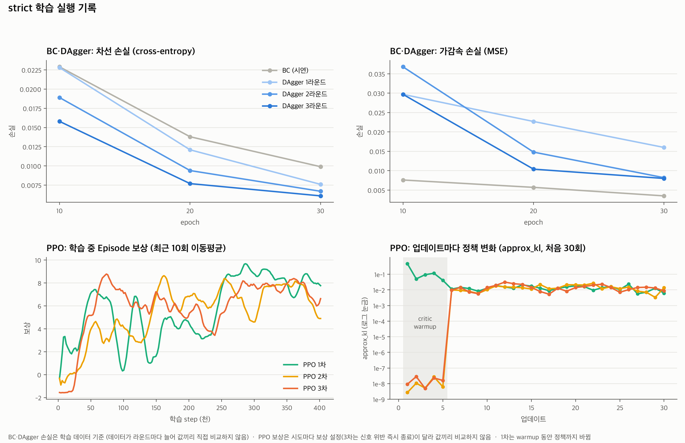
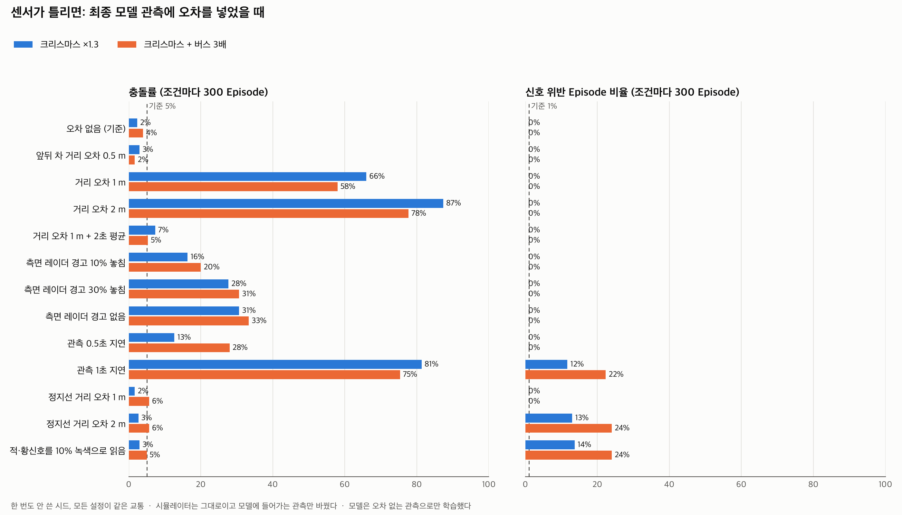

# 4개 비교 실험: BC, BC + DAgger(β = 0), BC + DAgger(β 쿨다운), BC + PPO

네 가지를 같은 환경(보조 규칙 없는 strict 환경, 관측 38차원)에서 같은 시드로 비교했다. expert(규칙)는 상한을 보는 참고용으로 같이 돌렸다.
최종 모델에 대해서는 학습 시드 재현성(4절)과 센서 오차 강건성(5절)도 쟀다.
이 문서는 각각을 **어떤 설정(하이퍼파라미터)으로 돌렸고, 학습이 어떻게 진행됐고, 결과가 어땠는지**를 모은 것이다.
과정과 이유는 [학습_과정_기록.md](학습_과정_기록.md), 결과를 보기 전에 정한 규칙은 [strict/평가_계획.md](strict/평가_계획.md)에 있다.

| 비교 대상 | 역할 | 파일 |
|---|---|---|
| expert (규칙) | 학습 정답을 만드는 운전자. 상한 참고용 | `utils/rule_policy.py` |
| BC | expert 시연을 지도학습 | `models/strict_bc.pt` |
| **BC + DAgger (β = 0)** | BC + 학생이 운전한 상태에 expert 정답을 붙여 3라운드 | **`models/strict_bc_dagger.pt` (최종)** |
| BC + DAgger (β 쿨다운) | 위와 같고, 라운드마다 expert가 일부 스텝을 대신 운전 (β = 0.5 → 0.25 → 0.125). 참고 비교 | `models/strict_bc_dagger_beta.pt` |
| BC + PPO | BC + 보상으로 미세조정, 3번 시도 | `models/strict_bc_ppo3.pt` (3차) |

후보는 BC, BC + DAgger(β = 0), BC + PPO였다. β 쿨다운은 평가 계획(결과를 보기 전)에 "β를 바꾼 것은 후보가 아니라 참고 비교로만 돌린다"고 정해 둔 대로, 최종 모델을 고른 뒤 검증 시드로만 비교했다.

공통 환경: ego 최대 가속 3.0 m/s², 최대 감속 5.4 m/s², 제한속도 13.89 m/s(50 km/h), 1 step = 0.5초, Episode 최대 600 step(300초).

---

## 1. 설정 (하이퍼파라미터)

### 1.1 expert (`utils/rule_policy.py`의 `RulePolicy` 기본값)

| 항목 | 값 | 의미 |
|---|---|---|
| 가감속 | IDM, 차간 시간 1.2초, 최소 간격 2.0 m | 앞차를 따라가는 표준 차량추종 공식 |
| 차로 변경 틈 기준 | 앞 3.0 m + 0.3초 × 접근 속도, 뒤 3.0 m + 0.5초 × 접근 속도 | 옆 차로에 이만큼 틈이 있어야 옮긴다 |
| SUMO 안전 판정 확인 | 켬 | 옮기기 전 SUMO의 차선변경 안전 판정도 확인 (expert만 쓰는 내부 정보) |
| 진입 보호 거리 | 60 m | 진입 도로 처음 60 m에서는 차로를 바꾸지 않는다 |
| 대기 속도 | 5 m/s | 옮겨야 하는데 막히면 이 속도로 줄여 틈을 기다린다 |
| 버스 추월 | 켬 (80 m 앞 정류장 버스) | 정류장 버스가 서 있으면 한 칸 왼쪽으로 지나간 뒤 S2에서 복귀 |
| 신호 정지 | 켬, 정지선 1 m 앞 | 적신호는 IDM으로 정지선 앞에 서고, 황신호는 최대 감속으로 설 수 있으면 선다 (관측 [31]·[32]만 사용) |

### 1.2 BC (`scripts/training/train_strict_model.sh` → `train.py --pretrain`)

| 항목 | 값 |
|---|---|
| 데이터 | expert 시연 1,000 Episode: 평시 400, 크리스마스 400, 크리스마스·버스 3배 200 (수집 시드 141~143) = 384,684 step |
| 신경망 | 수업 PPO 네트워크 (38 → 256 → 256, ReLU, 가감속·차선 3갈래·가치 head), 77,062개 파라미터 |
| 최적화 | Adam, 학습률 3e-4, 배치 256, 30 epoch, 시드 0 |
| 손실 | 가감속 MSE + 차선 cross-entropy + 0.5 × 가치 MSE |
| 차선 클래스 가중치 | 왼쪽 20.0 / 유지 1.0 / 오른쪽 12.3 (빈도 역수의 제곱근, 최대 20). 차선 명령은 왼쪽 37, 유지 382,126, 오른쪽 2,521 step |
| 가감속 log σ | −1.0 (평가는 결정적이라 주행에는 영향 없음) |

### 1.3 BC + DAgger (β = 0)

| 항목 | 값 |
|---|---|
| 시작 | 1.2의 BC |
| 라운드 | 3라운드, 라운드마다 400 Episode (평시 150, 크리스마스 150, 버스 3배 100) |
| 운전 | 직전 라운드 모델이 결정적으로 운전, β = 0 (expert는 운전하지 않음) |
| 정답 | 매 스텝 expert가 그 상태에서 낼 행동 |
| 데이터 | 누적 (라운드 1: 532,641 / 2: 686,160 / 3: 840,864 step) |
| 학습 | 라운드마다 누적 데이터 전체로 처음부터, 1.2와 같은 설정 |
| 수집 시드 | 151~153, 161~163, 171~173 |

### 1.4 BC + DAgger, β 쿨다운 (`scripts/training/strict_dagger_beta.sh`)

β = 0과 같은 BC에서 출발하고, 수집 시드·Episode 수·조건 비율·학습 설정이 모두 같다. 다른 것은 β 하나다.

| 항목 | 값 |
|---|---|
| β | 라운드 1: 0.5, 2: 0.25, 3: 0.125 (β_i = 0.5^i). 스텝마다 β 확률로 expert가 대신 운전 |
| 정답 | β와 상관없이 매 스텝 expert의 행동 |
| 실제로 expert가 운전한 비율 | 50.2% / 25.0% / 12.5% |
| 데이터 | 누적: 1라운드 538,873 / 2라운드 691,861 / 3라운드 845,962 step |
| 수집 시드 | β = 0과 같음 (151~153, 161~163, 171~173) |

β는 DAgger 논문(Ross, Gordon, Bagnell 2011)의 유일한 하이퍼파라미터다. 처음에는 expert가 많이 운전해 학생이 크게 벗어나지 않게 하고, 라운드마다 줄여 학생이 실제로 들어가는 상태를 모은다.

### 1.5 BC + PPO (`scripts/training/train_strict_ppo.sh`)

| 항목 | 1차 | 2차 | 3차 |
|---|---|---|---|
| 시작 | 1.2의 BC | 같음 | 같음 |
| 학습량 | 40만 step (196 업데이트) | 같음 | 같음 |
| 학습률 | 5e-5 | 같음 | 같음 |
| rollout / epoch / minibatch | 2048 / 10 / 64 | 같음 | 같음 |
| γ / GAE λ / clip ε | 0.99 / 0.95 / 0.2 | 같음 | 같음 |
| 가치 손실 계수 / gradient clip | 0.5 / 0.5 | 같음 | 같음 |
| 엔트로피 (전체 / 차선만) | 0 / 0.01 | 같음 | 같음 |
| 초기 가감속 log σ | −1.5 | 같음 | 같음 |
| BC 정규화 | 0.1 (expert 시연 384,684 step) | 같음 | 같음 |
| critic warmup | 5번, 몸통까지 바뀜 | 5번, **가치 출력층만** | 5번, 가치 출력층만 |
| 학습 조건 | 평시·크리스마스 섞기, 버스 3배 | 같음 | 같음 |
| 보상 | 속도 0.1, 시간 −0.02(신호 ① 뒤부터), 근접 −0.1, 충돌·경로 이탈 −5, 신호 위반 −5, 도착 +2 | 같음 | 같음 + **신호 위반 시 즉시 종료** |
| 평가에 쓴 모델 | 마지막 모델 | 같음 | 같음 |

원래 설정 그대로 쓴 것(train.py 기본값)과 바꾼 것의 이유는 [모델_설계_정리.md 2.4절](모델_설계_정리.md).

---

## 2. 실행 기록

### 2.1 걸린 시간 (맥북)

| 실행 | 걸린 시간 | 비고 |
|---|---|---|
| expert 시연 수집 + BC | 약 40분 | 8병렬 수집 |
| DAgger 3라운드 | 라운드당 약 19분, 합계 약 1시간 | 라운드마다 수집 + 처음부터 학습 |
| DAgger β 쿨다운 3라운드 | 라운드당 약 19분, 합계 약 1시간 | β = 0과 같음 |
| PPO 1차 / 2차 / 3차 | 약 1시간 40분 / 1시간 30분 / 1시간 25분 | 1차는 DAgger와 동시에 실행 |
| 검증 평가 (모델마다 1,200 Episode) | 약 15분 | 10병렬 |
| 최종 평가 (3모델 × 1,200 Episode) | 약 35분 | 10병렬 |

### 2.2 학습 곡선

**BC·DAgger** (학습 데이터 기준, 따로 떼어 둔 검증 데이터는 없음. 데이터가 라운드마다 늘어서 값끼리 직접 비교하지 않음):

| 학습 | 데이터 | 가감속 MSE (10 → 30 epoch) | 차선 CE (10 → 30 epoch) | 차선 변경 재현율 | 불필요한 차선 변경 |
|---|---|---|---|---|---|
| BC | 384,684 | 0.0076 → 0.0035 | 0.0229 → 0.0099 | 99% | 0.11% |
| DAgger 1라운드 | 532,641 | 0.0297 → 0.0160 | 0.0228 → 0.0076 | 99% | 0.10% |
| DAgger 2라운드 | 686,160 | 0.0368 → 0.0082 | 0.0189 → 0.0067 | 100% | 0.17% |
| DAgger 3라운드 | 840,864 | 0.0297 → 0.0080 | 0.0158 → 0.0061 | 100% | 0.12% |
| β 쿨다운 1라운드 | 538,873 | 0.0173 → 0.0130 | 0.0207 → 0.0083 | 100% | 0.25% |
| β 쿨다운 2라운드 | 691,861 | 0.0209 → 0.0136 | 0.0182 → 0.0071 | 99% | 0.25% |
| β 쿨다운 3라운드 | 845,962 | 0.0172 → 0.0130 | 0.0159 → 0.0066 | 99% | 0.14% |

- 차선 변경 재현율: expert가 차로를 바꾼 스텝에서 모델도 같은 방향을 고른 비율. 불필요한 차선 변경: expert가 유지한 스텝에서 모델이 바꾼 비율.
- DAgger 라운드부터 가감속 손실이 BC보다 큰 것은, 학생이 실수한 상태(정지선 앞, 출구 차로 앞 등)에서 expert가 급감속 같은 큰 행동을 낸 데이터가 들어왔기 때문으로 본다 (따로 나눠 재지는 않았다). 이 상태들이 바로 DAgger로 메우려던 부분이다.
- 학습 데이터 손실만으로는 BC와 DAgger의 차이가 보이지 않는다. 차이는 학생이 직접 운전할 때 드러난다 (3절).

**DAgger 수집 중 운전한 모델의 실수** (라운드마다 400 Episode, 학습용 시드라 추세 확인용):

| 라운드 | β = 0: 충돌 / 경로 이탈 / 신호 위반 | β 쿨다운: 충돌 / 경로 이탈 / 신호 위반 |
|---|---|---|
| 1 (BC가 운전) | 4 / 14 / **42** | 3 / 1 / 0 (expert가 50% 운전) |
| 2 | 4 / 0 / 1 | 4 / 0 / 4 (expert 25%) |
| 3 | 0 / 1 / 0 | 7 / 1 / 0 (expert 12.5%) |

- β = 0은 1라운드에서 BC가 혼자 운전해 BC의 실수(적신호에 기어 나가기 42회, 출구 차로 놓치기 14회)를 그대로 데이터에 담았다. 그 상태마다 expert의 정답이 붙어, 2라운드부터 실수가 거의 사라졌다.
- β 쿨다운은 expert가 절반을 운전해서 1라운드에 그런 실수가 거의 나오지 않았다. 대신 β가 줄어든 2·3라운드에서 학생의 실수(신호 위반 4회, 충돌 7회)가 드러나 그때 데이터에 담겼다.

**PPO** (`training_log.csv`, 업데이트 196회):

| 지표 | 1차 | 2차 | 3차 |
|---|---|---|---|
| warmup 1~5번 approx_kl (평균) | 0.155 (최대 0.47) | ≈ 1e-8 | ≈ 1e-8 |
| 6~10번 approx_kl | 0.0118 | 0.0087 | 0.0103 |
| 마지막 20회 approx_kl | 0.0117 | 0.0139 | 0.0156 |
| 마지막 20회 BC 정규화 손실 | 0.042 | 0.031 | 0.029 |
| 마지막 20회 차선 변경 확률 | 0.79% | 0.75% | 0.70% |
| 학습 중 내부 점검 (10,240 step마다 10 Episode, 39번 평균) | 충돌 3.8%, 완주 95.4% | 충돌 3.3%, 완주 96.2% | 충돌 3.1%, 완주 93.6% |

- 1차는 critic warmup 동안 가치와 정책이 공유하는 몸통까지 바뀌어 정책이 흔들렸다 (approx_kl 0.47). 2차부터 가치 출력층만 바꾸자 warmup 동안 정책이 그대로였다 (≈ 1e-8).
- BC 정규화 손실이 2·3차에서 더 낮다. 처음에 흔들리지 않아 BC에서 덜 멀어졌다.
- 학습 중 Episode 보상은 시도마다 보상 설정(3차는 신호 위반 즉시 종료)이 달라 값끼리 비교하지 않는다.
- 내부 점검은 학습 중 상태 확인용이고 모델 선택에는 쓰지 않았다 (평가는 마지막 모델, 검증 시드로).

원본: [strict/run_logs/](strict/run_logs/) (`train.py` 인자, PPO 로그 csv, BC·DAgger 손실, β 쿨다운 손실 `bc_dagger_beta_pretrain.txt`). 그림과 표 다시 만들기: `python scripts/training/summarize_strict_runs.py`

---

## 3. 결과

### 3.1 검증 시드 (441101~441112, 조건마다 300 Episode, 모델 고르기에 사용. expert는 고른 뒤 참고용으로 돌림)

| 조건 | 모델 | 충돌 | 신호 위반 | 경로 이탈 | 시간초과 | 실패 | 복잡 구간 |
|---|---|---|---|---|---|---|---|
| 평시 | expert | 0 | 0 | 0 | 0 | 0 | 14.97초 |
| | BC | 0 | 6 | 2 | 0 | 6 | 15.11초 |
| | **BC + DAgger** | 0 | 0 | 0 | 0 | **0** | 15.18초 |
| | β 쿨다운 (참고) | 0 | 0 | 0 | 0 | 0 | 15.19초 |
| | PPO 1차 / 2차 / 3차 | 3 / 1 / 0 | 9 / 13 / 0 | 10 / 6 / 0 | 0 / 0 / 0 | 22 / 17 / 0 | 15.78 / 15.33 / 15.91초 |
| 크리스마스 | expert | 0 | 0 | 0 | 0 | 0 | 21.07초 |
| | BC | 6 | 42 | 13 | 0 | 45 | 20.86초 |
| | **BC + DAgger** | 1 | 0 | 0 | 0 | **1** | 21.08초 |
| | β 쿨다운 (참고) | 3 | 1 | 0 | 0 | 4 | 20.80초 |
| | PPO 1차 / 2차 / 3차 | 5 / 7 / 3 | 13 / 4 / 5 | 4 / 4 / 1 | 0 / 0 / 0 | 21 / 14 / 8 | 21.38 / 19.80 / 21.76초 |
| 크리스마스 ×1.3 | expert | 0 | 0 | 4 | 0 | 4 | 24.74초 |
| | BC | 12 | 26 | 9 | 0 | 38 | 24.34초 |
| | **BC + DAgger** | 7 | 0 | 0 | 1 | **8** | 24.69초 |
| | β 쿨다운 (참고) | 6 | 0 | 0 | 0 | 6 | 24.17초 |
| | PPO 1차 / 2차 / 3차 | 23 / 21 / 6 | 6 / 2 / 3 | 1 / 1 / 0 | 0 / 1 / 0 | 30 / 25 / 9 | 24.64 / 23.82 / 25.36초 |
| 버스 3배 | expert | 1 | 0 | 0 | 0 | 1 | 22.06초 |
| | BC | 16 | 54 | 11 | 0 | 64 | 22.39초 |
| | **BC + DAgger** | 13 | 0 | 1 | 0 | **14** | 21.80초 |
| | β 쿨다운 (참고) | 7 | 0 | 0 | 0 | 7 | 21.77초 |
| | PPO 1차 / 2차 / 3차 | 21 / 13 / 9 | 10 / 4 / 5 | 0 / 1 / 1 | 0 / 0 / 0 | 29 / 17 / 15 | 22.85 / 22.05 / 24.04초 |

합계 (1,200 Episode):

| 모델 | 충돌 | 신호 위반 Episode | 경로 이탈 | 시간초과 | 실패 | 복잡 구간 | 선정 규칙 |
|---|---|---|---|---|---|---|---|
| expert | 1 (0.1%) | 0 | 4 | 0 | 5 | 20.69초 | (참고) |
| BC | 34 (2.8%) | 128 (10.7%) | 35 | 0 | 153 | 20.46초 | 신호 위반 탈락 |
| **BC + DAgger (β = 0)** | 21 (1.8%) | **0** | 1 | 1 | **23** | 20.65초 | **통과 → 선정** |
| BC + DAgger (β 쿨다운) | 16 (1.3%) | 1 (0.1%) | 0 | 0 | 17 | 20.46초 | (참고, 후보 아님) |
| PPO 1차 | 52 (4.3%) | 38 (3.2%) | 15 | 0 | 102 | 21.13초 | 신호 위반 탈락 |
| PPO 2차 | 42 (3.5%) | 23 (1.9%) | 12 | 1 | 73 | 20.22초 | 신호 위반 탈락 |
| PPO 3차 | 18 (1.5%) | 13 (1.1%) | 2 | 0 | 32 | 21.71초 | 신호 위반 탈락 (1회 차이) |

복잡 구간은 실패 없이 도착한 Episode의 평균이다. 실패 = 충돌·신호 위반·경로 이탈·시간초과 중 하나라도 있는 Episode.

β 쿨다운이 처음부터 후보였다면, 규칙(실패 차이 6회 이내면 시간이 짧은 쪽)에 따라 β 쿨다운이 선정됐을 것이다. 결과를 보기 전에 참고 비교로 정해 두었으므로 최종 모델은 β = 0 그대로이고, β 쿨다운은 처음 쓰는 시드로 평가하지 않았다 (최종 평가 시드는 한 번만 쓴다). 전체 표: [strict/val/selection_with_beta.txt](strict/val/selection_with_beta.txt)

### 3.2 최종 평가 (처음 쓰는 시드 2026111721~32, 한 번만)

| 조건 | 모델 | 충돌 | 신호 위반 | 경로 이탈 | 시간초과 | 실패 | 복잡 구간 |
|---|---|---|---|---|---|---|---|
| 평시 | BC | 1 | 5 | 0 | 0 | 6 | 15.00초 |
| | **BC + DAgger** | 0 | 0 | 0 | 0 | **0** | 14.91초 |
| | PPO 3차 | 1 | 0 | 0 | 0 | 1 | 15.59초 |
| 크리스마스 | BC | 8 | 49 | 14 | 0 | 56 | 22.59초 |
| | **BC + DAgger** | 2 | 0 | 0 | 0 | **2** | 21.89초 |
| | PPO 3차 | 5 | 3 | 0 | 0 | 7 | 23.12초 |
| 크리스마스 ×1.3 | BC | 18 | 29 | 9 | 0 | 44 | 25.99초 |
| | **BC + DAgger** | 5 | 0 | 0 | 1 | **6** | 25.39초 |
| | PPO 3차 | 10 | 2 | 0 | 0 | 12 | 27.53초 |
| 버스 3배 | BC | 11 | 42 | 12 | 0 | 49 | 23.39초 |
| | **BC + DAgger** | 12 | 0 | 0 | 0 | **12** | 22.74초 |
| | PPO 3차 | 9 | 5 | 0 | 0 | 13 | 24.88초 |

합계: BC 실패 155 (충돌 38, 신호 위반 125), **BC + DAgger 실패 20 (충돌 19, 신호 위반 0)**, PPO 3차 실패 33 (충돌 25, 신호 위반 10).
같은 Episode끼리 뺀 복잡 구간 시간: BC + DAgger − BC = −0.34 ±0.30초, PPO − BC + DAgger = +1.40 ±0.42초.

### 3.3 정리

| 비교 | 결과 |
|---|---|
| DAgger β = 0 vs β 쿨다운 | 통계적으로 차이 없음. 실패 23 대 17, 시간 차이 −0.21 ±0.26초 (β 쿨다운 − β = 0, 1,166쌍). 같은 Episode에서 β = 0만 실패 17번, β 쿨다운만 실패 11번(짝 부호 검정 p = 0.35). 이 도로에서는 β를 0으로 두든 줄여 가든 결과가 비슷했다. 시연 1,000 Episode가 이미 논문의 "1라운드 β = 1" 역할을 해서 그 뒤 β를 섞는 효과가 작았던 것으로 본다 |
| BC vs BC + DAgger | DAgger가 BC의 두 실수(적신호에 기어 나가기, 출구 차로 놓치기)를 없앴다. 신호 위반 125 → 0, 경로 이탈 35 → 0 (최종 평가). 시간도 0.34초 빠르다 |
| BC + DAgger vs BC + PPO | PPO는 3번 고쳐 실패를 102 → 32로 줄였지만 신호 위반이 1% 안팎 남았고, 1.40초 느렸다. 신호 위반을 벌점으로만 배워서, 정지선 앞 작은 가속 차이를 고치기 어려웠다 |
| BC + DAgger vs expert | 시간(+0.06 ±0.27초)과 신호 준수(둘 다 0)는 같은 수준이다. 충돌은 expert 1회, 최종 모델 21회로 많다. expert는 옆 차로의 실제 틈을 SUMO에서 읽고, 학생은 관측 38칸만 본다 |
| 검증 vs 최종 평가 | 세 모델의 순서(실패: DAgger < PPO 3차 < BC)가 그대로 나왔다. 검증 시드에 맞춰진 선택이 아니었다 |

원본 (Episode별 JSON): [strict/val/](strict/val/), [strict/expert_val/](strict/expert_val/), [strict/final_eval/](strict/final_eval/). 표 다시 만들기: `python scripts/training/strict_select.py` (검증), `--final` (최종 평가).

---

## 4. 재현성: 학습 시드를 바꿔 다시 학습 (`scripts/training/strict_seed_repro.sh`)

최종 모델(BC + DAgger β = 0)과 같은 데이터(840,864 step)·같은 설정으로 학습 시드만 1, 2로 바꿔 다시 학습했다 (`--hparam seed=1`, `seed=2`). DAgger 수집은 다시 하지 않아 학습 시드에 따른 흔들림만 잰다. 검증 시드 1,200 Episode.

| 학습 시드 | 충돌 | 신호 위반 | 경로 이탈 + 시간초과 | 실패 | 복잡 구간 | 같은 Episode 시간 차이 (시드 0 대비) |
|---|---|---|---|---|---|---|
| **0 (최종 모델)** | 21 (1.8%) | 0 | 2 | 23 | 20.65초 | |
| 1 | 11 (0.9%) | 0 | 1 | 12 | 20.72초 | +0.10 ±0.24초 |
| 2 | 16 (1.3%) | 0 | 1 | 17 | 20.41초 | −0.24 ±0.29초 |

| 학습 (30 epoch, 학습 데이터 기준) | 가감속 MSE | 차선 CE | 차선 변경 재현율 | 불필요한 차선 변경 |
|---|---|---|---|---|
| 시드 0 | 0.0080 | 0.0061 | 100% | 0.12% |
| 시드 1 | 0.0059 | 0.0070 | 97% | 0.09% |
| 시드 2 | 0.0081 | 0.0055 | 99% | 0.10% |

- 신호 위반 0과 시간은 재현되고, 충돌은 0.9~1.8%로 흔들린다. 최종 모델(시드 0)이 셋 중 충돌이 가장 많다.
- β 쿨다운(충돌 16, 실패 17)도 이 범위 안이라, β 설정 차이보다 학습 시드 흔들림이 비슷하거나 크다.

## 5. 센서 오차 강건성 (`eval_sensor_noise.py`, `scripts/training/strict_sensor_noise.sh`)

최종 모델에 들어가는 관측에만 오차를 넣었다. 한 번도 쓰지 않은 시드(442001~3, 442011~3), 조건마다 300 Episode, 모든 설정이 같은 교통.

| 설정 | 넣은 오차 |
|---|---|
| 거리 오차 | 앞뒤 차 거리에 표준편차 0.5·1·2 m, 상대속도에 그 절반(m/s)의 가우시안 잡음 (차가 있을 때만) |
| 2초 평균 | 위 오차 값을 최근 4스텝 평균으로 씀 (실제 센서의 추적 필터에 해당) |
| 측면 레이더 | 막힘 경고 [33]·[34]가 켜져야 할 때 10%·30% 확률로 꺼짐, 또는 항상 꺼짐 |
| 지연 | 관측 전체가 1·2스텝(0.5·1초) 늦게 들어옴 |
| 정지선 거리 | [32]에 표준편차 1·2 m 잡음 |
| 신호 오인 | 적·황신호 [31]가 스텝마다 10% 확률로 녹색으로 읽힘 |

| 넣은 오차 | ×1.3 충돌 | ×1.3 신호 위반 | 버스 3배 충돌 | 버스 3배 신호 위반 |
|---|---|---|---|---|
| 없음 (기준) | 2% | 0% | 4% | 0% |
| 앞뒤 차 거리 오차 0.5 m | 3% | 0% | 2% | 0% |
| 거리 오차 1 m | 66% | 0% | 58% | 0% |
| 거리 오차 2 m | 87% | 0% | 78% | 0% |
| 거리 오차 1 m + 최근 2초 평균 | 7% | 0% | 5% | 0% |
| 측면 레이더 경고 10% 놓침 | 16% | 0% | 20% | 0% |
| 측면 레이더 경고 30% 놓침 | 28% | 0% | 31% | 0% |
| 측면 레이더 경고 없음 | 31% | 0% | 33% | 0% |
| 관측 0.5초 지연 | 13% | 0% | 28% | 0% |
| 관측 1초 지연 | 81% | 12% | 75% | 22% |
| 정지선 거리 오차 1 m | 2% | 0% | 6% | 0% |
| 정지선 거리 오차 2 m | 3% | 13% | 6% | 24% |
| 적·황신호를 10% 녹색으로 읽음 | 3% | 14% | 5% | 24% |

- **앞뒤 차 거리:** 0.5 m까지는 기준과 같고, 1 m부터 충돌이 58~66%로 크게 늘었다. 충돌은 대부분 신호 대기 줄에서 앞차가 실제보다 멀어 보일 때 출발해 앞차를 받는 것이다. 최근 2초(4스텝)를 평균 내서 쓰면 5~7%로 크게 회복된다.
- **측면 레이더:** 경고를 10%만 놓쳐도 충돌이 16~20%가 된다. 모델이 차로 변경 안전을 이 경고에 크게 맡긴다는 뜻이다.
- **지연:** 0.5초 늦으면 13~28%, 1초 늦으면 75~81%이고 신호 위반도 생긴다.
- **신호 (새 모델에서 새로 잰 것):** 정지선 거리 오차 1 m는 괜찮지만 2 m면 신호 위반이 13~24%다. 적·황신호를 10% 확률로 녹색으로 잘못 읽어도 신호 위반이 14~24%다. 모델이 신호 관측을 그대로 믿는다.
- **해석:** 정확한 관측으로만 학습한 정책이라 실제 차에 그대로는 쓸 수 없다. 쓰려면 학습할 때 관측에 오차를 섞거나, 센서 값을 걸러 쓰는 단계(위 2초 평균처럼)가 필요하다. expert는 SUMO 내부 정보를 직접 읽어서 이 실험 자체를 할 수 없다.
- 오차는 0.5초마다 따로 뽑아서, 측정을 걸러 쓰는 실제 센서보다 가혹한 조건이다. 복잡 구간 시간은 실패한 Episode가 빠져서 설정끼리 비교하지 않는다.

원본: [strict/sensor_noise/](strict/sensor_noise/), 표: [strict/sensor_noise/summary.txt](strict/sensor_noise/summary.txt)
