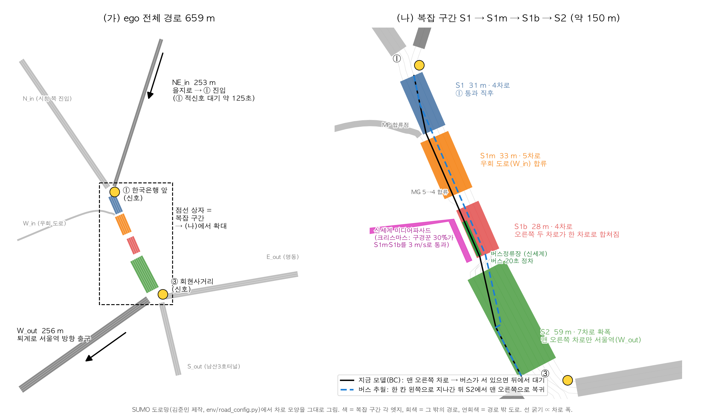
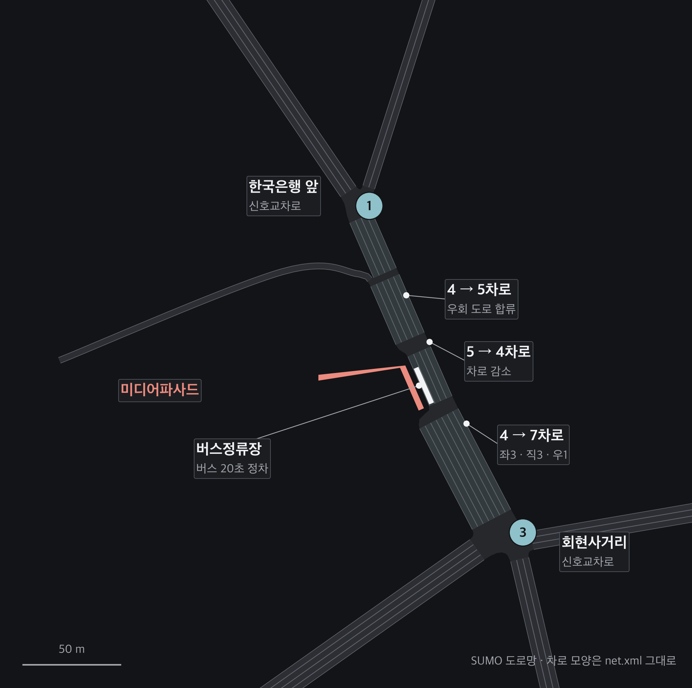
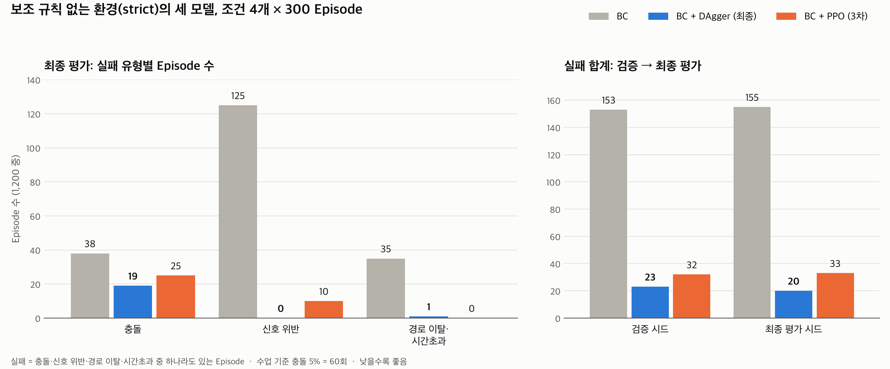
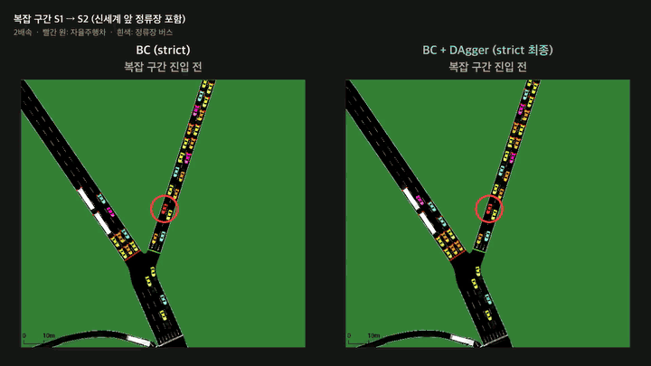
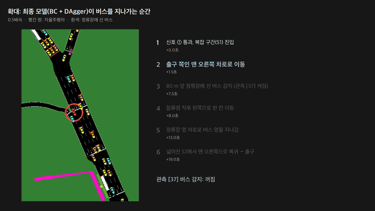
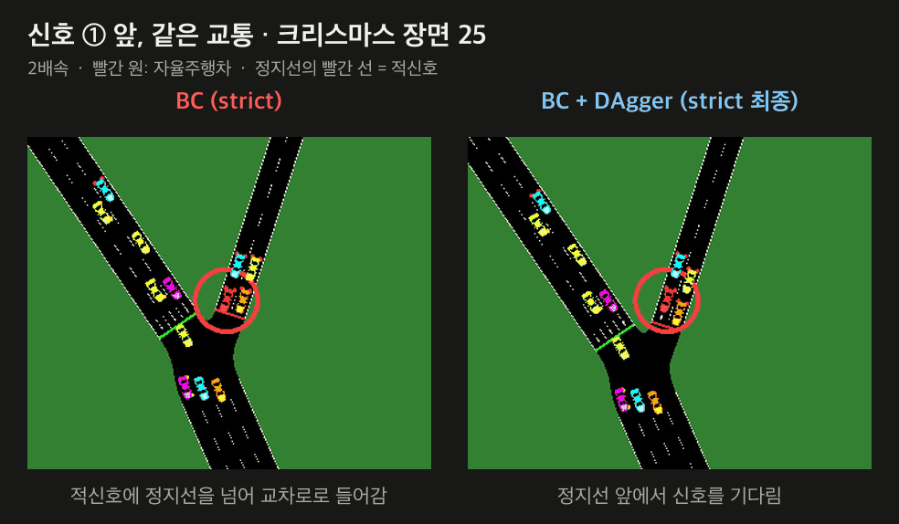
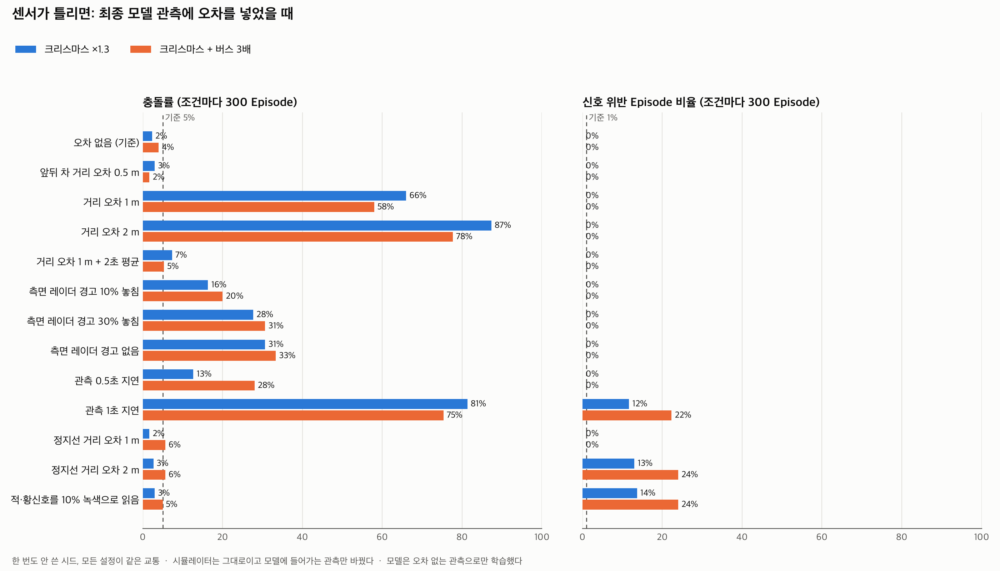

# 명동 소공로 자율주행 — AV 모델 학습 과정 기록

이 문서는 학습 과정 전체를 시간 순서대로 적은 것이다. 무엇을 왜 했는지, 무엇이 실패했는지, 결과 수치를 남긴다.
`results/`와 `data/`는 용량 때문에 저장소에 올리지 않는다. 검증·최종 평가 원본은 `docs/training/strict/`에 있다.

최종 모델은 **`models/strict_bc_dagger.pt`** (expert 시연 BC + DAgger 3라운드, 관측 38차원)다.
교수님 Q&A를 보고 SUMO의 운전 보조를 모두 끈 환경(이 문서에서 strict라고 부른다)에서 처음부터 다시 만든 모델이다.
그 전 환경에서 한 실험은 2~3절에 순서와 결론만 남겼다. 그 환경의 수치는 지금 환경과 조건이 달라 직접 비교하지 않는다.

---

## 0. 한눈에 보기

| 단계 | 한 일 | 결과 |
|---|---|---|
| 1 | 처음부터 PPO (보상 설계 3종) | 실패. 충돌 7~42% 또는 기어가다 시간초과 |
| 2 | 관측 33 → 36 → 37차원 + 규칙 기반 시연(BC) + DAgger + 버스 추월 시연 | 잘 됐다. 충돌 0~0.3%, 버스를 만나면 약 10초 단축. 그 위에 PPO 미세조정은 효과 없음 |
| 3 | **교수님 Q&A: 보조 규칙 금지, 라우팅은 지도 수준만** | 2단계 환경에 걸리는 것 5가지를 찾음 (SUMO 신호 정지, 차선 단위 안내, SUMO 차선변경 판정, 시작 차로, 교차로 충돌 검사) |
| 4 | 환경 수정, 관측 37 → 38차원 (차선 단위 안내 → 회전 방향·거리, 측면 레이더) | SUMO 보조 없이 모델이 직접 신호를 보고 서야 한다 |
| 5 | 평가 계획을 결과보다 먼저 씀 (시드 3종, 선정 규칙) | `strict/평가_계획.md` |
| 6 | expert(규칙) 고치고 점검 (적·황신호 정지 추가) | 기준 통과 (조건마다 100 Episode: 충돌 0~2, 신호 위반 0) |
| 7 | 처음부터 다시: expert 시연 → BC | 신호 위반 10.7%, 경로 이탈 35회 (검증) |
| 8 | BC → DAgger 3라운드 | 신호 위반 0, 실패 23 (검증) |
| 9 | BC → PPO 미세조정, 계획에서 허용한 3번 | 실패 102 → 73 → 32. 신호 위반이 1% 안팎 남아 기준 탈락 |
| 10 | 검증 시드로 선정 | BC + DAgger (기준을 넘은 유일한 후보) |
| 11 | **처음 쓰는 시드로 최종 평가 한 번** | 최종 모델 충돌 1.6% (평가 반복 3회 1.58 ± 0.38%), 신호 위반 0, 실패 20/1,200. 세 모델 중 가장 좋고 가장 빠름 |
| 12 | 분석: PPO가 안 된 이유, expert와 비교, 버스 장면, 신호 위반 장면, DAgger β 쿨다운(참고), 재현성, 센서 오차 | 시간·신호 준수는 expert와 같은 수준, 충돌은 expert(1/1,200)보다 많음(21/1,200) |

---

## 1. 출발점: 받은 것과 목표

### 1.1 받은 도로·환경 코드

- 도로망 `env/road_config.py`, `env/road_builder.py`:
  - 구간 S1~S2, 차로, 연결, 합류점
  - 신호 ①③, 버스 노선·정류장(20초 정차)
  - 크리스마스(교통량 1.5배, 구경꾼 30%가 S1m·S1b를 3 m/s로 통과, 신호 변경)
- ego 경로: 을지로(NE_in) → ① → S1 → S1m → S1b → S2 → ③ → 퇴계로 서울역(W_out), 659 m
- 관측 33차원: 교수님 기본 31 + [31] 신호 상태, [32] 정지선까지 거리

수업 코드(교수님)인 `SumoHighwayEnv`, PPO, BC, 데이터 수집기를 그대로 쓰고, 버그만 고쳤다 (2.1절).

### 1.2 도로 구간



위성사진과 같은 범위 · 축척으로 그린 SUMO 도로망 (차로 모양은 net.xml 그대로, `python scripts/training/plot_road_network.py <net.xml> <출력.png>`):



| 구간 | 길이 | 특징 |
|---|---|---|
| NE_in | 253 m | 을지로 → ① 진입. **① 적신호 대기 약 125초** |
| S1 | 31 m | ① 통과 직후 4차로 |
| S1m | 33 m | 우회 도로(W_in) 합류, 5차로 |
| S1b | 28 m | 오른쪽 두 차로가 하나로 합침. **버스정류장(맨 오른쪽 차로 7~27 m)** |
| S2 | 59 m | 7차로 확폭. **맨 오른쪽 차로만 서울역(W_out)** |
| W_out | 256 m | 출구 |

"복잡 구간" = S1 → S1m → S1b → S2 (약 150 m). 막힘이 없으면 약 13초 걸린다.
전체 도착시간 약 190초 중 약 125초는 ① 적신호 대기라 운전으로 줄일 수 없다. 그래서 시간은 복잡 구간으로 비교한다.

### 1.3 평가 기준 (수업)

- 100 Episode 충돌 5% 미만
- 목적지 도달 (비정상 정지·경로 이탈·무한 대기 없음)
- HV 충분, 데이터 10^7, 30초 이상 영상

### 1.4 목표

1. **안전하게** 목적지 도착 (충돌, 신호 위반, 경로 이탈 없이)
2. 그 위에서 **복잡 구간을 빨리 통과** ("퇴근길에 복잡한 구간을 빨리 지나 집에 가서 쉬기")

---

## 2. 첫 시도: 처음부터 PPO — 실패

보상: 속도 보상 + 시간 벌점 0.02/스텝 + 도착 +2 / 충돌 −5 / 경로 이탈 −5. 30만 스텝, 평가는 100 Episode.

| 실험 | 보상 | 평시 완주 / 충돌 | 크리스마스 완주 / 충돌 |
|---|---|---|---|
| p1 | 시간 벌점 0.02 | 83% / 7% | 79% / 17% |
| p2 | + 목표 차로 잠재함수 shaping | 66% / 21% | 47% / 42% |
| p3 | + 충돌 벌점 10 | 도착 0% (기어가다 시간초과) | — |

무작위 차선 변경 → 충돌 → "움직이지 않기"로 굳는 전형적인 실패다. 그래서 행동을 직접 보여 주는 모방학습으로 방향을 바꿨다.

### 2.1 함께 고친 수업 코드 버그

- `sumo_env.py`: 충돌로 제거된 ego가 SUMO 도착 목록에도 올라가 '도착'으로 세던 것. 학습 안 된 PPO가 30/30 도착으로 나왔다. 충돌이 아닐 때만 도착으로 센다.
- `ppo.py`: 시간초과(truncated)를 Episode 끝으로 처리
- 평가 시드 분리: `test.py`가 모델을 불러올 때 시드가 0으로 초기화돼 평가 교통이 수집 때와 같은 순서로 나왔다 → `--eval-seed` 추가
- 실행마다 도로 파일을 따로 만든다 (`env/cli.private_sumo_dir`). 학습 중에 다른 평가를 돌리면 도로 파일이 덮어써지는 문제가 있었다.

---

## 3. 관측 확장 + 모방학습 — 잘 됐다 (교수님 Q&A 이전 환경)

이 단계는 SUMO가 적신호 정지와 교차로 양보를 대신 해 주던 환경(speedMode 24)에서 했다. 순서와 결론만 남긴다.

1. **관측 33 → 36차원.** 옆 차로 관측은 SUMO `getNeighbors` 값이라 바로 옆 약 2.5 m 안의 차가 "없음"으로 나왔다 (관측만 믿는 규칙은 충돌 7~13%). 그래서 [33]·[34] 옆 차로 막힘(사각지대 경고)과 [35] 경로상 옮겨야 할 차로 수(내비게이션 차로 안내)를 넣었다.
2. **규칙 기반 운전자(expert) 시연 → BC.** 가감속 IDM, 차선은 경로상 필요할 때 틈이 충분하면 옮긴다. 36차원 BC는 33차원 BC보다 크리스마스 충돌이 26% → 7%로 줄었고, 크리스마스 시연을 섞자 1%가 됐다. BC 위의 PPO 미세조정은 개선이 없었다.
3. **충돌 진단 → expert 개선 → DAgger.** 처음 보는 혼잡(크리스마스 + 교통량 1.3배)에서 BC 충돌이 8%였다. expert의 차선 변경 확인을 고치고 DAgger 3라운드를 하자 0~1%가 됐다.
4. **시간 단축을 PPO로 6가지 시도 → 효과 없음.** 원인을 보니 시간 손실의 주범은 정류장에 20초 서는 버스 뒤 대기였고, 관측에 그 정보가 없었다.
5. **관측 [36] 정류장 버스 정차 (37차원) + 버스를 추월하는 expert 시연 → BC·DAgger.** 크리스마스에서 버스를 만난 Episode가 36.2초 → 22.9초로 줄었다. 이 모델(v3_3) 위의 PPO 미세조정, PPO가 추월을 스스로 찾는지 본 실험은 모두 효과가 없었다.
6. v3_3를 처음 쓰는 시드로 한 번 평가했고, 조건마다 300 Episode에서 충돌 0~1회였다.

여기서 배운 것은 지금 모델에도 그대로 이어진다.
- 처음부터 RL은 이 도로에서 안 됐고, expert 시연으로 시작하는 모방학습이 됐다.
- BC 혼자로는 expert가 안 가 본 상태에서 실수가 커지고, DAgger가 그것을 메웠다.
- 줄일 수 있는 시간은 버스 장면에 있고, 추월은 시연으로 가르쳐야 배웠다. PPO는 탐험으로 그 행동을 찾지 못했다.

---

## 4. 교수님 Q&A와 환경 수정

### 4.1 Q&A 내용과 걸린 것

- 보조 규칙이나 운전을 도와주는 요소를 넣으면 안 된다.
- 라우팅은 지도 수준만 허용된다. 어느 차로로 가라는 차선 단위 안내는 안 된다.

3절 환경을 다시 보니 다섯 가지가 걸렸다.

| 항목 | 예전 | 지금 (strict) | 이유 |
|---|---|---|---|
| ego `speed_mode` | 24: 적신호 정지·교차로 우선권을 SUMO가 대신 함 | 0: SUMO 보조 없음 (수업 원본과 같음) | 보조 규칙 금지 |
| 경로 안내 관측 [35] | 목표 차로까지 칸 수 | [35] 다음 회전 방향, [36] 회전 지점까지 거리 | 차선 단위 안내 금지, 지도 수준 라우팅 허용 |
| 옆 차로 관측 [33]·[34] | 옆 차로 훑기 + SUMO 차선변경 판정(`couldChangeLane`) | 측면 레이더: ego 옆 띠 안 차의 위치·속도로만 판정 | SUMO 규칙의 판단 결과를 관측으로 주지 않음 |
| ego 시작 차로 | `best`: SUMO가 경로에 맞는 차로를 골라 줌 | `random`: 진입 도로 2차로 중 무작위 | 경로 정보로 자리를 잡아 주지 않음 |
| 교차로 안 충돌 검사 | 꺼짐 (SUMO 기본값) | 켬 (`--collision.check-junctions true`) | ego가 교차로에서 스스로 양보해야 하므로 교차로 안 충돌을 빠짐없이 센다 |

모델(신경망)이 직접 신호를 보고 서야 하므로, 예전 모델을 그대로 쓸 수 없다. 데이터와 모델을 처음부터 다시 만들었다.

### 4.2 관측 37 → 38차원

| 칸 | 내용 | 실제 차량 대응 |
|---|---|---|
| [0..30] | 수업 기본 (내 속도, 주변 차로 앞뒤 차 거리·상대속도, 차로 연결성, 차로별 밀도) | |
| [31], [32] | 다음 신호 상태, 정지선까지 거리 | 신호 인식 카메라 |
| [33], [34] | 왼쪽·오른쪽 측면 레이더: 옆 0.5~1.5 차로 폭 띠 안에서, 진행 방향 차이 30° 이하인 차와의 앞뒤 간격이 3 m + 1초 × 접근 속도보다 짧으면 1 | 사각지대 경고(BSM) |
| [35] | 다음 회전 방향 (왼쪽 +1, 오른쪽 −1). 남은 회전이 없으면 0 | 내비게이션 |
| [36] | 회전 지점(회전하는 도로의 끝)까지 거리 / 200 m (최대 1). 남은 회전이 없으면 1 | 내비게이션 |
| [37] | 80 m 앞 정류장에 버스 정차 중이면 1 | 카메라 |

회전은 경로의 연결 방향으로 정한다. 이 경로에서 실제로 고를 일이 있는 회전은 ③에서 서울역으로 빠지는 우회전 하나이고, 어느 차로로 가라는 정보는 주지 않는다.

### 4.3 expert 수정과 신호 위반 감지

- expert(`utils/rule_policy.py`)에 적·황신호 정지를 넣었다. 관측 [31]·[32]만 쓴다. 적신호면 정지선 1 m 앞에 서도록 IDM으로 감속하고, 황신호는 최대 감속으로 설 수 있으면 선다.
- 신호 위반 감지: 0.5초 스텝 앞뒤가 모두 적신호(r, R, u)인데 정지선을 넘은 경우만 센다 (신호 id가 바뀐 것으로 판단). 정지선 앞에서 차로만 바꾼 것은 넘은 것이 아니다. 스텝 사이에 신호가 바뀐 경우는 언제 넘었는지 알 수 없어 세지 않는다.
- 보상(PPO에만 씀)에 신호 위반 −5를 넣었다 (충돌과 같은 크기).

---

## 5. 평가 계획을 먼저 쓰기

같은 실수를 반복하지 않으려고, 결과를 보기 전에 시드와 고르는 규칙을 정해 [strict/평가_계획.md](strict/평가_계획.md)에 적었다. 그 뒤로 바꾼 것은 그 문서 끝 변경 기록에 시각과 함께 남겼다.

| 용도 | 시드 | 규칙 |
|---|---|---|
| 개발 점검 (expert 점검, 디버깅) | 441001~441099 | 여기서만 고치고 확인한다 |
| 검증 (모델 고르기, PPO 수정) | 441101~441112 | 평시 01~03, 크리스마스 04~06, ×1.3 07~09, 버스 3배 10~12 |
| 최종 평가 | 2026111721~2026111732 | 고른 뒤 한 번만 |
| 학습 데이터 수집 | 141~143 (시연), 151~173 (DAgger) | 다른 시드와 겹치지 않음 |

고르는 규칙:
1. 검증 시드로 후보 모두 평가 (조건 4개 × 300 Episode = 1,200 Episode)
2. 충돌률 5% 미만이고 신호 위반 Episode 1% 이하인 후보만 남긴다
3. 그중 실패(충돌·신호 위반·경로 이탈·시간초과) Episode가 가장 적은 것. 6회 이내로 비슷하면 복잡 구간 시간이 짧은 것
4. 고른 뒤 최종 평가 시드로 후보 전부를 한 번 평가한다. 그 결과를 보고 모델을 바꾸지 않는다

- 시간초과: Episode는 최대 600 step(300초). 그 안에 도착하지 못하면 실패다.
- PPO는 첫 시도를 포함해 최대 3번까지 설정을 바꿀 수 있다. 바꿀 때는 검증 결과만 보고, 그중 검증 결과가 가장 좋은 하나만 후보로 올린다.

---

## 6. expert 점검

학생은 expert를 따라 배우므로 expert가 먼저 잘 달려야 한다. 개발 시드(441021~441028)로 조건마다 100 Episode를 돌렸다.

| 조건 | 충돌 | 신호 위반 | 경로 이탈 + 시간초과 |
|---|---|---|---|
| 평시 | 0 | 0 | 1 |
| 크리스마스 | 2 | 0 | 0 |
| 크리스마스 ×1.3 | 0 | 0 | 0 |
| 크리스마스 + 버스 3배 | 1 | 0 | 0 |

기준(충돌 2% 이하, 신호 위반 1% 이하, 이탈 3% 이하)을 모두 넘어 학습을 시작했다. 원본: `strict/teacher_check/`

---

## 7. 처음부터 다시: expert 시연 → BC

- 시연: 평시 400, 크리스마스 400, 크리스마스·버스 3배 200 Episode (384,684 step)
- 학습 (`utils/pretrain.py`): PPO 네트워크를 시연에 지도학습. Adam 3e-4, 배치 256, 30 epoch, 시드 0. 손실 = 가감속 MSE + 차선 cross-entropy(클래스 가중, 최대 20) + 0.5 × 가치 MSE
- 결과: `results/strict_0/pretrained_model.pt` = `models/strict_bc.pt`

개발 시드로 간단히 돌려 보니(평시·크리스마스 각 25 Episode) 실수 두 가지가 보였다. 같은 시드로 다시 돌려 원인을 확인했다.
1. **적신호에 기어 나가기:** 신호 ① 정지선 바로 앞(1 m 안)에 서 있다가 앞차가 출발하자 +0.02~+0.2로 살짝 가속해 적신호에 정지선을 넘었다. 같은 순간 expert는 −1.0(최대 감속)이었다.
2. **차로 변경을 놓침:** S2에서 오른쪽 출구 차로가 비어 있는데(expert는 옮김) 옮기지 않아 경로를 이탈했다.

둘 다 expert를 덜 따라 한 모방 오차라, DAgger가 고치려는 바로 그 경우다. 계획대로 진행하고 아무것도 바꾸지 않았다.

---

## 8. BC → DAgger 3라운드

DAgger(Ross, Gordon, Bagnell 2011): 학생이 직접 운전하고, 들어간 상태마다 expert에게 "여기서 너라면?"을 물어 정답을 붙여 데이터에 더한 뒤 다시 학습한다. BC는 expert가 다닌 상태만 보고 배워서, 학생이 조금 벗어나면 처음 보는 상태가 되고 실수가 커진다. DAgger는 그 상태를 데이터에 넣는다.

- 라운드마다 400 Episode (평시 150, 크리스마스 150, 버스 3배 100), 직전 모델이 결정적으로 운전, β = 0 (학생만 운전)
- 데이터는 누적하고, 라운드마다 처음부터 다시 학습한다
- 데이터: 시연 384,684 + 1라운드 147,957 + 2라운드 153,519 + 3라운드 154,704 = 840,864 step
- β = 0인 이유: 논문은 첫 라운드에 β = 1(expert 운전)을 쓰는데, 우리의 시연이 그 역할을 한다. 그 뒤는 학생이 실제로 들어가는 상태를 모으는 것이 목적이라 expert가 끼어들지 않게 했다.

라운드별로 운전한 모델의 실수 (수집 데이터, 라운드마다 400 Episode, 시드가 달라 추세 확인용):

| 라운드 | 운전한 모델 | 충돌 | 경로 이탈 | 신호 위반 Episode |
|---|---|---|---|---|
| 1 | BC | 4 | 14 | 42 |
| 2 | 1라운드 모델 | 4 | 0 | 1 |
| 3 | 2라운드 모델 | 0 | 1 | 0 |

결과: `results/strict_3/pretrained_model.pt` = `models/strict_bc_dagger.pt`

---

## 9. BC → PPO 미세조정, 3번

같은 BC에서 출발한 비교 후보다. 설정은 3절에서 가장 나았던 PPO 설정과 같다.

- 학습률 5e-5, 40만 step, 평시·크리스마스 섞기, 버스 3배, 초기 log σ −1.5
- BC 정규화 0.1 (업데이트마다 expert 시연 따라 하기 손실을 더해 BC에서 너무 멀어지지 않게 함), critic warmup 5번
- 보상: 시간 벌점은 신호 ① 통과 후부터, 신호 위반 −5
- 평가에는 마지막 모델을 쓴다 (학습 중 내부 평가로 고른 best 모델은 쓰지 않음)

| 시도 | 바꾼 것 | 왜 | 검증 실패 |
|---|---|---|---|
| 1차 | 위 설정 그대로 | | 102 |
| 2차 | critic warmup 동안 가치 출력층만 학습 | 1차 학습 로그에서 결함 발견: 가치와 정책이 공유하는 앞단까지 바뀌어 정책이 흔들림(첫 업데이트 approx_kl 0.47, 그 동안 BC 정규화도 꺼짐). 고친 뒤 warmup 동안 approx_kl ≈ 1e-8 | 73 |
| 3차 | 2차 + 학습 중 신호 위반을 즉시 종료(−5)로 처리 | 2차가 기준에서 떨어진 이유가 신호 위반(1.9%) 하나였다. 평가는 종료 없이 끝까지 달리며 위반을 센다 | 32 |

한 번에 하나만 바꿔서 무엇이 효과를 냈는지 알 수 있게 했다. 계획에서 허용한 3번을 다 썼다.

---

## 10. 검증과 선정 (검증 시드, 모델마다 1,200 Episode)

| 모델 | 충돌 | 신호 위반 Episode | 경로 이탈 | 시간초과 | 실패 | 복잡 구간 |
|---|---|---|---|---|---|---|
| BC | 34 (2.8%) | 128 (10.7%) | 35 | 0 | 153 | 20.46초 |
| **BC + DAgger** | 21 (1.8%) | **0 (0.0%)** | 1 | 1 | **23** | 20.65초 |
| BC + PPO 1차 | 52 (4.3%) | 38 (3.2%) | 15 | 0 | 102 | 21.13초 |
| BC + PPO 2차 | 42 (3.5%) | 23 (1.9%) | 12 | 1 | 73 | 20.22초 |
| BC + PPO 3차 | 18 (1.5%) | 13 (1.1%) | 2 | 0 | 32 | 21.71초 |

- 규칙 적용: 충돌 5% 미만은 모두 통과. 신호 위반 1% 이하(12회 이하)는 BC + DAgger 하나 → **선정: BC + DAgger**
- PPO 3차는 신호 위반 13회(1.1%)로 1회 차이로 탈락했다. PPO 후보는 1·2·3차 중 실패가 가장 적은 3차다.
- PPO 3차부터 검증, 선정, 최종 평가까지는 사람이 중간에 고르지 않도록 스크립트 하나(`scripts/training/run_ppo3_and_final.sh`)로 돌렸다.
- 조건별 표와 같은 Episode끼리 뺀 시간 차이: [strict/val/selection_after_ppo3.txt](strict/val/selection_after_ppo3.txt)

---

## 11. 최종 평가 — 처음 쓰는 시드로 한 번

시드 2026111721~32, 조건마다 시드 3개 × 100 Episode. 세 모델이 같은 시드라 Episode마다 교통이 같다.

| 모델 | 충돌 | 신호 위반 Episode | 경로 이탈 | 시간초과 | 실패 | 복잡 구간 |
|---|---|---|---|---|---|---|
| BC | 38 (3.2%) | 125 (10.4%) | 35 | 0 | 155 | 21.48초 |
| **BC + DAgger (최종)** | **19 (1.6%)** | **0 (0.0%)** | **0** | 1 | **20** | **21.19초** |
| BC + PPO (3차) | 25 (2.1%) | 10 (0.8%) | 0 | 0 | 33 | 22.71초 |

평가 반복 3회(시드 묶음 s1 · s2 · s3, 각 4 조건 × 100 = 400 Episode)의 평균 ± 표준편차:

| 모델 | 충돌 % | 신호 위반 % | 실패 % |
|---|---|---|---|
| BC | 3.17 ± 1.76 | 10.42 ± 2.02 | 12.92 ± 2.75 |
| **BC + DAgger (최종)** | **1.58 ± 0.38** | **0.00 ± 0.00** | **1.67 ± 0.38** |
| BC + PPO 3차 | 2.08 ± 0.72 | 0.83 ± 0.29 | 2.75 ± 0.75 |

학습 시드 0 · 1 · 2로 학습한 BC + DAgger 세 모델(검증 시드)은 충돌 1.33 ± 0.42%, 신호 위반 0.00 ± 0.00%, 실패 1.44 ± 0.46%다 (12.6절). 조건별 표: [실험_설정과_결과.md](실험_설정과_결과.md) 3.3절, [strict/seed_stats.txt](strict/seed_stats.txt)

최종 모델, 조건별:

| 조건 | 충돌 | 신호 위반 | 경로 이탈 | 시간초과 | 복잡 구간 |
|---|---|---|---|---|---|
| 평시 | 0/300 | 0 | 0 | 0 | 14.91초 |
| 크리스마스 | 2/300 | 0 | 0 | 0 | 21.89초 |
| 크리스마스 ×1.3 (학습에 안 쓴 조건) | 5/300 | 0 | 0 | 1 | 25.39초 |
| 크리스마스 + 버스 3배 | 12/300 (4.0%) | 0 | 0 | 0 | 22.74초 |



- 검증에서 본 순서(실패: DAgger < PPO 3차 < BC)가 처음 쓰는 시드에서도 그대로 나왔다. 검증 시드에 맞춰진 선택이 아니었다는 근거다.
- 모든 조건에서 충돌이 수업 기준 5% 미만이다. 가장 혼잡한 버스 3배가 4.0%로 가장 높다.
- 같은 Episode끼리 뺀 복잡 구간 시간: 최종 모델 − BC = −0.34 ±0.30초 (1,030쌍), PPO − 최종 모델 = +1.40 ±0.42초 (1,151쌍)
- PPO 3차의 신호 위반은 최종 시드에서 0.8%로 1% 아래지만, 고르는 것은 검증 결과로만 했다. 실패 합계와 시간도 DAgger가 앞선다.
- 원본: [strict/final_eval/](strict/final_eval/), 요약 [strict/final_eval/summary.txt](strict/final_eval/summary.txt)
- 비교 대상의 설정, 학습 곡선, 조건별 표 전체: [실험_설정과_결과.md](실험_설정과_결과.md)

---

## 12. 분석

### 12.1 왜 PPO는 DAgger만큼 안 됐나

- PPO는 신호 위반을 벌점으로만 배운다. 벌점에 즉시 종료까지 더해도(3차) 위반이 1% 안팎 남았다. 위반은 정지선 1 m 앞에서 살짝 가속하는 작은 행동 차이라, 보상만으로는 어느 순간이 문제였는지 찾기 어렵다.
- DAgger는 위반 직전 상태마다 "여기서는 최대 감속"이라는 정답을 직접 받는다. 1라운드에서 신호 위반 42회 → 2라운드 1회로 바로 줄었다.
- 3절에서 본 것과 같은 결론이다. 줄여야 할 실수나 배워야 할 행동이 드문 상태에 있으면, 탐험보다 그 상태에서 정답을 보여 주는 쪽이 빨랐다.

### 12.2 expert와 비교 (검증 시드, 참고용)

검증 시드(441101~441112)로 expert도 같은 교통에서 돌렸다. 모델 선택은 이미 끝난 뒤라 선택에는 쓰지 않았고, 최종 평가 시드는 다시 쓰지 않았다. 조건마다 300 Episode.

| 조건 | expert | 최종 모델 | 같은 Episode 차이 (최종 − expert) | 충돌 (expert / 최종) | 신호 위반 (expert / 최종) |
|---|---|---|---|---|---|
| 평시 | 14.97초 | 15.18초 | +0.21 ±0.08초 | 0 / 0 | 0 / 0 |
| 크리스마스 | 21.07초 | 21.08초 | +0.05 ±0.46초 | 0 / 1 | 0 / 0 |
| 크리스마스 ×1.3 | 24.74초 | 24.69초 | +0.02 ±0.82초 | 0 / 7 | 0 / 0 |
| 크리스마스 + 버스 3배 | 22.06초 | 21.80초 | −0.05 ±0.57초 | 1 / 13 | 0 / 0 |

- **시간과 신호 준수는 expert와 같은 수준이다.** 네 조건 합계로 같은 Episode끼리 뺀 차이가 +0.06 ±0.27초다 (1,172쌍). 신호 위반은 둘 다 0이다.
- **충돌은 expert보다 많다.** 1,200 Episode에서 expert 1회, 최종 모델 21회(1.8%)다. 대부분 혼잡한 ×1.3과 버스 3배에서 났다. 수업 기준 5%보다는 낮지만, 학생이 expert를 따라가지 못한 부분이다.
- 이유로 보는 것: expert는 옆 차로의 실제 틈과 앞뒤 차를 SUMO에서 직접 읽고, 학생은 관측 38칸(측면 레이더는 막힘 여부 0/1)만 본다. 혼잡할수록 차로 변경 판단에 필요한 정보 차이가 커진다.
- 모방학습은 expert를 따라 하는 학습이라 expert가 사실상 상한이다. 시간은 상한에 닿았고, 충돌은 아직 닿지 못했다. 줄이려면 혼잡 조건 DAgger 라운드를 더 하거나, 측면 관측을 0/1 대신 거리로 주는 방법이 있다 (하지 않았다).
- 원본: [strict/expert_val/](strict/expert_val/)

### 12.3 버스 장면



크리스마스, 같은 교통(장면 55, 2배속). 빨간 원이 자율주행차, 흰색이 정류장에 선 버스다. 두 모델 모두 신호를 지키고 같은 시각에 복잡 구간에 들어간다.
- 왼쪽 BC: 정류장 차로(S1b 맨 오른쪽)에서 버스 뒤에 갇혀 39.5초
- 오른쪽 최종 모델: 버스 감지(관측 [37]) → 합류점 직후 왼쪽으로 한 칸 → 정류장 옆 차로로 통과 → 넓어진 S2에서 출구 차로로 복귀 → 26.0초
- 원본 영상(72초, 확대 장면 포함): [strict/video/bus_compare_strict.mp4](strict/video/bus_compare_strict.mp4)



평균으로 보면 (최종 평가, 버스를 만난 Episode):

| 조건 | 모델 | 버스를 만남 | 추월 | 추월했을 때 | 버스 뒤에서 기다렸을 때 |
|---|---|---|---|---|---|
| 크리스마스 | BC | 59 | 37 | 24.1초 | 27.3초 |
| 크리스마스 | BC + DAgger | 51 | 27 | 20.8초 | 27.8초 |
| 버스 3배 | BC | 146 | 118 | 23.2초 | 34.6초 |
| 버스 3배 | BC + DAgger | 142 | 111 | 23.1초 | 27.5초 |

- 추월하면 버스 뒤에서 기다릴 때보다 4~11초 빠르다.
- 이번에는 BC도 expert의 추월 시연을 따라 배워서 추월 비율이 비슷하다. 영상은 차이가 잘 보이는 장면이고, **BC와 최종 모델의 큰 차이는 버스가 아니라 신호 위반과 경로 이탈이다.**
- 장면은 `record_episode.py --search`로 크리스마스 장면 0~159를 두 모델로 돌려 찾았다. 평가 수치에는 쓰지 않았다. 장면 25도 BC가 버스 뒤에 갇혔지만, BC가 신호 ①을 적신호에 지나 두 모델이 다른 시각에 들어가서 버스 비교에서 뺐다.

### 12.4 신호 위반 장면



같은 교통(크리스마스 장면 25)에서 BC는 적신호에 정지선을 넘어 교차로로 들어가고, 최종 모델은 정지선 앞에서 기다린다. 7절에서 찾은 BC의 실수 1번이다.

### 12.5 DAgger β 쿨다운과 비교 (참고)

평가 계획에 결과를 보기 전부터 "β를 바꾼 것은 후보가 아니라 참고 비교로만"이라고 정해 두었고, 최종 모델을 고른 뒤 돌렸다.
β = 0과 같은 BC·수집 시드·Episode 수·학습 설정에서 β만 라운드마다 0.5 → 0.25 → 0.125로 줄였다 (스텝마다 이 확률로 expert가 대신 운전, 정답은 항상 expert).

| 검증 시드 1,200 Episode | 충돌 | 신호 위반 | 경로 이탈 + 시간초과 | 실패 | 복잡 구간 |
|---|---|---|---|---|---|
| BC + DAgger, β = 0 (최종) | 21 | 0 | 2 | 23 | 20.65초 |
| BC + DAgger, β 쿨다운 | 16 | 1 | 0 | 17 | 20.46초 |

- 통계적으로 차이가 없다. 같은 Episode에서 β = 0만 실패 17번, β 쿨다운만 실패 11번(짝 부호 검정 p = 0.35), 시간 차이 −0.21 ±0.26초.
- 데이터에 담긴 상태가 달랐다. β = 0은 1라운드에서 BC가 혼자 운전해 신호 위반 42회를 데이터에 담았고, β 쿨다운은 expert가 절반을 운전해 1라운드에는 거의 없고 2·3라운드에 드러났다. 결국 둘 다 학생의 실수 상태를 모아 비슷한 결과에 닿았다.
- β 쿨다운이 처음부터 후보였다면 규칙(실패 6회 이내면 시간이 짧은 쪽)상 β 쿨다운이 선정됐을 것이다. 정해 둔 대로 최종 모델은 β = 0 그대로이고, β 쿨다운은 최종 평가 시드로 평가하지 않았다.
- 자세한 설정과 라운드별 기록: [실험_설정과_결과.md](실험_설정과_결과.md)

### 12.6 재현성: 학습 시드를 바꿔 다시 학습

최종 모델과 같은 데이터(시연 + DAgger 3라운드, 840,864 step)로 학습 시드만 1, 2로 바꿔 다시 학습하고 검증 시드로 평가했다. 학습 시드에 따른 흔들림만 잰 것이고, DAgger 수집은 다시 하지 않았다.

| 학습 시드 | 충돌 | 신호 위반 | 경로 이탈 + 시간초과 | 실패 | 복잡 구간 | 같은 Episode 시간 차이 (시드 0 대비) |
|---|---|---|---|---|---|---|
| **0 (최종 모델)** | 21 (1.8%) | 0 | 2 | 23 | 20.65초 | |
| 1 | 11 (0.9%) | 0 | 1 | 12 | 20.72초 | +0.10 ±0.24초 |
| 2 | 16 (1.3%) | 0 | 1 | 17 | 20.41초 | −0.24 ±0.29초 |

- 신호 위반은 세 시드 모두 0이다. DAgger로 고친 부분은 학습 시드와 상관없이 재현된다.
- 시간도 재현된다 (차이는 오차 범위 안).
- 충돌은 학습 시드에 따라 11~21회, 평균 ± 표준편차 1.33 ± 0.42%로 흔들린다 (실패 1.44 ± 0.46%). 최종 모델(시드 0)이 셋 중 가장 많아, 운 좋게 잘 나온 시드를 고른 것은 아니다.
- β 쿨다운의 충돌 16회, 실패 17회(12.5절)도 이 흔들림 범위 안이다. β = 0과 β 쿨다운이 다르지 않다는 결론을 뒷받침한다.
- 원본: [strict/val/selection_reference.txt](strict/val/selection_reference.txt), 다시 돌리기: `bash scripts/training/strict_seed_repro.sh`

### 12.7 센서가 틀리면: 관측 오차 강건성

최종 모델을 그대로 두고, 모델에 들어가는 관측에만 센서 오차를 넣었다 (시뮬레이터는 그대로). 한 번도 쓰지 않은 시드(442001~3, 442011~3)로 크리스마스 ×1.3과 버스 3배에서 조건마다 300 Episode, 모든 설정이 같은 교통이다.



| 넣은 오차 | ×1.3 충돌 | ×1.3 신호 위반 | 버스 3배 충돌 | 버스 3배 신호 위반 |
|---|---|---|---|---|
| 없음 (기준) | 2% | 0% | 4% | 0% |
| 앞뒤 차 거리 오차 0.5 m | 3% | 0% | 2% | 0% |
| 거리 오차 1 m | 66% | 0% | 58% | 0% |
| 거리 오차 2 m | 87% | 0% | 78% | 0% |
| 거리 오차 1 m + 최근 2초 평균 | 7% | 0% | 5% | 0% |
| 측면 레이더 경고 10% 놓침 | 16% | 0% | 20% | 0% |
| 측면 레이더 경고 30% 놓침 | 28% | 0% | 31% | 0% |
| 측면 레이더 경고 없음 | 31% | 0% | 33% | 0% |
| 관측 0.5초 지연 | 13% | 0% | 28% | 0% |
| 관측 1초 지연 | 81% | 12% | 75% | 22% |
| 정지선 거리 오차 1 m | 2% | 0% | 6% | 0% |
| 정지선 거리 오차 2 m | 3% | 13% | 6% | 24% |
| 적·황신호를 10% 녹색으로 읽음 | 3% | 14% | 5% | 24% |

- **앞뒤 차 거리:** 0.5 m까지는 기준과 같고, 1 m부터 충돌이 58~66%로 크게 늘었다. 충돌은 대부분 신호 대기 줄에서 앞차가 실제보다 멀어 보일 때 출발해 앞차를 받는 것이다. 최근 2초(4스텝)를 평균 내서 쓰면 5~7%로 크게 회복된다.
- **측면 레이더:** 경고를 10%만 놓쳐도 충돌이 16~20%가 된다. 모델이 차로 변경 안전을 이 경고에 크게 맡긴다는 뜻이다.
- **지연:** 0.5초 늦으면 13~28%, 1초 늦으면 75~81%이고 신호 위반도 생긴다.
- **신호 (새 모델에서 새로 잰 것):** 정지선 거리 오차 1 m는 괜찮지만 2 m면 신호 위반이 13~24%다. 적·황신호를 10% 확률로 녹색으로 잘못 읽어도 신호 위반이 14~24%다. 모델이 신호 관측을 그대로 믿는다.
- **해석:** 정확한 관측으로만 학습한 정책이라 실제 차에 그대로는 쓸 수 없다. 쓰려면 학습할 때 관측에 오차를 섞거나, 센서 값을 걸러 쓰는 단계(위 2초 평균처럼)가 필요하다. expert는 SUMO 내부 정보를 직접 읽어서 이 실험 자체를 할 수 없다.
- 오차는 0.5초마다 따로 뽑아서, 측정을 걸러 쓰는 실제 센서보다 가혹한 조건이다. 복잡 구간 시간은 실패한 Episode가 빠져서 설정끼리 비교하지 않는다.
- 원본: [strict/sensor_noise/](strict/sensor_noise/), 다시 돌리기: `zsh scripts/training/strict_sensor_noise.sh`, 그래프: `python scripts/training/plot_strict_sensor_noise.py`

---

## 13. 반드시 공개할 것 (발표·보고서)

1. expert(규칙)는 학습 정답을 만들 때만 쓴다. expert는 SUMO 내부 정보(옆 차로 실제 틈, 경로)를 읽지만 주행에는 끼어들지 않는다. 주행은 신경망이 관측 38칸만 보고 혼자 한다.
2. ego의 SUMO 보조(적신호 정지, 교차로 양보, 차선변경 판정)는 모두 껐다. 경로 안내는 지도 수준(다음 회전 방향과 거리)만 준다.
3. 교수님 Q&A 이전 환경에서 먼저 모델을 만들었고(3절), 공지를 보고 환경을 고쳐 처음부터 다시 만들었다. 지금 수치는 모두 새 환경 기준이다.
4. 고르는 규칙은 결과를 보기 전에 정했고, 최종 평가는 고른 뒤 처음 쓰는 시드로 한 번만 했다. PPO는 계획에서 허용한 3번까지만 시도했다.
5. 신호 위반은 0.5초 스텝 앞뒤가 모두 적신호일 때 정지선을 넘은 경우만 센다 (세 모델에 똑같이 적용).
6. 크리스마스와 버스 3배 조건은 학습에도 썼다. 크리스마스 + 교통량 1.3배는 학습에 안 쓴 조건이다.
7. 버스 영상은 차이가 잘 보이는 장면이다. 추월 비율은 BC와 최종 모델이 비슷하다.
8. 관측은 센서가 항상 정확하다고 가정하고, 학습도 정확한 관측으로만 했다. 거리 오차 1 m, 측면 레이더 경고 10% 놓침, 0.5초 지연, 정지선 거리 오차 2 m, 신호 10% 오인 중 하나만 있어도 충돌이나 신호 위반이 기준을 넘는다 (12.7절). 실제 차에 쓰려면 오차를 섞어 학습해야 한다.
9. 최종 모델의 학습 시드는 0이다. 같은 데이터로 시드 1·2를 다시 학습하면 충돌 1.33 ± 0.42% (세 시드 평균 ± 표준편차), 신호 위반 0, 시간은 같았다 (12.6절).
10. 최종 모델은 expert를 따라 배운 것이라 expert가 사실상 상한이다. 시간과 신호 준수는 expert와 같지만, 충돌은 expert보다 많다 (검증 1,200 Episode에서 1회 대 21회, 12.2절).

### 13.1 자체 점검에서 나온 실수와 조치 (결과를 보기 전)

| 실수 | 조치 |
|---|---|
| 신호 위반 감지가 정지선 앞 차로 변경을 통과로 셈 | 신호 id가 바뀌고 앞뒤 모두 적색일 때만 위반으로 정의 |
| 교차로 안 충돌 검사가 꺼져 있었음 | 켬. 켜기 전에 돌리던 expert 점검 두 번은 결과를 보기 전에 버림 |
| 시작 차로 `best`가 경로 도움이었음 | `random`으로 바꿈 |
| PPO 1차의 critic warmup이 공유 앞단까지 바꿈 | 2차부터 가치 출력층만 (9절) |
| 검증 스크립트가 zsh 특수 변수 `path`를 덮어써 첫 실행 결과 0개 | 변수 이름을 고쳐 다시 실행 (본 결과 없음) |

---

## 14. 파일 지도

| 파일 | 내용 |
|---|---|
| `models/strict_bc_dagger.pt` | **최종 모델** (BC + DAgger 3라운드, 38차원) |
| `models/strict_bc.pt`, `models/strict_bc_ppo3.pt` | 비교 모델 (BC, BC + PPO 3차) |
| `env/sumo_env.py`, `env/mdp_config.py`, `env/road_config.py` | 환경, 관측 38차원, 보상, speed_mode 0 |
| `utils/rule_policy.py` | expert (시연, DAgger 정답) |
| `utils/pretrain.py` | BC (PPO 네트워크 지도학습) |
| `collect_pomdp_data.py` | 시연·DAgger 수집 (`--policy rule`, `--label rule`) |
| `eval_section_time.py` | 충돌, 신호 위반, 경로 이탈, 복잡 구간 시간 평가 |
| `scripts/training/train_strict_model.sh` | 시연 → BC → DAgger 3라운드 |
| `scripts/training/train_strict_ppo.sh` | BC + PPO (시도 기록 포함) |
| `scripts/training/strict_val.sh`, `strict_eval.sh`, `strict_select.py`, `run_ppo3_and_final.sh` | 검증, 최종 평가, 선정 규칙 |
| `scripts/training/strict_expert_val.sh` | expert 검증 시드 평가 (12.2절) |
| `scripts/training/strict_dagger_beta.sh`, `models/strict_bc_dagger_beta.pt` | DAgger β 쿨다운 (12.5절, 참고) |
| `scripts/training/strict_seed_repro.sh`, `models/strict_bc_dagger_seed{1,2}.pt` | 재현성 (12.6절) |
| `eval_sensor_noise.py`, `scripts/training/strict_sensor_noise.sh`, `plot_strict_sensor_noise.py` | 센서 오차 (12.7절) |
| `scripts/training/record_episode.py`, `make_compare_video.py`, `make_redlight_gif.py`, `plot_strict_results.py` | 영상, 그래프 |
| `scripts/training/diagnose_collision.py` | 충돌 Episode 다시 돌려 스텝별 기록 |
| `docs/training/실험_설정과_결과.md` | 비교 실험의 설정(하이퍼파라미터), 학습 곡선, 조건별 결과 |
| `docs/training/strict/run_logs/`, `strict_train_curves.png` | 학습 실행 로그 원본과 학습 곡선 (`scripts/training/summarize_strict_runs.py`) |
| `docs/training/strict/평가_계획.md` | 결과를 보기 전에 정한 규칙과 변경 기록 |
| `docs/training/strict/train_log.txt` | 시간순 기록 |
| `docs/training/strict/teacher_check/`, `dev_check/`, `val/`, `expert_val/`, `final_eval/` | 원본 결과 (Episode별 JSON) |

### 재현 명령

```bash
# 처음부터: expert 시연 → BC → DAgger 3라운드 (맥북 8병렬 약 1시간 40분)
bash scripts/training/train_strict_model.sh
# BC + PPO (3차 설정)
RUN=strict_ppo3 EXTRA=--warmup-value-head-only REWARD_EXTRA=red_light_terminate=1 bash scripts/training/train_strict_ppo.sh
# 검증 평가와 선정 (검증 시드)
zsh scripts/training/strict_val.sh 이름 모델경로
python scripts/training/strict_select.py
# expert 검증 시드 평가 (12.2절)
zsh scripts/training/strict_expert_val.sh
# 그래프
python scripts/training/plot_strict_results.py
```

최종 평가 시드(2026111721~32)는 이미 썼으므로 새 모델 평가에는 다른 시드를 쓴다.
