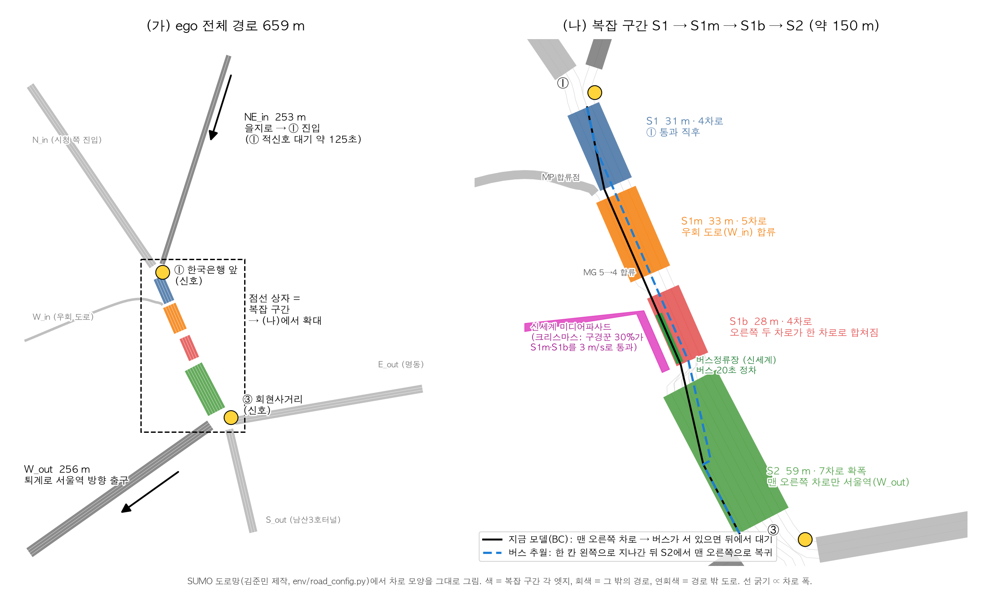

# 명동 소공로 자율주행 — AV 모델 학습 과정 기록

- 기간: 2026-11-11 ~ 11-12
- 기준 코드: 팀 저장소 `main`의 `021c834` ("docs: README 수정")
- 실행 환경: SUMO 1.27.1, `conda activate sumo-rl`
- 최종 모델: `models/bc_v3_3.pt`. 인계 방법은 [모델_인계.md](모델_인계.md)를 본다.

이 문서는 학습 과정 전체를 시간 순서대로 적은 것이다. 무엇을 왜 했는지, 무엇이 실패했는지, 결과 수치를 모두 남긴다.
`results/`와 `data/`는 용량 때문에 저장소에 올리지 않는다. 공식 평가 결과만 `docs/training/official_eval/`에 넣었다.

---

## 0. 한눈에 보기

| 단계 | 한 일 | 결과 |
|---|---|---|
| 1 | 도로·환경 파악, 관측 33 → 36차원 | 옆 차로 사각지대 결함 발견, 관측 3칸 추가 |
| 2 | 처음부터 PPO (보상 설계 3종) | 실패. 충돌 7~42% 또는 기어가기 |
| 3 | 규칙 기반 시연 → BC | 합격 수준 (평시·크리스마스 충돌 0~2%) |
| 4 | BC에서 PPO 미세조정 | 개선 없음 |
| 5 | 평가 방법 점검 | **평가 시드 누수 발견·수정.** 처음 보는 혼잡(×1.3)에서 BC 충돌 8% |
| 6 | 충돌 원인 진단 → 선생(규칙) 개선 → DAgger | 크리스마스 ×1.3 충돌 8% → 0~1% |
| 7 | 최종 BC(dag3) 평가 (그때는 "최종 시드"라 불렀으나 이후 검증용으로 재분류) | 평시 0%, 크리스마스 0.3%, ×1.3 0.3% 충돌 (각 300회) |
| 8 | PPO로 시간 단축 6종 시도 | 유의한 단축 없음 |
| 9 | 시간 손실 원인 분석 | 주범은 **정류장 버스(20초 정차) 뒤 대기**. 관측에 정보 없음 |
| 10 | 관측 [36] 버스 정차 + 추월하는 선생 → BC·DAgger (v3) | 버스 많을 때 약 −7초, 평소엔 −1초 안팎 |
| 11 | v3에서 PPO, PPO 스스로 추월 발견 실험, 구경꾼 추월 상한 | 셋 다 효과 없음. PPO는 추월을 스스로 찾지 못함 |
| 12 | **최종 모델 v3_3 확정 → 새 시드로 딱 한 번 공식 평가** | 충돌: 평시 0, 크리스마스 0, ×1.3 0, 버스 3배 1 (각 300회). 복잡 구간 15.2 / 21.3 / 23.4 / 22.7초 |

---

## 1. 출발점: 받은 것과 목표

### 1.1 김준민(도로 담당)에게 받은 것 — 수정하지 않음

- 도로망 `env/road_config.py`, `env/road_builder.py`:
  - 구간 S1~S2, 차로, 연결, 합류점
  - 신호 ①③, 버스 노선·정류장(20초 정차)
  - 크리스마스(교통량 1.5배, 구경꾼 30%가 S1m·S1b를 3 m/s로 통과, 신호 변경)
- ego 경로: 을지로(NE_in) → ① → S1 → S1m → S1b → S2 → ③ → 퇴계로 서울역(W_out), 659 m
- 관측 33차원: 교수님 기본 31 + [31] 신호 상태, [32] 정지선까지 거리
- 신호 정지는 SUMO가 담당 (`speed_mode=24`). 모델이 신호를 보고 서는 것이 아니다.

수업 코드(교수님)인 `SumoHighwayEnv`, PPO, BC, 데이터 수집기는 그대로 썼고, 버그만 고쳤다.

### 1.2 도로 구간



| 구간 | 길이 | 특징 |
|---|---|---|
| NE_in | 253 m | 을지로 → ① 진입. **① 적신호 대기 약 125초** |
| S1 | 31 m | ① 통과 직후 4차로 |
| S1m | 33 m | 우회 도로(W_in) 합류, 5차로 |
| S1b | 28 m | 오른쪽 두 차로가 하나로 합침. **버스정류장(맨 오른쪽 차로 7~27 m)** |
| S2 | 59 m | 7차로 확폭. **맨 오른쪽 차로만 서울역(W_out)** |
| W_out | 256 m | 출구 |

"복잡 구간" = S1 → S1m → S1b → S2 (약 150 m). 막힘이 없으면 약 13초 걸린다.

### 1.3 평가 기준 (수업)

- 100 에피소드 충돌 5% 미만
- 목적지 도달 (비정상 정지·경로 이탈·무한 대기 없음)
- HV 충분, 데이터 10^7, 30초 이상 영상

### 1.4 사용자(학습 담당) 목표

1. BC로 **안전하게** 목적지 도착
2. 그 위에서 **복잡 구간을 빨리 통과** ("퇴근길에 복잡한 구간을 빨리 지나 집에 가서 쉬기")
3. 일요일(11/15)~월요일까지 데이터 수집 담당에게 최종 모델 인계

---

## 2. 환경 파악과 관측 확장 (33 → 36차원)

### 2.1 발견한 결함

- **옆 차로 사각지대:** 관측 [5..8]·[13..16](옆 차로 앞뒤 차)은 SUMO `getNeighbors` 값이다. 그래서 **바로 옆에 겹쳐 있거나 약 2.5 m 안에 있는 차가 "없음"으로 나온다.**
  - 관측만 믿는 규칙은 충돌 7~13%였다.
  - 충돌 순간 실제 틈은 −4~2 m였다.
- **경로상 필요한 차로를 모름:** 연결성 칸 [21..25]는 "어디로든 이어지는가"만 본다. 서울역으로 가려면 몇 칸 옮겨야 하는지 알 수 없다.

### 2.2 추가한 관측 (6장 "자유롭게 확장 가능" 근거)

| 칸 | 의미 | 실제 차량 대응 |
|---|---|---|
| [33] | 왼쪽 차로 막힘 (실제 틈 ≤ 3 m 또는 차로 없음) | 사각지대 경고(BSM) |
| [34] | 오른쪽 차로 막힘 | 사각지대 경고 |
| [35] | 경로상 옮겨야 할 차로 수 / 3 | 내비게이션 차로 안내 |

11/9 팀 회의에서 "목표 차선" 관측을 빼기로 한 결정과 충돌하므로 **팀 합의가 필요하다.**

### 2.3 함께 고친 수업 코드 버그

- `sumo_env.py`: 충돌로 제거된 ego가 SUMO 도착 목록에도 올라가서 '도착'으로 세던 것
  - 학습 안 된 PPO가 30/30 도착으로 나왔다.
  - 수정: 충돌이 아닐 때만 도착으로 센다.
- `ppo.py`: 시간초과(truncated)를 에피소드 끝으로 처리
- 실행마다 도로 파일을 따로 만든다 (`env/cli.private_sumo_dir`). 학습 중에 다른 평가를 돌리면 도로 파일이 덮어써지는 문제가 있었다.

---

## 3. 처음부터 PPO — 실패 (11/11)

보상: 속도 보상 + 시간 벌점 0.02/스텝 (빨리 도착할수록 이득). 30만 스텝, 평가는 100 에피소드.

| 실험 | 보상 | 평시 완주/충돌 (도착 소요시간) | 크리스마스 완주/충돌 (도착 소요시간) |
|---|---|---|---|
| p1 | 시간 벌점 0.02 | 83% / 7% (201.5초) | 79% / 17% (223.0초) |
| p2 | + 목표 차로 잠재함수 shaping | 66% / 21% | 47% / 42% |
| p3 | + 충돌 벌점 10 | 도착 0% (기어가다 시간초과) | — |

33차원 PPO는 1.4 m/s로 기어갔다. 무작위 차선 변경 → 충돌 → "움직이지 않기"로 굳는 전형적인 실패다.

---

## 4. 규칙 기반 시연 → BC (11/11)

### 4.1 규칙 기반 운전자 (`utils/rule_policy.py`, 새로 작성)

- 가감속: **IDM** 차량추종 공식 (Treiber 외 2000)
- 차선: 경로상 옮겨야 하는 방향(`getBestLanes`)으로만, 옆 차로 틈이 충분할 때만 옮긴다 (gap acceptance)
- 관측 밖 정보를 SUMO에서 직접 읽는다 (특권 정보):
  - 경로상 필요한 차로
  - 옆 차로 실제 앞뒤 틈
  - → "특권 정보를 가진 선생 → 관측만 보는 학생" 구조 (예: Chen et al. 2019, *Learning by Cheating*)
- 진입 후 60 m 안에서는 차선 변경을 하지 않는다 (입구에서 막 생성된 차와 충돌 방지)
- 규칙 자체 성능: 평시 99% / 충돌 1%, 크리스마스 98% / 2%

### 4.2 BC 결과 (100 에피소드)

| 모델 | 평시 완주/충돌 | 크리스마스 완주/충돌 |
|---|---|---|
| 33차원 BC (평시 시연만) | 87% / 6% | 71% / 26% |
| 36차원 BC (평시 시연만) | 100% / 0% (186.8초) | 92% / 7% (194.4초) |
| 36차원 BC (평시+크리스마스 시연, 수업 `train_bc.py`) | 99% / 1% (187.7초) | 99% / 1% (194.7초) |
| 36차원 PPO 네트워크를 같은 시연으로 지도학습 (`utils/pretrain.py`) | 100% / 0% | 98% / 2% |

- 관측을 36차원으로 늘린 효과가 컸다 (크리스마스 충돌 26% → 7%).
- 크리스마스 시연을 섞자 크리스마스도 합격 수준이 됐다.
- 섞은 뒤에는 "크리스마스를 안 보고도 잘했다"는 일반화 주장을 할 수 없다. 일반화 근거는 평시 시연만 쓴 BC의 크리스마스 결과다.

### 4.3 "PPO 네트워크 사전학습"이란

- 학습 방법은 같은 BC(시연 따라 하기)이고, 그릇만 PPO 네트워크다 (가속 분포 + 차선 3택 + 가치).
- 나중에 PPO로 이어서 학습하려고 이 구조를 썼다.
- 손실: 가속 MSE + 차선 cross-entropy(클래스 가중, 최대 20) + 가치 0.5 × MSE(할인 누적보상)

---

## 5. BC에서 PPO 미세조정 — 개선 없음 (11/11)

| 실험 | 학습률 | 평시 (best / last) | 크리스마스 (best / last) |
|---|---|---|---|
| w1 | 3e-5 | 95/2 / 100/0 | 90/8 / 96/4 |
| w2 | 1e-4 | 98/0 / 99/1 | 96/4 / 90/9 |

출발점(사전학습 모델)보다 나아지지 않았고, 크리스마스 충돌은 오히려 늘었다.

---

## 6. 평가 방법 점검 — 누수 발견 (11/11 밤)

### 6.1 평가 시드 누수

- test.py가 PPO 모델을 불러올 때, PPO 생성자가 `np.random.seed(0)`을 실행한다.
- 그래서 평가 에피소드의 SUMO 시드(68268, 43567, 42613 …)가 **데이터 수집 워커 0번과 같은 순서**로 나왔다.
  - 평시 100개 중 100개, 크리스마스 약 67개가 겹쳤다.
- 배경차 초기 배치는 시드 없는 별도 난수라 교통이 완전히 같지는 않다. 그래도 방법론상 오류다.
- 수정: `test.py --eval-seed` (기본 777001)를 추가했다. 수집(워커 시드 0~5, 이후 11~93)과 겹치지 않는다.

### 6.2 겹치지 않는 시드로 재평가 (100 에피소드, 완주/충돌)

| 모델 | 평시 | 크리스마스 | 평시 교통량 ×1.3 |
|---|---|---|---|
| PPO 네트워크 사전학습 | 98 / 2 | 97 / 3 | 99 / 1 |
| 수업 BC (섞은 시연) | 99 / 0 (이탈 1) | 97 / 3 | — |
| 수업 BC (평시 시연만) | — | 96 / 4 | — |
| 규칙 | — | — | 98 / 1 |

### 6.3 처음 보는 더 혼잡한 조건: 크리스마스 + 교통량 ×1.3 (평시 대비 약 1.95배)

학습에 한 번도 쓰지 않은 조건이고, **시험 전용**이다. 300 에피소드 결과:

| 모델 | 충돌 |
|---|---|
| 수업 BC (섞은 시연) | **8.0%** |
| PPO 네트워크 사전학습 | **8.7%** |
| 규칙 (선생) | 4.7% |

합격선 5%를 넘었다. 선생 자체도 경계선이고, 학생은 거기에 약 3%p를 더 잃었다.

---

## 7. 충돌 진단 → 선생 개선 → DAgger (11/11 밤 ~ 11/12 새벽)

### 7.1 충돌 진단 (크리스마스 ×1.3, 150 에피소드)

- **규칙: 충돌 8회.**
  - 대부분 S1 끝, 합류점 MP 직전에서 차선을 바꾸다 옆에서 박았다.
  - 원인: 규칙은 지금 엣지의 차로만 훑어서, 교차로에 막 들어선 차를 못 봤다.
  - 3회는 다른 차가 ego에 끼어든 경우였다.
- **BC: 충돌 15회.** 같은 약점에 더해 학생 고유의 실수가 있었다.
  - 옆이 막혔는데 차선 변경
  - 차선 변경 직후 늦은 제동

### 7.2 선생 개선 (같은 시드 150 에피소드)

| 규칙 | 완주 | 충돌 | 경로이탈 |
|---|---|---|---|
| 기존 | 139 | 9 | 2 |
| + SUMO 안전판정 (`couldChangeLane`, 교차로 너머까지 확인) | 136 | 1 | 13 |
| **+ 옮겨야 하는데 막히면 5 m/s로 감속해 대기** | **146** | **0** | 4 |
| (대기 속도 8 m/s) | 144 | 0 | 6 |

- 평시 100 에피소드: 100/100 완주.
- 학생 관측 [33]·[34]도 같은 기준(SUMO 판정 포함)으로 바꿨다 (`side_block_sumo`). 선생이 보는 것을 학생도 보게 하기 위해서다.

### 7.3 DAgger란, 왜 했나

- **BC의 약점:** 선생이 다닌 상태만 보고 배운다. 학생이 조금 벗어나면 처음 보는 상태가 되고, 거기서 실수가 커진다.
- **DAgger(Dataset Aggregation):**
  1. 학생이 직접 운전한다.
  2. 매 순간 선생에게 "여기서 너라면?"을 물어 정답을 기록한다.
  3. 기존 데이터에 합쳐 다시 학습한다.
  4. 반복한다.
- **왜 했나:** 학생이 선생보다 약 3%p 더 충돌했고, 이건 정확히 "덜 따라 한" 부분이다.
- 구현: `collect_pomdp_data.py --policy ppo --model <학생> --label rule`

### 7.4 결과 (개발용 시드, 100 에피소드, 충돌 / 완주)

| 모델 | 학습 데이터 | 크리스마스 ×1.3 | 크리스마스 | 평시 |
|---|---|---|---|---|
| 예전 BC | 옛 규칙 시연 | 8% / 92% | 3% / 97% | 0% / 99% |
| dag0 | 개선 규칙 시연 800 에피소드 (약 31만 step) | 1% / 98% | 2% / 98% | 0% / 100% |
| dag1 | + dag0이 운전한 400 에피소드 | 0% / 99% | 1% / 99% | 0% / 100% |
| dag2 | + dag1이 운전한 400 에피소드 | 0% / 100% | 2% / 98% | 0% / 100% |
| **dag3** | + dag2가 운전한 400 에피소드 | **0% / 99%** | **1% / 99%** | **0% / 100%** |

---

## 8. 1단계 BC(dag3) 평가 (11/12)

- 시드 990001~992003: 이때까지 학습·수집·개발 중 평가에 한 번도 쓰지 않은 값이다.
- 처음에는 "최종 시드"라고 불렀지만, 뒤에 v3_3 평가에도 다시 쓰고 그 결과로 모델을 골랐다. 그래서 지금은 **검증용 시드**로 분류한다 (12.1절 #1). 공식 수치는 11.2절이다.
- 조건마다 300 에피소드.
- 복잡 구간 통과시간은 `eval_section_time.py`로 잰다. S1에 들어간 순간부터 W_out에 들어선 순간까지다.

| 조건 | 완주 | 충돌 | 경로이탈 | 복잡 구간 (평균 / 중앙값) | 전체 도착 |
|---|---|---|---|---|---|
| 평시 | 100.0% | 0.0% | 0.0% | 16.0초 / 14.0초 | 187.9초 |
| 크리스마스 | 99.3% | 0.3% (95% 구간 ±0.7%) | 0.3% | 21.9초 / 17.0초 | 195.6초 |
| 크리스마스 ×1.3 | 99.0% | 0.3% (±0.7%) | 0.7% | 25.3초 / 22.0초 | 201.9초 |

→ 1단계 목표("BC로 안전하게 도착")를 달성했다.

---

## 9. PPO로 시간 단축 — 6가지 시도, 유의한 효과 없음 (11/12)

### 9.1 시간이 어디서 쓰이는가 (규칙, 크리스마스 40 에피소드, 평균 193초)

| 구간 | 평균 | 그중 정지 |
|---|---|---|
| NE_in (① 앞) | 151.1초 | **126.0초 (적신호)** |
| W_out | 19.4초 | 0 |
| S2 / S1b / S1m / S1 | 5.1 / 5.1 / 3.9 / 3.4초 | S1b 1.1초 |
| 교차로 내부 | 5.2초 | 0 |

- 정책이 줄일 수 있는 건 복잡 구간뿐이다.
- 그래서 측정 기준을 **복잡 구간 통과시간**으로 바꿨다.
- BC(dag3) 기준선: 평시 16.1초, 크리스마스 21.2초, ×1.3 24.6초 (개발용 시드)

### 9.2 추가한 학습 도구

- `time_penalty_from_route_index=1`: 신호 ① 통과 후에만 시간 벌점. 손쓸 수 없는 적신호 대기를 보상에서 뺀다.
- `--init`: 학습된 BC에서 출발
- `--critic-warmup N`: 처음 N번 업데이트는 critic만 학습. 새 보상에 가치가 맞기 전에 actor가 망가지는 것을 막는다.
- `--bc-coef`, `--bc-data`: PPO 업데이트마다 시연 따라 하기 손실을 더한다. BC에서 너무 멀어지지 않게 한다.
- `--bus-scale`: 학습용 버스 빈도 배율 (기본 1)

### 9.3 결과 (같은 시드 100 에피소드, 복잡 구간 평균)

| 실험 | 설정 | 평시 | 크리스마스 | 크리스마스 충돌 |
|---|---|---|---|---|
| BC (dag3) | — | 16.1초 | 21.2초 | 1% |
| t1 | BC 정규화 0.5, lr 3e-5, 30만 | 16.1초 | 20.7초 | 2% |
| t2 | BC 정규화 0.1, lr 3e-5, 30만 | 15.8초 | 20.7초 | 1% |
| t3 | BC 정규화 0.05, lr 1e-4, 60만 | 16.2~16.4초 | 21.3~22.1초 | **3~5%** |
| t4 | t3 + 시간 벌점 0.04 | 15.9~16.2초 | 20.9~23.4초 | 0~2% |
| t5 | 버스 3배 학습, BC 0.1, lr 5e-5, 40만 | — | 21.5초 | 1% |
| t6 | 버스 3배 학습, BC 0.1, lr 1e-4, 40만 | — | 21.2초 | 4% |

- t5는 버스 3배 크리스마스 100 에피소드에서 28.4초(BC 30.6초)로 빨라 보였다.
- 그런데 **300 에피소드로 다시 재니 31.0초 vs 31.6초로 0.6초 차이**였다. 우연이었다. 충돌은 1.7% vs 0.7%였다.

**결론:** 조심스러우면 BC와 같은 운전에 머물고, 과감하면 충돌만 늘었다.

---

## 10. 시간 손실 원인 분석 → 관측 추가 + 추월 (11/12 오전)

### 10.1 BC가 오래 걸린 에피소드 (크리스마스 60회 중 상위 10회)

- **S1b 14~21초 (4회):** 정류장에 20초 서는 버스 뒤 대기. ego도 그 차로(S1b 맨 오른쪽)로 가야 한다.
- S1m 10~12초 (5회): 합류 혼잡 + 구경꾼
- S2 26초 (1회)

### 10.2 왜 PPO가 못 줄였나

1. **관측에 정보가 없다:** "앞차가 서 있다"만 보인다. 곧 출발할 대기 줄인지, 20초 서는 버스인지 구분할 수 없다. 추월할지 기다릴지 판단할 근거가 없다.
2. **추월 동작을 본 적이 없다:** 선생이 추월하지 않았으니 BC도 모르고, PPO가 무작위 탐색으로 발견하기도 어렵다.

### 10.3 추월이 이득인지 먼저 확인 (규칙, 같은 시드 200 에피소드)

추월 = 버스가 서 있으면 한 칸 왼쪽 줄(S1 1번 → S1m 2번 → S1b 1번)로 지나간 뒤 S2(7차로)에서 맨 오른쪽으로 복귀.

| 규칙 | 크리스마스·버스 3배: 평균 (중앙값, 상위 10%) | 충돌 | 크리스마스: 평균 (중앙값) |
|---|---|---|---|
| 추월 없음 | 33.1초 (28.0, 63.0) | 2/200 | 22.4초 (18.5) |
| 추월 (버스 위치를 다 앎) | 23.8초 (22.0, 37.3) | 0/200 | 20.9초 (17.5) |
| 추월 (50 m 안 버스만 봄) | 약 26.8초 | 1/200 | — |
| **추월 (80 m 안 버스만 봄)** | **약 23.9초** | 0/200 | **약 20.9초** |

### 10.4 해결

- **관측 [36] 추가 (37차원):** 80 m 안 정류장에 버스 정차 중이면 1 (`bus_stop_flag`, `bus_flag_range=80`)
  - 카메라로 "정류장에 선 버스"를 알아보는 것에 해당한다. 정차가 얼마나 남았는지는 모른다.
  - 정차 버스는 커서 시야 50 m보다 멀리 보인다고 가정했다.
- **선생에 추월 추가:** `RulePolicy(overtake_bus=True)`. 학생과 같은 80 m 기준으로만 추월한다.

### 10.5 추월을 배운 BC (v3) 결과 (개발용 시드 100 에피소드, 복잡 구간 평균)

- 시연: 평시 400 + 크리스마스 400 + 크리스마스·버스 3배 200 에피소드
- DAgger: 라운드마다 400 에피소드

| 모델 | 크리스마스·버스 3배 | 크리스마스 | 크리스마스 ×1.3 | 평시 | 충돌 |
|---|---|---|---|---|---|
| 기존 BC (dag3) | 약 31초 | 21.2초 | 24.6초 | 16.1초 | 0~1% |
| v3_0 | 24.0초 | 20.6초 | 23.6초 | 15.5초 | 0~1% |
| v3_1 | 24.8초 | 20.5초 | 23.4초 | 15.4초 | 0~1% |
| v3_2 | 24.6초 | 19.8초 | 23.5초 | 15.3초 | 0~1% |
| **v3_3** | 24.7초 | 20.5초 | 22.9초 | 15.4초 | **전 조건 0%** |

### 10.6 솔직한 평가

- **버스가 많을 때(3배)만 단축이 크다 (약 −7초).**
- 원래 버스 빈도에서는 평균 단축이 −0.7~−1.7초로 작고, 오차 범위와 겹친다. 버스에 막히는 에피소드가 10번에 1번꼴이라 평균으로 희석된다.
- 의미 있게 보여줄 수 있는 지표:
  - 버스에 막힌 에피소드만 따로 본 비교
  - 최악의 경우(상위 10%)
  - 시간 편차 감소 (평시 표준편차 4.6초 → 2.4초)
- 이 단축은 **RL이 아니라 "관측 추가 + 선생이 추월을 가르침(BC)"의 결과**다. PPO의 기여는 11절에서 확인한다.

---

### 10.7 검증용 시드 비교: dag3 vs v3_3 (11/12, 조건마다 300 에피소드)

시드: 평시 99000x, 크리스마스 99100x, ×1.3 99200x, 버스 3배 99300x (x = 1~3). 시간은 복잡 구간 평균 ±95% 구간이다.
이 시드는 8절에서 이미 썼으므로 검증용이다 (12.1절 #1).

| 조건 | dag3 | **v3_3** | 단축 | 상위 10% (dag3 → v3_3) | 충돌 (dag3 → v3_3) |
|---|---|---|---|---|---|
| 평시 | 16.0 ±0.5초 | **15.2 ±0.3초** | −0.8초 | 19.5 → 18.1초 | 0% → 0% |
| 크리스마스 | 21.9 ±1.2초 | **20.5 ±1.0초** | −1.4초 | 36.0 → 34.1초 | 0.3% → 0% |
| 크리스마스 ×1.3 | 25.3 ±1.2초 | **23.4 ±1.0초** | −1.9초 | 39.2 → 36.5초 | 0.3% → 0% |
| 크리스마스·버스 3배 | 31.7 ±2.1초 | **22.6 ±1.0초** | **−9.1초** | 57.8 → 35.2초 | 1.3% → 0.7% |

**버스를 만난 에피소드만 비교** (정차 버스가 80 m 안에 보인 에피소드):

| 조건 | dag3 | v3_3 | 단축 |
|---|---|---|---|
| 크리스마스 (원래 버스 빈도) | 35회, **36.2 ±5.1초** (추월 1회) | 37회, **22.9 ±3.6초** (추월 28회) | **−13.3초 (−37%)** |
| 크리스마스·버스 3배 | 143회, 42.3초 (추월 14회) | 144회, 23.9초 (추월 108회) | **−18.4초 (−44%)** |
| (참고) 버스를 안 만난 크리스마스 | 263회, 20.0초 | 263회, 20.2초 | 차이 없음 |

- 원래 버스 빈도에서 버스를 만나는 에피소드는 약 12%다. 그래서 전체 평균 단축이 1~2초로 희석된다.
- 버스를 만난 경우에는 95% 구간이 겹치지 않는 확실한 단축이다.
- 버스를 안 만난 경우는 같다. 추월 학습이 다른 운전을 해치지 않았다.
- 발표 문장: **"크리스마스 퇴근길에 신세계 앞 버스에 막히면 36초 걸리던 복잡 구간을 23초에 지나간다 (충돌 0/300)."**
- 이 단축은 BC(선생이 가르친 추월)의 결과다. RL의 기여는 11절에서 확인한다.

### 10.8 다른 시간 단축 후보 검토 — 효과 없음 (11/12 오후, 규칙으로 상한 측정, 검증용 시드)

크리스마스 복잡 구간은 평시보다 약 6초 길다. 규칙으로 40 에피소드를 재서 그 내역을 봤다 (에피소드당 초).

| 항목 | 평시 | 크리스마스 |
|---|---|---|
| 복잡 구간 시간 | 14.5 | 20.4 |
| 바로 앞(15 m 안) 차가 5 m/s 미만 | 0.2 | **5.6** |
| 옮겨야 하는데 막혀 감속 대기 | 0.5 | **3.2** |

| 후보 | 내용 | 결과 (200 에피소드) |
|---|---|---|
| 느린 구경꾼 추월 (`overtake_slow`) | 앞차가 5 m/s 미만이면 더 빠른 옆 차로로 (경로 차로에서 한 칸까지) | 20.2초 → 20.2초. **효과 없음.** 동작은 했지만(30 에피소드 46 스텝) 개별 구경꾼에 막히는 시간 자체가 에피소드당 약 1초 |
| 합류 항상 건너뛰기 (`always_bypass`) | 버스가 없어도 S1m 2번 → S1b 1번으로 가서 MG 합류를 피함 | 크리스마스 20.2 → **21.6초 (더 느림)**, 경로이탈 3/200. 평시 15.3 → 16.7초, 이탈 7/200 |

**결론:** 크리스마스의 남은 지연은 합류점(MG, 5→4차로) 앞 대기 줄 때문이다. 우회도로 차량, 구경꾼, 정류장 차로가 한 차로로 모이고, 옆 차로도 같이 느려서 피할 길이 없다. 운전으로 줄일 수 있는 시간 손실 가운데 효과가 확인된 것은 **버스 추월뿐**이다.

## 11. v3 이후 실험과 최종 모델 확정 (11/12 오후)

| 작업 | 내용 | 결과 |
|---|---|---|
| 검증용 시드 비교 | dag3 vs v3_3, 평시·크리스마스·×1.3·버스 3배 각 300 에피소드 | 10.7절 |
| v3 기반 PPO A | v3_3에서 출발, BC 0.1, lr 3e-5, 30만 | 100 에피소드: 최종 모델 크리스마스 19.1초지만 충돌 4% → 탈락 |
| v3 기반 PPO B | v3_3 + 버스 3배 학습, lr 5e-5, 40만 | 300 에피소드(새 검증 시드 55600x·66700x): 크리스마스 21.2 → 20.4초(오차 범위 안), 충돌 0 → 5/300. 버스 3배 22.6 → 22.1초, 이탈 0 → 4/300. **효과 없고 안전만 나빠짐 → 최종 모델은 v3_3(BC)** |
| PPO 스스로 추월 발견 실험 | 추월 안 하는 선생으로 37차원 BC(noot) → PPO 2종 (BC 0.02 / 0, 차선 탐험 0.03, 버스 3배, 60만). 평가에서 "버스를 본 에피소드 중 추월 횟수"를 센다 | **발견 못 함** → 11.1절 |
| 구경꾼 추월 상한 | 크리스마스 구경꾼(3 m/s) 뒤를 옆 차로로 피하는 "속도 이득 차선 변경"을 규칙으로 측정 | 효과 없음 → 10.8절 |

### 11.1 PPO가 버스 추월을 스스로 찾는가 (11/12, 15:10~18:10)

다시 돌리기: `bash scripts/training/ppo_overtake_experiment.sh`

**질문:** 추월을 가르치지 않은 BC에서 출발해도, 시간 벌점만 주면 PPO가 "정류장 버스 옆으로 지나가기"를 스스로 찾는가? 찾는다면 RL이 시간 단축에 기여했다고 말할 수 있다.

**설정**
- 출발점 noot_1: 37차원 관측(버스 정차 [36] 포함)은 똑같이 주되, 선생이 추월하지 않는 데이터로 BC + DAgger 1라운드
- PPO 2종, 둘 다 평시·크리스마스 섞기 + 버스 3배, 60만 step, 학습률 5e-5, 차선 탐험 0.03, 시간 벌점은 J1 통과 후부터
  - bc002: BC 정규화 0.02 (BC에서 너무 멀어지지 않게)
  - bc0: BC 정규화 없음 (마음대로 바뀔 수 있게)
- 평가: 검증용 시드(666001, 555002) 100 에피소드, 마지막 모델과 best 모델 둘 다

**결과 (복잡 구간 평균, 추월 = 버스를 본 에피소드 중 옆 차로로 지나간 횟수)**

| 모델 | 버스 3배: 충돌 / 시간 / 추월 | 크리스마스: 충돌 / 시간 / 추월 |
|---|---|---|
| noot_1 (출발점, BC) | 1% / 32.7초 / 5/45 | 0% / 21.6초 / 0/18 |
| bc002 마지막 | 11% / 30.6초 / 6/43 | 7% / 22.0초 / 0/18 |
| bc002 best | 5% / 31.0초 / 5/43 | 7% / 20.4초 / 0/17 |
| bc0 마지막 | 5% / 32.8초 / 0/41 | 5% / 21.6초 / 0/19 |
| bc0 best | 11% / 31.8초 / 0/46 | 1% / 21.7초 / 0/18 |
| 참고: v3_3 (추월을 배운 BC) | 0.7% / 22.6초 (300 에피소드) | 0% / 20.5초 (300 에피소드) |

**결론**
- PPO는 추월을 찾지 못했다. 추월 횟수는 출발점과 같거나(5~6회) 오히려 0으로 줄었다.
- 시간은 거의 그대로이고(30.6~32.8초), 충돌만 1% → 5~11%로 늘었다.
- 이유로 보이는 것: 추월은 "버스를 보고 → 차로를 미리 옮기고 → 정류장을 지나 → 필요하면 다시 들어오는" 여러 단계 행동이다. 차선 탐험을 무작위로 해서는 이 순서를 우연히 맞추기 어렵고, 시도 중에 생기는 충돌 벌점이 탐험을 더 줄인다.
- 그래서 시간 단축의 공은 RL이 아니라 **"관측 [36] + 추월을 보여 준 시연(모방학습)"** 에 있다고 정직하게 말한다. 이 실험이 그 근거다.

### 11.2 최종 모델 확정과 공식 평가 (11/12 18:12~18:22, 딱 한 번)

- **최종 모델: v3_3** (`models/bc_v3_3.pt`). PPO A·B와 noot+PPO 모두 v3_3보다 낫지 않았다.
- 최종 모델을 정한 뒤, 한 번도 쓰지 않은 새 시드 2026111201~12로 조건마다 300 에피소드(시드 3개 × 100)를 한 번만 평가했다. 이 결과를 본 뒤로는 모델을 바꾸지 않았다.
- 스크립트: `scripts/training/official_eval.sh`, 결과: `docs/training/official_eval/` (에피소드별 JSON)

| 조건 | 충돌 | 경로 이탈 | 복잡 구간 (평균 ± 95% 구간) | 중앙값 | 상위 10% | 전체 도착 | 버스 추월 |
|---|---|---|---|---|---|---|---|
| 평시 | 0/300 | 0 | 15.2 ± 0.3초 | 14.0 | 18.5 | 187.4초 | 7/11 |
| 크리스마스 | 0/300 | 1 | 21.3 ± 1.0초 | 17.5 | 35.5 | 195.4초 | 15/27 |
| 크리스마스 ×1.3 (처음 보는 조건) | 0/300 | 3 | 23.4 ± 1.1초 | 20.5 | 38.0 | 199.8초 | 16/36 |
| 크리스마스 + 버스 3배 | 1/300 | 1 | 22.7 ± 1.1초 | 19.0 | 36.0 | 196.5초 | 104/133 |

- 검증용 시드 결과(10.7절: 15.2 / 20.5 / 23.4 / 22.6초)와 거의 같다. 검증 시드에 과적합되지 않았다는 근거다.
- 발표·보고서의 공식 수치는 이 표다.

---

## 12. 반드시 공개할 것 (발표·보고서)

1. 시연자(규칙)는 관측 밖 시뮬레이터 정보를 쓴다. 최종 모델은 실행할 때 관측만 본다.
2. 관측 33 → 36 → 37차원 확장. 팀 합의가 필요하다 (11/9 결정과 충돌).
3. 신호 정지는 SUMO 안전 모드(`speed_mode=24`)가 한다.
4. 수업 코드 수정: 도착 판정 버그, 시간초과 처리, 시간 벌점, 평가 시드 분리.
5. 규칙 기준값과 모델 선택은 개발용·검증용 시드로 했다. 공식 수치(11.2절)는 그 뒤 새 시드에서 한 번만 잰 것이다.
6. 크리스마스 시연을 학습에 섞었으므로, "크리스마스 일반화"의 근거는 크리스마스 ×1.3(학습에 없던 조건)과 평시 전용 BC 결과다.
7. 버스 3배 조건 일부를 v3 학습에 썼다. 버스 3배 평가는 "학습한 조건의 스트레스 테스트"다.
8. 100 에피소드에서 1~2%p 차이는 통계적으로 의미가 없다. 중요한 비교는 300 에피소드로 했다.

### 12.1 자체 점검에서 나온 약점과 조치 (11/12)

| # | 약점 | 조치 |
|---|---|---|
| 1 | "최종 시드"(99000x~99300x)를 dag3·v3_3 평가에 모두 쓰고, 그 결과로 모델을 골랐다. 시험지를 여러 번 본 셈이다 | 이 시드들은 **검증용**으로 다시 분류했다. 최종 모델을 정한 뒤 새 시드로 딱 한 번 평가해 공식 수치로 썼다 (11.2절). 결과가 검증용과 거의 같아서, 검증 시드에 맞춰진 모델은 아니었다 |
| 2 | 관측 [33]·[34]에 SUMO 차선변경 판단(`couldChangeLane`)을 넣었다. 팀이 11/4에 env 안전장치를 끈 취지("env가 끼어들 타이밍을 대신 판단하지 않게")와 부딪칠 수 있다 | 강제가 아니라 관측이므로 반칙은 아니다. 팀 합의가 필요하고, 발표에서 "사각지대 경고 센서 가정"으로 밝힌다 |
| 3 | 시간 단축은 사람이 설계한 선생(버스·구경꾼 추월, 이 도로 전용 차로 지정)에서 나왔다 | "모방학습으로 전문가 기술 전달"로 설명한다. RL 기여는 11절 실험으로 따로 판단한다 |
| 4 | 버스 3배 조건을 학습에도 썼다 | 버스 3배 결과는 스트레스 테스트로 부른다. 처음 보는 조건은 크리스마스 ×1.3뿐이다 |
| 5 | [33]~[36]은 완벽한 센서를 가정한다 | 공개한다 |
| 6 | 평가 지표를 전체 도착시간에서 복잡 구간 시간으로 바꿨다 | 근거(적신호 대기가 2/3)를 적고, 두 지표를 모두 보고한다 |
| 7 | 모든 모델을 학습 시드 하나로 한 번만 학습했다 | 확인 완료 (11/12): 같은 v3 데이터로 학습 시드 0·1·2. 새 검증 시드 300 에피소드에서 크리스마스 21.2 / 20.9 / 21.1초, 버스 3배 22.6 / 23.3 / 22.8초로 시간은 재현됨. 충돌은 크리스마스 0 / 0 / 1, 버스 3배 0 / 0 / 4 (최대 1.3%). 발표에서는 "학습 시드 3개 기준 충돌 0~1.3%"로 말한다 |

---

## 13. 파일 지도

| 파일 | 내용 |
|---|---|
| `models/bc_v3_3.pt` | **최종 모델** (37차원, 버스 추월 BC + DAgger 3라운드) |
| `models/bc_dag3_36dim.pt` | 1단계 BC (36차원, 비교용). `BUS_STOP_FLAG=0`을 붙여 실행 |
| `utils/rule_policy.py` | 규칙 기반 운전자 (IDM + 틈 수락 + SUMO 판정 + 대기 + 버스 추월) |
| `utils/pretrain.py` | 시연으로 PPO 네트워크 지도학습, 차선 클래스 가중치 |
| `eval_section_time.py` | 복잡 구간 통과시간, 버스 추월 횟수 평가 |
| `collect_pomdp_data.py` | `--policy rule`, `--label rule`(DAgger), `--rule-kw` 추가 |
| `train.py` | `--pretrain`, `--init`, `--critic-warmup`, `--bc-coef`, `--bc-data`, `--mix-christmas`, `--reward`, `--hparam` |
| `test.py` | `--eval-seed`, `--algorithm rule` |
| `algorithms/ppo.py` | critic warmup, BC 정규화, 시간초과를 에피소드 경계로, best 모델 저장 |
| `env/sumo_env.py` | 관측 [33..36], 도착 판정 수정, 시간 벌점 시작 위치, 평시·크리스마스 섞기 |
| `env/cli.py` | `--bus-scale`, 실행별 도로 폴더 |
| `env/mdp_config.py` | 관측·보상 설정. `BUS_STOP_FLAG=0`이면 36차원 |
| `utils/evaluator.py` | 도착 소요시간 지표 추가 |
| `scripts/training/` | 최종 모델 학습, 공식 평가, PPO 추월 실험 스크립트 |
| `docs/training/official_eval/` | 공식 평가 에피소드별 결과 (JSON) |
| `docs/training/road_sections.png`, `draw_road.py` | 도로 구간 그림과 그리는 스크립트 |

### 재현 명령

```bash
conda activate sumo-rl
# 최종 모델 처음부터: 규칙 시연 → BC → DAgger 3라운드 (맥북 8병렬 약 4~5시간)
bash scripts/training/train_final_model.sh
# 공식 평가 (이미 본 시드이므로 새 모델 평가에는 다른 시드를 쓸 것)
bash scripts/training/official_eval.sh models/bc_v3_3.pt
# PPO가 버스 추월을 스스로 찾는가 실험
bash scripts/training/ppo_overtake_experiment.sh

# 하나씩 돌릴 때
python collect_pomdp_data.py --policy rule --episodes 400 --workers 8 --seed 41 --name v3_rule_normal
python train.py --run-name dagv3_0 --timesteps 0 --pretrain data/v3_rule_*.npz
python collect_pomdp_data.py --policy ppo --model results/dagv3_0/pretrained_model.pt --label rule --episodes 150 --workers 8 --seed 51 --name v3_dag1_normal
python eval_section_time.py models/bc_v3_3.pt --episodes 100 --christmas --eval-seed 991001
# PPO 시간 미세조정 (시도했지만 최종 모델에는 쓰지 않음)
python train.py --run-name v3_ppoA --init models/bc_v3_3.pt --init-log-std -1.5 --critic-warmup 5 \
  --mix-christmas --reward time_penalty_from_route_index=1 --hparam lr=3e-5 --timesteps 300000 \
  --bc-coef 0.1 --bc-data data/v3_*.npz
```
